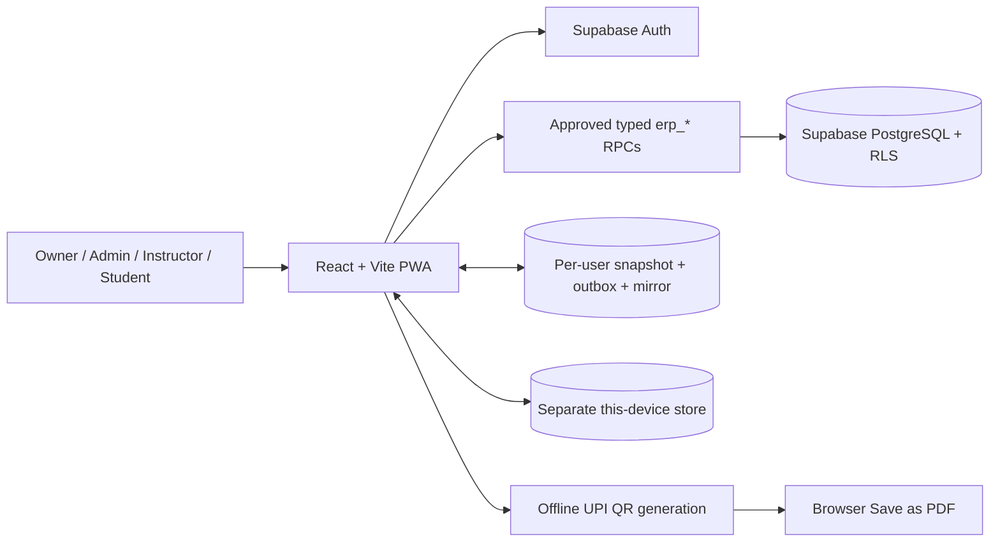

# Yoga Studio

A mobile- and desktop-friendly progressive web app (PWA) for running a yoga
studio: branches, students, instructors, batches, attendance, memberships,
INR fees, payment setup and themed invoice PDFs.

> **Current source release:** 1.4.0 · **Database setup:** SQL v3 in
> [`supabase/erp_setup.sql`](supabase/erp_setup.sql) · **Live path:**
> <https://rajeshlande.github.io/yoga_studio/>
>
> Production contains the revision actually deployed from `main`; the app's
> visible version comes from `package.json` and appears in Settings and the
> page footers.

## Table of contents

- [Overview](#overview)
- [Features](#features)
- [Online, offline and automatic sync](#online-offline-and-automatic-sync)
- [Payments, GST and invoice PDFs](#payments-gst-and-invoice-pdfs)
- [Architecture](#architecture)
- [Quick start](#quick-start)
- [Configuration](#configuration)
- [First-run checklist](#first-run-checklist)
- [Testing and quality gates](#testing-and-quality-gates)
- [Build and deployment](#build-and-deployment)
- [Versioning and releases](#versioning-and-releases)
- [Security and privacy](#security-and-privacy)
- [Project structure](#project-structure)
- [Troubleshooting](#troubleshooting)
- [Known limitations and roadmap](#known-limitations-and-roadmap)
- [Documentation](#documentation)

## Overview

Yoga Studio is a React + Vite PWA backed by Supabase Auth and PostgreSQL.
It provides a role-scoped studio ERP for Owner, Admin, Instructor and Student
users. All prices and fee calculations are in Indian rupees (INR), stored as
integer paise to avoid floating-point money errors.

The application supports two clearly separated data modes:

| Mode | Purpose | Synchronization |
|---|---|---|
| **Supabase mode** | Shared, multi-user studio data | Offline-first. After an online sign-in and initial download, changes are saved in a per-user/per-organization device outbox and automatically pushed when a connection is available. |
| **This-device mode** | A standalone browser-local studio copy | Never syncs and never becomes Supabase data automatically. It starts empty and offers JSON export/import/clear in Settings. |

There is **no demo account, seeded business data, offline sign-in bypass or
sample-data mode**. Test fixtures live only under `tests/` and are not bundled
into the application.

## Features

### Studio ERP

- Multi-branch studio structure with branch filtering throughout the ERP.
- Dashboard KPIs for active students, today's classes, monthly collections
  and pending dues, plus expiring-membership alerts and a setup checklist.
- Student records with branch, contact details, joining date, batches,
  attendance history/percentage, search and CSV export.
- Instructor records and recurring batches with weekdays, start time,
  duration, capacity and roster management.
- Attendance by date and batch using **Present**, **Absent** and **Late**,
  including mark-all-present, history and CSV export.
- INR fee plans and memberships using either calendar-month or joining-date
  billing.
- Membership price snapshots, partial payments, dues, expiry status and CSV
  payment exports.
- Append-only payments. A synced payment is corrected with an audited void
  and a required reason; it is never silently edited or deleted.
- Role portals:
  - **Owner/Admin:** manage the ERP and payment/invoice configuration.
  - **Instructor:** view assigned batches and manage/view attendance in scope.
  - **Student:** view their own batches, attendance, membership, dues,
    payments and invoices.

### Experience and platform

- Responsive phone, tablet and desktop layouts with keyboard-focus handling.
- Installable PWA with an offline app shell after the first successful visit.
- Light, Dark and System themes with a top-bar quick toggle, a Settings
  picker, pre-paint theme bootstrap and persistent per-device preference.
- Always-visible **Online/Offline** status in the top bar, including whether
  signed-in changes are synced, waiting, saved locally or need review.
- Supabase email/password sign-up, sign-in, password recovery and profile
  management.
- Visible semantic app version sourced from `package.json`.

## Online, offline and automatic sync

The top bar is the quickest way to understand the current data state:

| Badge | Meaning |
|---|---|
| **Online · synced** | Internet is available and no ERP change is waiting on this device. |
| **Online · syncing…** | The client is pushing/pulling through the approved Supabase RPCs. |
| **Online · _n_ waiting** | Changes are safely queued locally and automatic retry is active. |
| **Online · _n_ to review** | Supabase contains a newer version of one or more records; manual conflict review is required. |
| **Offline · _n_ saved locally** | No internet is available, but the queued changes are on this device. |
| **Offline · local copy** | No internet is available and the last downloaded signed-in copy can be used. |
| **Online/Offline · this device** | The separate browser-local mode is active; it does not sync to Supabase. |

### How no-forget sync works

In signed-in Supabase mode, a write is persisted to the device snapshot/outbox
before the UI treats it as saved. The sync state has a same-origin mirrored
backup copy to protect against a truncated/corrupt primary storage value, and
the app requests persistent browser storage when queuing work.

Automatic sync is attempted:

- immediately after a change;
- when the browser fires the `online` event;
- when the tab/app becomes visible or regains focus (throttled);
- every 30 seconds while visible **only if work is pending**;
- after transient failures using bounded exponential backoff (5 seconds up
  to a 60-second cap while the app remains open);
- on a best-effort basis when the page is hidden.

Users do not need to remember **Sync now**. If there is still pending work, a
new edit brings the next attempt forward instead of waiting for an old
backoff timer.

### Closing the app with device-only changes

While changes are pending, conflicted or actively syncing, the browser's
standard close/refresh confirmation is requested. Closing does **not** erase
the durable outbox: reopening the app for the same signed-in user resumes
automatic sync. Do not clear site data, uninstall the browser profile or use
Settings → **Reset offline copy** until the badge says the work is synced or
any conflict has been reviewed.

> Browser storage is not an off-device backup. Persistent-storage permission
> and the mirrored copy reduce eviction/corruption risk, but Supabase remains
> the shared system of record in Supabase mode.

### Conflicts

Every synchronized row carries a server `sync_version`. Device edits include
the version they were based on. If another user changed the same record in
the meantime, the server does not apply last-write-wins. The conflict dialog
shows the device proposal beside the current Supabase value:

- **Keep Supabase** discards only that device proposal.
- **Keep mine** reapplies only fields changed on this device onto the newer
  server record, preserving concurrent changes to other fields.

The separate **This-device mode** is not part of this protocol and never
uploads its data automatically.

## Payments, GST and invoice PDFs

Open **Fees → Payment setup** as an Owner/Admin to configure:

- billing legal name, address, city, state/PIN, email, phone, invoice prefix,
  due-days and invoice terms;
- optional GST on/off, seller GSTIN, GST rate, SAC/HSN and whether plan prices
  already include GST;
- receiving UPI ID and payee name for dynamic UPI QR codes;
- receiving bank name, account name/number/type and IFSC;
- Razorpay or Cashfree as the intended gateway, test/live environment and
  its **public** key/client identifier;
- an HTTPS trusted-webhook/Edge Function URL and whether that external
  webhook has been deployed and tested.

Validation checks GSTIN/state-code consistency, GST rate, SAC/HSN shape,
complete-or-empty bank details, account number, IFSC, UPI ID, Razorpay key
environment prefix and webhook URL consistency. Setup warnings also appear
when recording a payment—for example, if UPI is selected before a receiving
UPI ID exists, or if a card gateway is not ready for automatic confirmation.

### Gateway safety boundary

> **Never enter a Razorpay Key Secret, Cashfree Secret Key, webhook secret or
> any other provider/API secret into this app.** Version 1.4.0 stores public
> identifiers and readiness only.

This release does **not** launch gateway checkout and does **not** mark a
membership paid from a browser callback. Collect by cash, UPI, bank transfer
or an external card terminal/provider flow, verify the funds, and then use
**Record verified payment**. A future live-gateway phase must add a trusted
Supabase Edge Function/server for order creation, secret storage, webhook
signature verification, idempotency and reconciliation before automatic
payment confirmation can be claimed.

### Due invoices and paid receipts

Use **Invoice PDF** from a membership with a balance or from a recorded
payment. The same themed document supports both cases:

- **UNPAID / PARTIALLY PAID:** shows the amount due, due date, bank transfer
  instructions and—when a UPI ID is configured—a dynamic QR generated in the
  browser from a `upi://pay?...` URI for the exact grand total and reference.
- **PAID:** shows the server receipt number, method, date and note/reference,
  and hides all payment instructions and the QR code.
- **VOID:** preserves the receipt history and void reason and cannot be used
  to request payment.

**Download PDF / Print** uses the browser print dialog; choose **Save as PDF**
there. The A4 layout, colors and dark/light appearance follow the current app
theme. The in-app filename/title uses the invoice/receipt reference.

### GST behaviour

- With GST off, the document is a retail-style fee invoice/receipt with no
  GSTIN, SAC/HSN or tax split.
- With GST on and GST-inclusive prices, tax is back-calculated from the fee.
- With GST on and GST-exclusive prices, tax is added to the taxable fee and
  the invoice grand total/QR uses the tax-inclusive payable amount. Fees and
  dashboard dues then use those gross payable totals, recorded payments are
  the actual gross cash received, and paid-receipt tax breakups are derived
  from that received amount so GST is never added twice.
- Intra-state supply splits tax into CGST + SGST; inter-state supply uses
  IGST, based on seller state and the selected place of supply. A customer
  GSTIN can be entered for an individual PDF when relevant.

Yoga Studio calculates and displays these invoice values; it is not a GST
filing, government e-invoicing/IRN or accounting system. Ask your CA to
confirm GST applicability, SAC/HSN, rate, place-of-supply treatment and your
invoice-numbering policy.

## Architecture



Important design rules:

- Business reads/writes use approved typed PostgreSQL RPCs; application code
  does not perform business-table `.from(...)` CRUD or raw table REST calls.
- All ERP database tables/functions are maintained in the single idempotent
  file [`supabase/erp_setup.sql`](supabase/erp_setup.sql), which the project
  owner runs manually in the Supabase SQL Editor.
- Billing settings are one synchronized configuration record per
  organization and use the same outbox, idempotency and version-conflict
  rules as the other ERP collections.
- QR payloads are generated locally by the bundled `qrcode` package, so QR
  generation does not need a network service.
- The service worker caches the static app shell only, not passwords or Auth
  API responses.

## Quick start

### Prerequisites

- Node.js **22** (see `package.json` engines).
- npm.
- A Supabase project if using shared/signed-in mode.
- Chromium for the complete browser test suite.

### Install and run

```sh
npm ci
cp .env.example .env.local
# Fill in the public Supabase values described below.
npm run dev
```

The Vite development server binds to `0.0.0.0`. Use the URL printed by Vite.

### Set up Supabase

1. In Supabase, enable the Email auth provider and configure confirmation and
   password-recovery email delivery.
2. Open **SQL Editor**, paste the complete contents of
   `supabase/erp_setup.sql`, and run it. Re-running the current file upgrades
   earlier ERP installs to SQL v3 without deleting business rows.
3. Configure the production Site URL and allowed redirect URL for
   `https://rajeshlande.github.io/yoga_studio/`; add your local development
   origin separately.
4. Sign up/sign in through the app, select **Settings → Data mode:
   Supabase**, create the organization once and wait for **Online · synced**.
5. Grant additional Admin/Instructor/Student access using the reviewed
   examples at the bottom of the SQL file after those users have accounts.

## Configuration

Create `.env.local` for local development:

```text
VITE_SUPABASE_URL=<SUPABASE_PROJECT_URL>
VITE_SUPABASE_ANON_KEY=your_public_publishable_or_anon_key
```

| Variable | Required for | Notes |
|---|---|---|
| `VITE_SUPABASE_URL` | Supabase Auth/ERP | Public project URL. |
| `VITE_SUPABASE_ANON_KEY` | Supabase Auth/ERP | Publishable or legacy anon **public** key. For GitHub Actions, store a publishable key under this exact secret name because that is the build variable the app reads. |

`VITE_` variables are visible in compiled browser assets. Never place a
service-role key, provider secret, database password or repository token in
them. `.env.local` is ignored by Git.

## First-run checklist

1. Confirm the top bar says **Online · synced** in Supabase mode.
2. Create at least one branch, instructor, fee plan and student.
3. Create batches, enroll students and verify attendance.
4. Assign a membership/plan to a student.
5. Complete **Fees → Payment setup**, especially UPI and/or bank receiving
   details and the GST choice that matches your CA's advice.
6. Generate a due **Invoice PDF** and scan the UPI QR with a small test flow,
   or verify the displayed bank details without sending money.
7. Record only a verified payment, then generate the paid Invoice PDF and
   confirm the QR/payment instructions are hidden.
8. Before relying on offline work, open every ERP area once while online so
   the initial role-scoped snapshot is downloaded.

## Testing and quality gates

Install the browser once in a fresh environment, then run the full suite:

```sh
export PATH=/opt/node-v22.22.1-linux-x64/bin:$PATH # only if Node 22 is not the default
npx playwright install chromium
npm test
```

The suite includes:

- Node tests for security configuration, ERP money/dates, GST/UPI billing,
  sync coalescing/dependencies/conflicts/payments, mirrored-state recovery
  and theme helpers;
- Playwright tests for authenticated UI flows, the separate local-device ERP
  flow (including GST invoice, dynamic QR and real PDF generation), and a
  mocked-Supabase offline → conflict → resolution flow;
- a mocked-Supabase payment-setup test proving offline save, mirrored queue,
  browser-close guard and automatic sync after reconnect.

For a release, also run:

```sh
npm run build
npm run build:pages
node scripts/check-pages.mjs
npm run security:check
node scripts/security-check.mjs --build
```

For the Pages/offline smoke, start the production preview in one managed
terminal/process:

```sh
npm run preview -- --base=/yoga_studio/ --port 4174 --host 0.0.0.0
```

Then run this from another terminal:

```sh
node scripts/test-pages.mjs
```

Mocked tests and ephemeral-Postgres checks are not live-provider UAT. After
running SQL v3 in the real Supabase project, test a real sign-in, an offline
attendance/payment cycle, a billing-settings sync, and a two-account conflict
resolution before operational sign-off.

## Build and deployment

```sh
npm run build          # domain-root hosting
npm run build:pages    # /yoga_studio/ GitHub Pages hosting
```

GitHub Pages deployment is handled by `.github/workflows/pages.yml` for
successful pushes to `main`; the repository Pages source must be **GitHub
Actions**. Configure these encrypted repository secrets before building:

- `VITE_SUPABASE_URL`
- `VITE_SUPABASE_ANON_KEY`

Then dispatch or push a fresh `main` workflow run. If the public bundle was
previously built without those values, deploy the rebuilt bundle and clear
the installed PWA/site data once so the old service-worker shell is replaced.

Recommended go-live order for 1.4.0:

1. Back up/verify the Supabase project according to your operational policy.
2. Run the complete current `supabase/erp_setup.sql` (SQL v3).
3. Deploy the 1.4.0 web build with the two public Actions secrets.
4. Sign in online, wait for **Online · synced**, and complete the UAT checks.
5. Configure and verify Payment setup before issuing unpaid invoices.

If the new app reaches an older database, a billing-settings change remains
queued with a setup-needed message rather than becoming a false conflict;
run SQL v3 and reopen/focus the app to resume sync.

## Versioning and releases

Versions follow [Semantic Versioning](https://semver.org/):

- **MAJOR:** incompatible product, data or API changes;
- **MINOR:** backward-compatible features;
- **PATCH:** backward-compatible fixes.

`package.json` is the single source of truth. Use exactly one of:

```sh
npm run version:patch
npm run version:minor
npm run version:major
```

These update `package.json` and `package-lock.json` without automatically
committing or tagging. Update `CHANGELOG.md`, run the quality gates, review
the diff, and only then commit, push and deploy through the approved process.

## Security and privacy

- Browser configuration contains only the Supabase public URL/key.
- No gateway secret or webhook secret is requested, stored or bundled.
- Business-table access is through approved RPCs with per-call organization
  and role checks; tables are RLS-locked without browser table grants.
- Signed-in offline data is namespaced by user and organization. Use trusted
  devices, sign out on shared devices, and remove/reset the offline copy
  when appropriate after sync.
- UPI IDs and bank receiving details are intentionally invoice-facing
  payment instructions. Do not reuse passwords, OTPs or secrets in any
  billing field.
- The security pattern checks are a guardrail, not a complete security audit.

Please do not disclose credentials or real production data in issues, test
fixtures or screenshots.

## Project structure

```text
.
├── .github/workflows/       # GitHub Pages build/test/deploy workflow
├── docs/                    # Product, architecture, operations and ERP guides
├── public/                  # PWA manifest/icons and static assets
├── scripts/                 # Pages and security verification scripts
├── src/
│   ├── App.jsx              # App shell, auth screens, settings and top status
│   ├── erp/
│   │   ├── ErpApp.jsx       # ERP pages, invoices and sync UI
│   │   └── erp.css          # ERP, invoice and print styles
│   ├── lib/
│   │   ├── auth.js          # Supabase client/auth helpers
│   │   ├── erp/
│   │   │   ├── data.js      # Supabase offline-first client + mode routing
│   │   │   ├── localStore.js  # Separate this-device ERP adapter
│   │   │   ├── logic.js     # Money, dates, GST/UPI and shared ERP logic
│   │   │   └── syncStore.js # Snapshot, outbox, mirror and conflict engine
│   │   └── theme.js         # Light/Dark/System theme helpers
│   └── style.css            # Global application styles
├── supabase/
│   └── erp_setup.sql        # The single owner-run ERP SQL setup/upgrade file
├── tests/                   # Node and Playwright tests
├── CHANGELOG.md
├── CLAUDE.md
└── package.json
```

## Troubleshooting

### “Account access is currently unavailable”

The deployed bundle does not contain valid public Supabase configuration.
Set both GitHub Actions secrets, rebuild/deploy from `main`, then clear the
old PWA/site data if an older shell remains installed.

### “Sync setup needed” or billing settings stay waiting

Run the complete current `supabase/erp_setup.sql` in the intended Supabase
project. Keep the app open or reopen it after the SQL run; automatic sync will
retry queued work.

### The app says changes are saved locally while offline

This is expected. Reconnect and keep the app visible until the top badge says
**Online · synced**. If it says **to review**, open the conflict dialog and
choose a side. Do not clear site data first.

### An unpaid invoice has no QR code

An Owner/Admin must add a valid receiving UPI ID in **Fees → Payment setup**.
Bank details can be shown without UPI, but there is no QR until a UPI ID is
configured. Paid and void invoices intentionally hide the QR.

### A configured gateway does not auto-confirm a payment

That is the correct 1.4.0 behaviour. Public gateway configuration is a
readiness record only; verify the external payment and record it manually.
Live checkout/webhook confirmation requires the future trusted-backend phase.

### Persistent storage shows as not granted

Install/use the PWA regularly and avoid private browsing or clearing site
data while work is waiting. The outbox still saves when persistence is not
granted, but browser eviction protection is weaker.

## Known limitations and roadmap

- Full visible-snapshot pulls suit a small studio; cursor/delta sync and
  pagination should be added before very large datasets.
- The offline store uses browser `localStorage`; IndexedDB is the scaling
  follow-up if snapshot/outbox size approaches browser limits.
- PDFs are generated at share/print time and are not stored as immutable
  documents in Supabase Storage.
- GST display/calculation does not replace accounting, GST returns or
  government e-invoicing.
- Live Razorpay/Cashfree checkout, webhook signature verification, refunds
  and automated reconciliation remain a separate trusted-backend phase.
- Automated reminders/messaging, payroll, expenses, self check-in and
  advanced reporting remain outside the authorized ERP core.
- Live Supabase Auth/RLS/email and real-device UAT remain owner-project
  acceptance steps after SQL/deployment.

## Documentation

- [ERP core and sync/payment guide](docs/12-erp-core/README.md)
- [Version and release management](docs/05-development/version-management.md)
- [GitHub Pages deployment](docs/08-devops-deployment/github-pages.md)
- [Changelog](CHANGELOG.md)
- [Documentation index](docs/README.md)
- [Project instructions and constraints](CLAUDE.md)

Historical documents/evidence may describe earlier baselines. Current code,
`package.json`, this README, the ERP guide and the latest changelog entry take
precedence for the 1.4.0 release.
