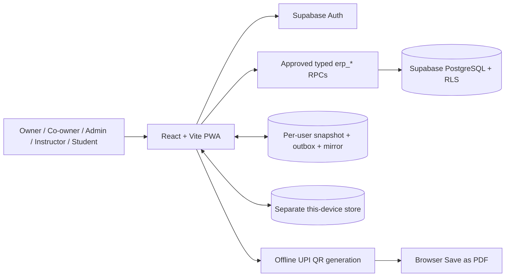

# Yoga Studio

A mobile- and desktop-friendly progressive web app (PWA) for running a yoga
studio: branches, students, instructors, batches, attendance, subscriptions,
INR payments, payment setup and one-page A4 invoice PDFs.

> **Current source release:** 1.11.1 · **Database setup:** SQL v12 in
> [`supabase/erp_setup.sql`](supabase/erp_setup.sql) · **Live path:**
> <https://rajeshlande.github.io/yoga_studio/>
>
> Production contains the revision actually deployed from `main`; the app's
> visible version comes from `package.json` and appears in Settings and the
> page footers.

## Table of contents

- [Overview](#overview)
- [Features](#features)
- [Online, offline and automatic sync](#online-offline-and-automatic-sync)
- [Payments, GST and invoice PDFs](#payments-gst-and-invoice-pdfs)
- [Architecture](#architecture)
- [Quick start](#quick-start)
- [Configuration](#configuration)
- [First-run checklist](#first-run-checklist)
- [Testing and quality gates](#testing-and-quality-gates)
- [Build and deployment](#build-and-deployment)
- [Versioning and releases](#versioning-and-releases)
- [Security and privacy](#security-and-privacy)
- [Project structure](#project-structure)
- [Troubleshooting](#troubleshooting)
- [Known limitations and roadmap](#known-limitations-and-roadmap)
- [Documentation](#documentation)

## Overview

Yoga Studio is a React + Vite PWA backed by Supabase Auth and PostgreSQL.
It provides a role-scoped studio ERP for Owner, Co-owner, Admin, Instructor
and Student users. All prices and fee calculations are in Indian rupees (INR), stored as
integer paise to avoid floating-point money errors.

The application supports two clearly separated data modes:

| Mode | Purpose | Synchronization |
|---|---|---|
| **Supabase mode** | Shared, multi-user studio data | Offline-first. After an online sign-in and initial download, changes are saved in a per-user/per-organization device outbox and automatically pushed when a connection is available. |
| **This-device mode** | A standalone browser-local studio copy | Never syncs and never becomes Supabase data automatically. It starts empty; JSON export/import/clear is in the Owner/Admin-only **Settings → Studio ERP data** panel. |

There is **no demo account, seeded business data, offline sign-in bypass or
sample-data mode**. Test fixtures live only under `tests/` and are not bundled
into the application.

## Features

### Studio ERP

- Multi-branch studio structure with branch filtering throughout the ERP.
- Dashboard KPIs for active students, today's classes, monthly collections
  and pending dues, plus expiring-subscription alerts and a setup checklist.
- Student records with branch, split first/last name, contact and admission
  profile details, joining date, batches, attendance history/percentage,
  search and CSV export.
- A complete **Branches & batches** operational workspace: searchable branch
  health cards with students, active batches, seat fill, weekly classes,
  recent attendance and next class; plus batch **List** and weekly
  **Schedule** views with search, status/day/availability filters, sorting,
  capacity progress, next-class details, duplicate-batch setup and warnings
  for full, empty, unassigned or instructor-overlapping batches. Students
  see the same schedule/list pattern only for their own assigned batches and
  without studio roster or class-count details.
- Rich Instructor profiles and recurring batches with weekdays, start time,
  duration, capacity and roster management. A manager-maintained profile can
  include a teaching bio, specialties/styles, qualifications/certifications,
  experience, joining date, contact/home branch, status, assigned batches,
  active-student counts and the next class. Managers manage profiles from
  **Branches & batches → Instructor profiles**; Instructors and Students keep
  their standalone assigned-batch view. A signed-in Instructor may open
  **Roster** on an active batch assigned to them and add/remove existing
  active students from that batch's branch, subject to capacity.
- Attendance by date and batch using **Present**, **Absent** and **Late**,
  including mark-all-present, history and CSV export.
- INR fee plans as reusable Odoo-style templates in **Subscriptions → Plans**.
  A template now records its type (**Subscription** or **One-month only**),
  price, billing period in months, default calendar-month/joining-date
  alignment, renewal-tracking default and Active/Archived status.
- **Native Odoo-style subscriptions:** the top-level **Subscriptions** menu
  contains **Subscriptions & dues**, **One-month passes** and **Plans**.
  Subscriptions have active, scheduled, paused, expired and cancelled
  lifecycle views; pause/resume with the elapsed pause days added to the end
  date; cancellation reasons; renewal-enabled tracking and next renewal
  dates; linked renewal history; and a summary for active and paused
  subscriptions, renewals due and monthly recurring revenue.
- **One-click renewal:** a manager creates the next linked period at the
  current Plan price and duration, starting the day after the current end
  date (or today if already expired). The old period keeps its agreed amount,
  payments and receipts. Only one live renewal can follow a period; a
  cancelled future renewal can be replaced. A period must be resumed before
  renewal, and cannot be paused while a live renewal already follows it.
- **One-month-only passes:** a one-month Plan creates a distinct single fixed
  month shown separately under **Subscriptions → One-month passes**. It has
  its own dues, invoice and payment, but no Pause, Renew, History, renewal
  date or MRR contribution.
- Subscription price snapshots for existing periods, partial payments, dues
  and CSV payment exports. Payments and due invoices remain available for
  paused, scheduled and expired periods, but not cancelled subscriptions.
- The top-level **Payments** menu contains payment history, **Record
  payment**, paid/due invoice PDFs and **Payment setup**. The payment form
  can collect against either a subscription period or a one-month pass.
- Append-only payments. A synced payment is corrected with an audited void
  and a required reason; it is never silently edited or deleted.
- Fixed, server-enforced role portals (Odoo-inspired security groups plus
  branch/record rules; no custom permission editor):
  - **Owner:** protected primary account; all branches and operations,
    including Co-owner management. Ownership cannot be transferred or the
    primary Owner removed in the app.
  - **Co-owner:** all-branch operations, plans/payment setup, and
    Admin/Instructor/Student access; cannot add/remove Owner or Co-owner.
  - **Admin:** operations plus Instructor/Student access only in explicitly
    selected branches; cannot manage Admins/Co-owners, plans, payment setup
    or other branches.
  - **Instructor:** own linked batches, rosters and attendance only. They
    may add/remove existing active same-branch students in those batches,
    but the server sends only roster identity fields—not student contact,
    address, admission or medical details—and they cannot create/edit
    Student records, change batch settings/capacity, see fees/payments,
    set up Instructor profiles or administer access.
  - **Student:** a personal, view-only dashboard for their assigned batches,
    next classes, attendance, subscription lifecycle/next renewal, dues,
    payments and invoices. Students can open their own subscription history
    but cannot pause, cancel or renew it. The
    Student portal does not show studio rosters/class counts, sync badges or
    **Sync now**, or the **Studio ERP data** settings panel. Its server
    snapshot contains no other student, no instructor contact/profile fields
    beyond the assigned teacher's display name, and no Plan except one used
    by that student's own subscription/pass.
- **In-app role access:** after a person creates and confirms a Supabase
  account and does not create their own organization, an authorized manager
  links that exact sign-in email. Use **Access** for Co-owner, branch Admin
  and Instructor roles, and **Students → Portal access** for a Student.
  Instructor profile setup in **Branches & batches → Instructor profiles** and
  Instructor Portal grants/removals are limited to the Owner, a Co-owner or
  an Admin acting within their assigned branches. Manual membership SQL is
  an emergency-repair fallback only.
- **Public Student admissions:** a manager or Instructor shares the
  studio-wide or branch-specific link from **Students → Admission requests**
  / **Students → Share public admission URL**. The link opens one
  **Student registration & admission** form—not a sign-in screen—where the
  applicant enters the admission details, a password for their future
  Student portal and accepts the linked **Terms & Conditions**. The request
  is then pending for **Instructor and above** within server-enforced scope:
  Owner/Co-owner across branches, branch Admin in assigned branches, and
  Instructor for studio-wide or teaching-branch requests, confirming only
  into a teaching branch. Approval requires the applicant email to be
  confirmed, creates the Student, grants Student portal access to the
  form-created account and continues to batch assignment and plan selection.
  **Medical / Physical issue** remains limited to Owner, Co-owner, the
  student's branch Admin and the student; Instructor admission review hides
  medical/address/DOB/reason details server-side.

### Experience and platform

- A role-aware **Profile** page for every signed-in user: editable name,
  phone and personal bio; read-only sign-in email; ERP role, organization and
  access scope; and the linked Instructor or Student record summary where one
  exists. Role/branch assignments remain manager-controlled.
- Responsive phone, tablet and desktop layouts with keyboard-focus handling.
- Installable PWA with an offline app shell after the first successful visit.
- Light, Dark and System themes with a top-bar quick toggle, a Settings
  picker, pre-paint theme bootstrap and persistent per-device preference.
- Always-visible **Online/Offline** status in the top bar for studio staff,
  including whether signed-in changes are synced, waiting, saved locally or
  need review. The view-only Student portal hides sync badges and controls.
- Supabase email/password sign-up, sign-in, password recovery and profile
  management.
- Visible semantic app version sourced from `package.json`.

## Online, offline and automatic sync

For Owner, Co-owner, Admin and Instructor accounts, the top bar is the
quickest way to understand the current data state. Student accounts use the
same automatic refresh internally, but do not display sync badges or a
**Sync now** button:

| Badge | Meaning |
|---|---|
| **Online · synced** | Internet is available and no ERP change is waiting on this device. |
| **Online · syncing…** | The client is pushing/pulling through the approved Supabase RPCs. |
| **Online · _n_ waiting** | Changes are safely queued locally and automatic retry is active. |
| **Online · _n_ to review** | Supabase contains a newer version of one or more records; manual conflict review is required. |
| **Offline · _n_ saved locally** | No internet is available, but the queued changes are on this device. |
| **Offline · local copy** | No internet is available and the last downloaded signed-in copy can be used. |
| **Online/Offline · this device** | The separate browser-local mode is active; it does not sync to Supabase. |

### How no-forget sync works

In signed-in Supabase mode, a write is persisted to the device snapshot/outbox
before the UI treats it as saved. The sync state has a same-origin mirrored
backup copy to protect against a truncated/corrupt primary storage value, and
the app requests persistent browser storage when queuing work.

Automatic sync is attempted:

- immediately after a change;
- when the browser fires the `online` event;
- when the tab/app becomes visible or regains focus (throttled);
- every 30 seconds while visible **only if work is pending**;
- after transient failures using bounded exponential backoff (5 seconds up
  to a 60-second cap while the app remains open);
- on a best-effort basis when the page is hidden.

Users do not need to remember **Sync now**. If there is still pending work, a
new edit brings the next attempt forward instead of waiting for an old
backoff timer.

### Closing the app with device-only changes

While changes are pending, conflicted or actively syncing, the browser's
standard close/refresh confirmation is requested. Closing does **not** erase
the durable outbox: reopening the app for the same signed-in user resumes
automatic sync. Do not clear site data, uninstall the browser profile or use
Settings → **Reset offline copy** until the badge says the work is synced or
any conflict has been reviewed.

> Browser storage is not an off-device backup. Persistent-storage permission
> and the mirrored copy reduce eviction/corruption risk, but Supabase remains
> the shared system of record in Supabase mode.

### Conflicts

Every synchronized row carries a server `sync_version`. Device edits include
the version they were based on. If another user changed the same record in
the meantime, the server does not apply last-write-wins. The conflict dialog
shows the device proposal beside the current Supabase value:

- **Keep Supabase** discards only that device proposal.
- **Keep mine** reapplies only fields changed on this device onto the newer
  server record, preserving concurrent changes to other fields.

The separate **This-device mode** is not part of this protocol and never
uploads its data automatically.

## Payments, GST and invoice PDFs

Open **Payments → Payment setup** as an Owner or Co-owner to configure:

- billing legal name, address, city, state/PIN, email, phone, invoice prefix,
  due-days and invoice terms;
- optional GST on/off, seller GSTIN, GST rate, SAC/HSN and whether plan prices
  already include GST;
- receiving UPI ID and payee name for dynamic UPI QR codes;
- receiving bank name, account name/number/type and IFSC;
- Razorpay or Cashfree as the intended gateway, test/live environment and
  its **public** key/client identifier;
- an HTTPS trusted-webhook/Edge Function URL and whether that external
  webhook has been deployed and tested.

Validation checks GSTIN/state-code consistency, GST rate, SAC/HSN shape,
complete-or-empty bank details, account number, IFSC, UPI ID, Razorpay key
environment prefix and webhook URL consistency. Setup warnings also appear
when recording a payment—for example, if UPI is selected before a receiving
UPI ID exists, or if a card gateway is not ready for automatic confirmation.

### Gateway safety boundary

> **Never enter a Razorpay Key Secret, Cashfree Secret Key, webhook secret or
> any other provider/API secret into this app.** The current release stores public
> identifiers and readiness only.

This release does **not** launch gateway checkout and does **not** mark a
membership paid from a browser callback. Collect by cash, UPI, bank transfer
or an external card terminal/provider flow, verify the funds, and then use
**Record verified payment**. A future live-gateway phase must add a trusted
Supabase Edge Function/server for order creation, secret storage, webhook
signature verification, idempotency and reconciliation before automatic
payment confirmation can be claimed.

### Due invoices and paid receipts

Use **Invoice PDF** from a membership with a balance or from a recorded
payment. The same themed document supports both cases:

- **UNPAID / PARTIALLY PAID:** shows the amount due, due date, bank transfer
  instructions and—when a UPI ID is configured—a dynamic QR generated in the
  browser from a `upi://pay?...` URI for the exact grand total and reference.
- **PAID:** shows the server receipt number, method, date and note/reference,
  and hides all payment instructions and the QR code.
- **VOID:** preserves the receipt history and void reason and cannot be used
  to request payment.

**Print / Save A4 PDF** uses the browser print dialog; choose **Save as PDF**
as the destination there to download the complete document. The print sheet
is fixed to exactly one **A4 portrait page (210 × 297 mm)** with 10 mm
margins and a light print palette; the on-screen preview still follows the
app theme. The browser test verifies the generated PDF's one-page count and
A4 MediaBox. The in-app filename/title uses the invoice/receipt reference.

### GST behaviour

- With GST off, the document is a retail-style fee invoice/receipt with no
  GSTIN, SAC/HSN or tax split.
- With GST on and GST-inclusive prices, tax is back-calculated from the fee.
- With GST on and GST-exclusive prices, tax is added to the taxable fee and
  the invoice grand total/QR uses the tax-inclusive payable amount. Subscriptions and
  dashboard dues then use those gross payable totals, recorded payments are
  the actual gross cash received, and paid-receipt tax breakups are derived
  from that received amount so GST is never added twice.
- Intra-state supply splits tax into CGST + SGST; inter-state supply uses
  IGST, based on seller state and the selected place of supply. A customer
  GSTIN can be entered for an individual PDF when relevant.

Yoga Studio calculates and displays these invoice values; it is not a GST
filing, government e-invoicing/IRN or accounting system. Ask your CA to
confirm GST applicability, SAC/HSN, rate, place-of-supply treatment and your
invoice-numbering policy.

## Architecture



Important design rules:

- Business reads/writes use approved typed PostgreSQL RPCs; application code
  does not perform business-table `.from(...)` CRUD or raw table REST calls.
- All ERP database tables/functions are maintained in the single idempotent
  file [`supabase/erp_setup.sql`](supabase/erp_setup.sql), which the project
  owner runs manually in the Supabase SQL Editor.
- Billing settings are one synchronized configuration record per
  organization and use the same outbox, idempotency and version-conflict
  rules as the other ERP collections.
- QR payloads are generated locally by the bundled `qrcode` package, so QR
  generation does not need a network service.
- The service worker caches the static app shell only, not passwords or Auth
  API responses.

## Quick start

### Prerequisites

- Node.js **26 LTS** (see `package.json` engines; Node 22–26 is supported).
- npm.
- A Supabase project if using shared/signed-in mode.
- Chromium for the complete browser test suite.

### Install and run

```sh
npm ci
cp .env.example .env.local
# Fill in the public Supabase values described below.
npm run dev
```

The Vite development server binds to `0.0.0.0`. Use the URL printed by Vite.

### Set up Supabase

1. In Supabase, enable the Email auth provider and configure confirmation and
   password-recovery email delivery.
2. Open **SQL Editor**, paste the complete contents of
   `supabase/erp_setup.sql`, and run it. Re-running the current file upgrades
   earlier ERP installs to SQL v12 without deleting business rows.
3. Configure the production Site URL for
   `https://rajeshlande.github.io/yoga_studio/` and add the scoped redirect
   pattern `https://rajeshlande.github.io/yoga_studio/**` so email links can
   return an applicant to the admission flow; add your local development
   origin separately.
4. The primary studio Owner selects **Create my own studio** during sign-up,
   signs in through the app, selects **Settings → Data mode: Supabase** if
   needed, creates the organization once and waits for **Online · synced**.
5. For every additional user, have that person select **Join an existing
   studio** during sign-up and confirm their own account first. Then link the
   exact sign-in email in **Access** for Co-owner/Admin/Instructor roles,
   selecting branches for Admin/Instructor access, or in
   **Students → Portal access** for an existing Student. For a new Student,
   a manager or Instructor may instead share **Students → Admission requests
   → Public admission link**; the applicant completes one registration +
   admission form with password and terms acceptance, confirms their email,
   and an Instructor-or-above reviewer in scope approves/rejects it and
   continues to batch + plan. If a joining user signs in
   before the grant, they see a dedicated **Waiting for studio access**
   screen with no ERP navigation, studio data or organization-creation
   controls. Access changes are online-only and never enter the offline
   outbox.

## Configuration

Create `.env.local` for local development:

```text
VITE_SUPABASE_URL=<SUPABASE_PROJECT_URL>
VITE_SUPABASE_ANON_KEY=your_public_publishable_or_anon_key
```

| Variable | Required for | Notes |
|---|---|---|
| `VITE_SUPABASE_URL` | Supabase Auth/ERP | Public project URL. |
| `VITE_SUPABASE_ANON_KEY` | Supabase Auth/ERP | Publishable or legacy anon **public** key. For GitHub Actions, store a publishable key under this exact secret name because that is the build variable the app reads. |

`VITE_` variables are visible in compiled browser assets. Never place a
service-role key, provider secret, database password or repository token in
them. `.env.local` is ignored by Git.

## First-run checklist

1. Confirm the top bar says **Online · synced** in Supabase mode.
2. In **Branches & batches**, create at least one branch and instructor.
3. Create batches, enroll students and verify attendance.
4. In **Subscriptions → Plans**, create a subscription template and, if
   needed, a separate One-month only template; assign one to a student.
5. Complete **Payments → Payment setup**, especially UPI and/or bank receiving
   details and the GST choice that matches your CA's advice.
6. Generate a due **Invoice PDF** and scan the UPI QR with a small test flow,
   or verify the displayed bank details without sending money.
7. Record only a verified payment, then generate the paid Invoice PDF and
   confirm the QR/payment instructions are hidden.
8. Before relying on offline work, open every ERP area once while online so
   the initial role-scoped snapshot is downloaded.
9. With separate confirmed test accounts, verify each role: Owner grants a
   Co-owner; Co-owner grants an Admin to one selected branch; that Admin
   grants an Instructor and Student only in that branch; Instructor sees
   only their batches/attendance, can add/remove an existing active
   same-branch student in an assigned batch, and is denied another
   Instructor's batch or a Student-record edit; Student sees only their own
   records. Then
   remove each test link and verify the studio no longer loads for that
   account on the next online Retry/Sync.
10. As a manager in the Student's branch, pause and resume a test
    subscription, renew it after changing the Plan price, and verify the
    next period uses the new current price. Create a one-month pass and
    confirm it has Collect/Invoice/Cancel pass only—no Pause, Renew or
    History. Confirm the Student sees their subscription/pass but no
    lifecycle controls, and that an Admin from another branch and an
    Instructor cannot change it.

## Testing and quality gates

Install the browser once in a fresh environment, then run the full suite:

```sh
export PATH=/opt/node-v26.13.0-linux-x64/bin:$PATH # only if Node 26 is not the default
npx playwright install chromium
npm test
```

The suite includes:

- Node tests for security configuration, ERP money/dates, Instructor profile
  normalization, GST/UPI billing, sync coalescing/dependencies/conflicts/
  payments, mirrored-state recovery and theme helpers;
- Playwright tests for authenticated UI flows, the separate local-device ERP
  flow (including rich Instructor profile create/edit, Instructor roster
  add/remove, GST invoice, dynamic QR and a real one-page A4 PDF generation
  check), and a mocked-Supabase offline → conflict → resolution flow;
- mocked-Supabase role-access tests proving Owner grant/remove for Student,
  Co-owner, selected-branch Admin and Instructor accounts by registered
  email; Co-owner and branch-Admin Instructor Portal grants; hiding of
  Instructor profile setup and portal-access controls from Instructor and
  Student accounts; branch-Admin hiding of organization roles/plans/payment
  setup; signed-in Instructor identity locking, assigned-batch roster
  add/remove sync operations and the linked rich Instructor account profile;
  a waiting student's
  dedicated no-access screen and Retry flow; an explicit prospective-Owner
  creation path; the student's personal view-only dashboard/assigned-batch
  portal without sync controls or **Studio ERP data** settings;
  Owner/Admin-only visibility of that settings panel; cleared studio
  display after online revocation; the one-form public registration +
  admission submission with Terms, manager/Instructor review, Student +
  portal grant and enrolment continuation; and a
  mocked-Supabase subscription pause → resume → current-price renewal →
  history → cancellation journey;
- a mocked-Supabase payment-setup test proving offline save, mirrored queue,
  browser-close guard and automatic sync after reconnect.

For a release, also run:

```sh
npm run build
npm run build:pages
node scripts/check-pages.mjs
npm run security:check
node scripts/security-check.mjs --build
```

For the Pages/offline smoke, start the production preview in one managed
terminal/process:

```sh
npm run preview -- --base=/yoga_studio/ --port 4174 --host 0.0.0.0
```

Then run this from another terminal:

```sh
node scripts/test-pages.mjs
```

Mocked tests and ephemeral-Postgres checks are not live-provider UAT. After
running SQL v12 in the real Supabase project, test real Owner, Co-owner,
branch-Admin, Instructor and Student sign-ins; grant/revoke each role by its
confirmed email; open a public admission link signed out and verify it shows
the registration form (not sign-in), submit it with password + Terms,
confirm the email, approve it as an in-scope Instructor/manager and verify
branch scope, batch/plan continuation, Student portal access with the same
email/password and Instructor admission-field redaction; verify a Student cannot see another student, an
unrelated Plan or an assigned instructor's contact/profile fields; edit an
Instructor's rich profile as each manager
type; as that Instructor add/remove a same-branch active student in an
assigned batch and confirm capacity plus other-batch/other-branch denials;
verify the role-aware Profile for each role; verify other branch and
own-record scoping; pause,
resume, renew and cancel test subscriptions, create/collect a one-month
pass, and verify the Student view is read-only; run an offline
attendance/payment/subscription cycle and billing-settings sync as an
authorized manager; and resolve a two-account conflict before operational
sign-off.

## Build and deployment

```sh
npm run build          # domain-root hosting
npm run build:pages    # /yoga_studio/ GitHub Pages hosting
```

GitHub Pages deployment is handled by `.github/workflows/pages.yml` for
successful pushes to `main`; the repository Pages source must be **GitHub
Actions**. Configure these encrypted repository secrets before building:

- `VITE_SUPABASE_URL`
- `VITE_SUPABASE_ANON_KEY`

Then dispatch or push a fresh `main` workflow run. If the public bundle was
previously built without those values, deploy the rebuilt bundle and clear
the installed PWA/site data once so the old service-worker shell is replaced.

Recommended go-live order for 1.11.1:

1. Back up/verify the Supabase project according to your operational policy.
2. Ensure the complete current `supabase/erp_setup.sql` has installed
   **SQL v12**. Versions 1.11.x require SQL v12 for the public registration
   admission target/submit flow, terms acceptance, scoped Instructor
   admission review and the `setupVersion: 12` context response. If upgrading
   from SQL v11 or earlier, run the complete SQL v12 file instead of stopping
   at an older version; it is cumulative and preserves existing business rows.
3. Deploy the 1.11.1 web build with the two public Actions secrets.
4. Sign in online as the Owner, wait for **Online · synced**, open
   **Access**, and complete the five-role UAT checks with separate confirmed
   accounts before granting production staff/student access.
5. Configure and verify Payment setup as Owner/Co-owner before issuing
   unpaid invoices.

If the new app reaches an older database, a billing-settings change remains
queued with a setup-needed message rather than becoming a false conflict,
and **Access** / **Students → Portal access** / **Admission requests**
report that the current SQL setup is required; run the complete current
SQL file and reopen/focus the app to resume.

## Versioning and releases

Versions follow [Semantic Versioning](https://semver.org/):

- **MAJOR:** incompatible product, data or API changes;
- **MINOR:** backward-compatible features;
- **PATCH:** backward-compatible fixes.

`package.json` is the single source of truth. Use exactly one of:

```sh
npm run version:patch
npm run version:minor
npm run version:major
```

These update `package.json` and `package-lock.json` without automatically
committing or tagging. Update `CHANGELOG.md`, run the quality gates, review
the diff, and only then commit, push and deploy through the approved process.

## Security and privacy

- Browser configuration contains only the Supabase public URL/key.
- No gateway secret or webhook secret is requested, stored or bundled.
- Business-table access is through approved RPCs with per-call organization
  and role checks; tables are RLS-locked without browser table grants.
  Internal authorization/context/audit helper functions are not granted to
  browser roles, and role snapshots blank fields a role does not need.
- Signed-in offline data is namespaced by user and organization. Use trusted
  devices, sign out on shared devices, and remove/reset the offline copy
  when appropriate after sync.
- UPI IDs and bank receiving details are intentionally invoice-facing
  payment instructions. Do not reuse passwords, OTPs or secrets in any
  billing field.
- The security pattern checks are a guardrail, not a complete security audit.

Please do not disclose credentials or real production data in issues, test
fixtures or screenshots.

## Project structure

```text
.
├── .github/workflows/       # GitHub Pages build/test/deploy workflow
├── docs/                    # Product, architecture, operations and ERP guides
├── public/                  # PWA manifest/icons and static assets
├── scripts/                 # Pages and security verification scripts
├── src/
│   ├── App.jsx              # App shell, auth screens, settings and top status
│   ├── erp/
│   │   ├── ErpApp.jsx       # ERP pages, invoices and sync UI
│   │   └── erp.css          # ERP, invoice and print styles
│   ├── lib/
│   │   ├── auth.js          # Supabase client/auth helpers
│   │   ├── erp/
│   │   │   ├── data.js      # Supabase offline-first client + mode routing
│   │   │   ├── localStore.js  # Separate this-device ERP adapter
│   │   │   ├── logic.js     # Money, dates, subscriptions, GST/UPI logic
│   │   │   └── syncStore.js # Snapshot, outbox, mirror and conflict engine
│   │   └── theme.js         # Light/Dark/System theme helpers
│   └── style.css            # Global application styles
├── supabase/
│   └── erp_setup.sql        # The single owner-run ERP SQL setup/upgrade file
├── tests/                   # Node and Playwright tests
├── CHANGELOG.md
├── CLAUDE.md
└── package.json
```

## Troubleshooting

### “Account access is currently unavailable”

The deployed bundle does not contain valid public Supabase configuration.
Set both GitHub Actions secrets, rebuild/deploy from `main`, then clear the
old PWA/site data if an older shell remains installed.

### “Sync setup needed” or billing settings stay waiting

Run the complete current `supabase/erp_setup.sql` in the intended Supabase
project. Keep the app open or reopen it after the SQL run; automatic sync will
retry queued work.

### The app says changes are saved locally while offline

This is expected. Reconnect and keep the app visible until the top badge says
**Online · synced**. If it says **to review**, open the conflict dialog and
choose a side. Do not clear site data first.

### An unpaid invoice has no QR code

An Owner or Co-owner must add a valid receiving UPI ID in **Payments → Payment setup**.
Bank details can be shown without UPI, but there is no QR until a UPI ID is
configured. Paid and void invoices intentionally hide the QR.

### A configured gateway does not auto-confirm a payment

That is the correct current behaviour. Public gateway configuration is a
readiness record only; verify the external payment and record it manually.
Live checkout/webhook confirmation requires the future trusted-backend phase.

### Persistent storage shows as not granted

Install/use the PWA regularly and avoid private browsing or clearing site
data while work is waiting. The outbox still saves when persistence is not
granted, but browser eviction protection is weaker.

## Known limitations and roadmap

- Full visible-snapshot pulls suit a small studio; cursor/delta sync and
  pagination should be added before very large datasets.
- The offline store uses browser `localStorage`; IndexedDB is the scaling
  follow-up if snapshot/outbox size approaches browser limits.
- PDFs are generated at share/print time and are not stored as immutable
  documents in Supabase Storage.
- GST display/calculation does not replace accounting, GST returns or
  government e-invoicing.
- Live Razorpay/Cashfree checkout, webhook signature verification, refunds
  and automated reconciliation remain a separate trusted-backend phase.
- Subscription renewal is manager-confirmed. This release has no unattended
  recurring-invoice scheduler, saved-payment-method autopay, retry/dunning
  workflow or Student self-service pause/cancel/renew. Pausing a fee
  subscription also does not automatically change batch enrolment or
  attendance eligibility.
- Automated reminders/messaging, payroll, expenses, self check-in and
  advanced reporting remain outside the authorized ERP core.
- Live Supabase Auth/RLS/email and real-device UAT remain owner-project
  acceptance steps after SQL/deployment.

## Documentation

- [ERP core and sync/payment guide](docs/12-erp-core/README.md)
- [Version and release management](docs/05-development/version-management.md)
- [GitHub Pages deployment](docs/08-devops-deployment/github-pages.md)
- [Changelog](CHANGELOG.md)
- [Documentation index](docs/README.md)
- [Project instructions and constraints](CLAUDE.md)

Historical documents/evidence may describe earlier baselines. Current code,
`package.json`, this README, the ERP guide and the latest changelog entry take
precedence for the current release.
