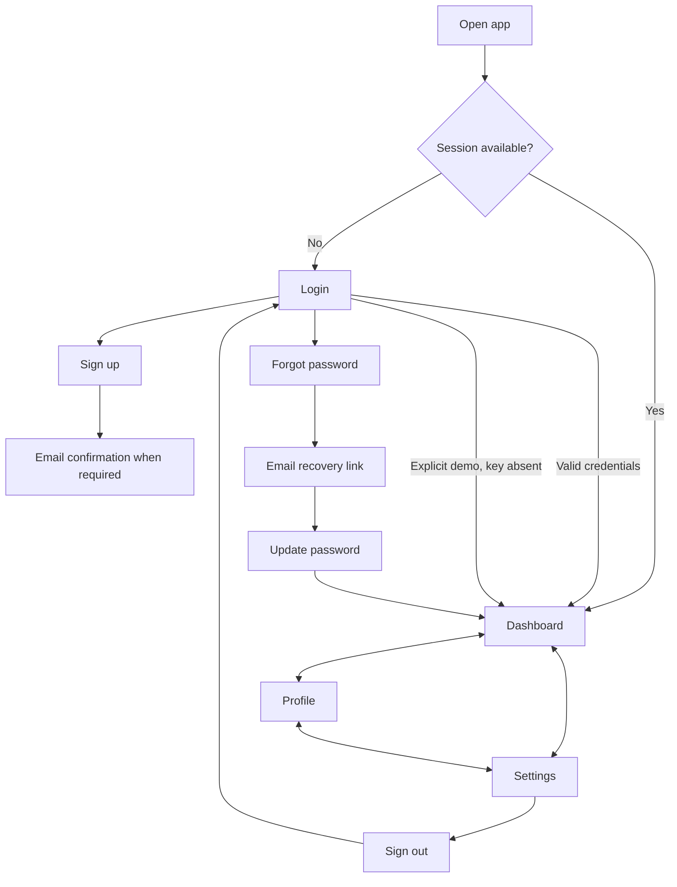

# UI/UX, screen, and responsive specification

- Project: yoga_studio
- Document ID: YS-UX-001
- Version: 0.1
- Status: Draft — not formally approved
- Author: Arena project assistant (code-derived draft)
- Proposed accountable owner: Design reviewer — assignment pending
- Reviewer / approver: Not assigned
- Created / last updated: 2026-10-15 (Asia/Calcutta)
- Classification: Internal
- Baseline: application commit `92f42e3`; repository `rajeshlande/yoga_studio`

## 1. Design direction
Minimal account portal with soft lavender/peach/mint surfaces, restrained borders, rounded corners, botanical SVG art, and generous spacing. Reference direction is the supplied pastel workspace image; the former class board is explicitly excluded from current scope.

Current tokens in `src/style.css`: primary `#8664ba`; root text `#383442`; page `#faf9fc`; muted `#9b92a4`; border `#ece6f1`. Font families: DM Sans for body, Manrope for headings, system fallbacks. Fonts load through Google Fonts and are not bundled. Many component-specific colors differ; the CSS, not this token list, is authoritative. Contrast has not been certified.

## 2. Sitemap and user flows

This describes logical screens, not URL routes. `screen` and `page` component state select views; hash deep links are not implemented, except recovery parsing delegated partly to the SDK.

## 3. Screen specification
| Screen | Fields / key actions | Feedback / restrictions |
|---|---|---|
| Login | Email, password, visibility toggle; Sign in; Create account; Forgot password | Required/HTML email validation; min 6; submit disabled while busy; demo path only without configuration |
| Signup | Full name (80 max), email, password; create account; login link | Password hint; success instructions if no session; provider/config errors |
| Forgot password | Email; send link; back to login | Neutral success message; setup error if key missing |
| Update password | New password, confirmation; visibility toggle; update; back to login | Match and minimum length; provider errors; recovery session required server-side |
| Dashboard | Personalized greeting; Profile and Settings shortcuts | No metrics, classes, notifications, or search |
| Profile | Initials avatar; name, read-only email, bio and counter; save | Name trim/nonblank; 80/250 character limits; busy state; success/error toast |
| Settings | Account email/type; reset-email action; install; sign-out | Demo reset disabled; install instructions if prompt unavailable |

## 4. Components and layout
`Logo`, `Avatar`, and `Botanical` are shared presentational components. `Auth`, `Profile`, and `ResetButton` encapsulate flow/form behavior. Main `App` owns sessions/navigation, shell, install dialog, and toasts. No external component framework or UI prototype file exists; the running app is the interactive design artifact.

Desktop authentication uses two columns (story and form); at ≤650px the story is hidden and the form becomes single column. Desktop workspace uses a fixed left sidebar; at ≤650px it becomes a slide-out drawer. Profile summary hides in the intermediate layout and reappears stacked on mobile. CSS also includes 850, 1100, 1500 and narrow 360px adjustments. Test actual results rather than assuming every breakpoint is approved.

## 5. Accessibility and content checklist (not a conformance report)
Existing: form labels, labeled icon controls, status/alert roles, visible focus styles, aria-current navigation, password reveal labels, reduced-motion override, and Escape-to-close dialog/drawer behavior.

Review required: pastel-text contrast, small type, screen-reader field/error association, browser zoom, 200%/400% reflow, touch targets, modal focus trap/restore, drawer focus management, and announcement behavior. Use WCAG 2.2 AA as a proposed acceptance standard and record actual measurements.

Messages must not expose passwords, tokens, or sensitive URLs. Forgotten-password success must not enumerate accounts. Current provider errors can be displayed directly; normalize to approved safe wording. All text is currently English; localization is out of scope. Screenshot references are not included as approved mockups; capture final screenshots during design review.

## Document control

Source of truth: current code, `.env.example`, `package-lock.json`, and automated evidence where cited. Proposed controls are not statements of implementation. Approval and owner assignment are pending.

| Version | Date | Author | Change |
|---|---|---|---|
| 0.1 | 2026-10-15 | Arena project assistant | Initial code-derived draft; review pending |
