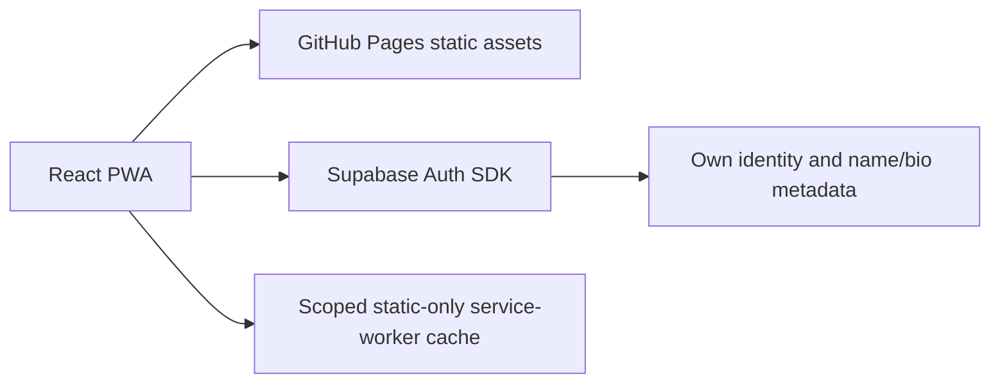

# Architecture, high-level and low-level design

- Project: yoga_studio / Yoga Studio
- Document ID: YS-TECH-001
- Version: 0.2
- Updated: 2026-10-16
- Status: Current-code description plus planned expansion; formal approval pending
- Code baseline: application 1.1.1 (`f72bee4`); management plan 0.4 is documentation only
- Accountable reviewer/approver: assignment pending

## 1. Current architecture

The implemented app has no custom business database schema/RPCs, management portals, Edge workflow, cron or private document integration. Auth provider configuration and email behavior require real-project verification. There is no demo state or private-data offline queue.

## 2. Module responsibilities

- `src/main.jsx`: mounts React, removes obsolete sample-state keys without reading them as authority, registers the production worker using the configured base path.
- `src/App.jsx`: auth/private view state, dashboard/profile/settings, accessible drawer/install interactions and profile draft; real Auth operations, no role authority.
- `src/lib/auth.js`: public-configured Supabase client, repository-path confirmation/recovery URL and safe error mapping.
- `src/lib/public-config.mjs`: endpoint/public-key validation; privileged or malformed credentials cannot enable the client.
- `src/lib/version.js`: package-derived display version; package manifest/lockfile remain the release source of truth.
- `public/sw.js` and `vite.config.js`: scoped static caching and content-based cache versioning; preserve unrelated same-origin project caches.

React/Vite/Supabase dependencies are defined by package.json and locked by package-lock.json; use Node 22, not historical workspace Node 20 observations. Pages CI exists in `.github/workflows/pages.yml`; branch protections and independent approvals are not presumed enabled.

## 3. Target management architecture

[The consolidated plan](../11-management-plan/README.md#database-functions) defines all business reads/writes via typed RPCs, non-exposed app_data/private schemas, reviewed RLS/executor privileges and authorized Edge workflows for secrets/Auth Admin/providers/documents. Ordinary Auth SDK operations remain an explicit provider exception. Pages is static and cannot hold server secrets.

Use the [Owner/Co-Owner vs branch-role predicate](../11-management-plan/README.md#governance-and-readiness). Co-Owner cannot acquire ownership/security powers through staff management. Context caches are presentation only; mutations reauthorize. Expected versions, idempotency and audit share the business transaction; multiple Edge RPC calls are not atomic together.

Adopt TypeScript/typed service boundaries incrementally when implementing. Preserve existing visuals, accessibility and Pages/recovery routing. Do not describe target architecture as already deployed or add a server-rendered framework solely for the plan.

## Document control

Current code/package manifest govern implemented behavior; the consolidated management plan governs future specifications. Historical evidence is not a new test run or approval.

| Version | Date | Author | Change |
|---|---|---|---|
| 0.1 | 2026-10-15 | Arena project assistant | Initial code-derived draft; review pending |

| 0.2 | 2026-10-16 | Arena project assistant | Current no-demo/Node 22/Pages baseline and consolidated management-plan references; no runtime changes |
