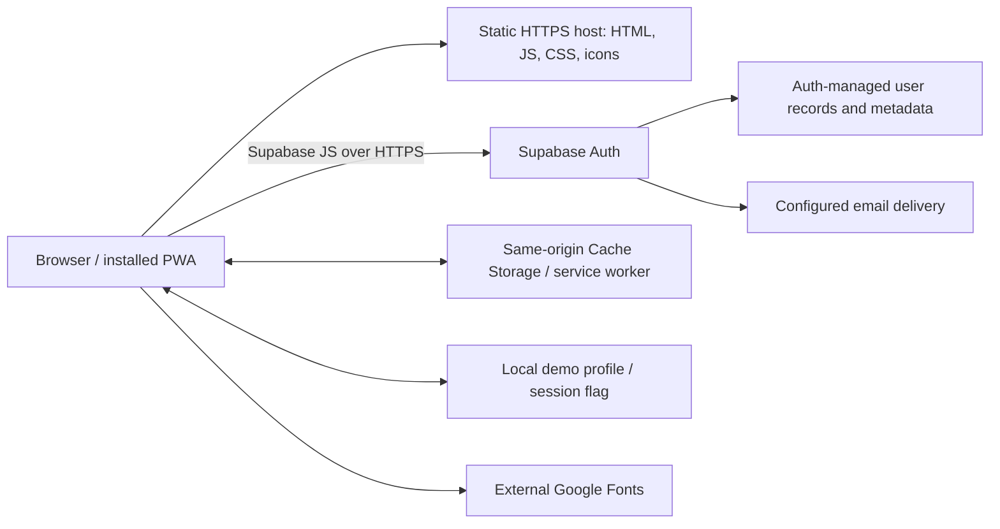
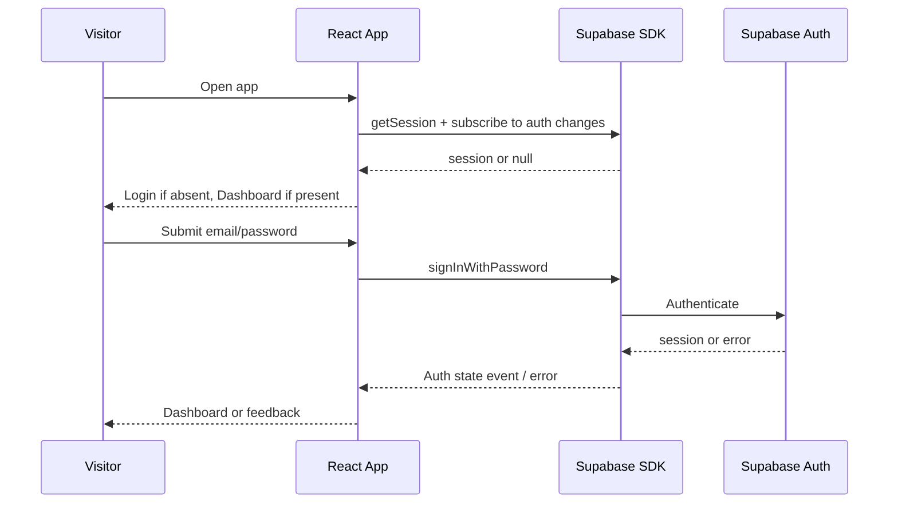

# Architecture, high-level and low-level design

- Project: yoga_studio
- Document ID: YS-TECH-001
- Version: 0.1
- Status: Draft — not formally approved
- Author: Arena project assistant (code-derived draft)
- Proposed accountable owner: Technical maintainer — assignment pending
- Reviewer / approver: Not assigned
- Created / last updated: 2026-10-15 (Asia/Calcutta)
- Classification: Internal
- Baseline: application commit `92f42e3`; repository `rajeshlande/yoga_studio`

## 1. System boundary / HLD

There is no custom API server, application database schema, file storage integration, queue, cron, container, IaC, or in-app admin. Supabase URL is configured; project access and real auth verification are pending. Static hosting provider and production domain are not selected in code.

## 2. Technology inventory (resolved lockfile versions)
| Dependency | Version | Responsibility |
|---|---|---|
| React / React DOM | 19.3.1 | Rendering and state |
| Supabase JS | 2.109.0 | Auth client and session lifecycle |
| Lucide React | 1.57.0 | Icons |
| Vite | 6.4.4 | Development/build/preview |
| Vite React plugin | 4.3.4 | JSX and React integration |
| Playwright Test | 1.64.1 | Browser automation |

These are code-derived installed versions, not recommendations about newest releases. `package.json` uses version ranges; `package-lock.json` supplies reproducibility. Node 20.20.2 and npm 10.8.2 were observed in the implementation workspace; the project does not declare an engines policy. Select a currently supported compatible runtime and validate in CI before release. A formal SBOM/license review is not yet supplied.

## 3. LLD / module responsibilities
- `src/main.jsx`: StrictMode render; registers `/sw.js` only in production after load.
- `src/App.jsx`: builds optional Supabase client from public env values. Owns `session`, local demo state, auth `screen`, private `page`, profile, drawer/toast/install state. Initializes session via `getSession` and listens to `onAuthStateChange`; subscription and event cleanup are implemented.
- `Auth`: validates browser inputs and matching reset passwords; calls signIn/signUp/reset/update SDK methods; shows busy/error/success states. Parent handles actual session transition.
- `Profile`: local draft; trims/nonblank-checks name; persists demo profile locally or user metadata through Supabase.
- `ResetButton`: reset email to current account with busy/error/success feedback.
- Shared `Logo`, `Avatar`, `Botanical`: presentational SVG/initials UI.
- `src/style.css`: layout, tokens, responsiveness, reduced-motion behavior.
- `public/sw.js`: precache and same-origin fetch handling. See caching document.

## 4. Session and navigation sequence

Demo mode bypasses the SDK only after its explicit button and only when the key is absent. It is not a secure account. Password recovery is detected through `type=recovery` in the initial hash and/or `PASSWORD_RECOVERY`; actual provider flow variants need testing. New page selection is local component state; reload returns to dashboard if a session exists.

## 5. Limitations and proposed evolution
Private UI gating is not backend authorization. The code currently has no server-protected application resources beyond Auth. Do not introduce roles using user-editable metadata. Before new data features, add per-user tables, RLS policies, migrations, tests, and separate authorization design. Refactor the single file before substantial growth; do not add infrastructure or a schema just to satisfy a documentation checklist.

## Document control

Source of truth: current code, `.env.example`, `package-lock.json`, and automated evidence where cited. Proposed controls are not statements of implementation. Approval and owner assignment are pending.

| Version | Date | Author | Change |
|---|---|---|---|
| 0.1 | 2026-10-15 | Arena project assistant | Initial code-derived draft; review pending |
