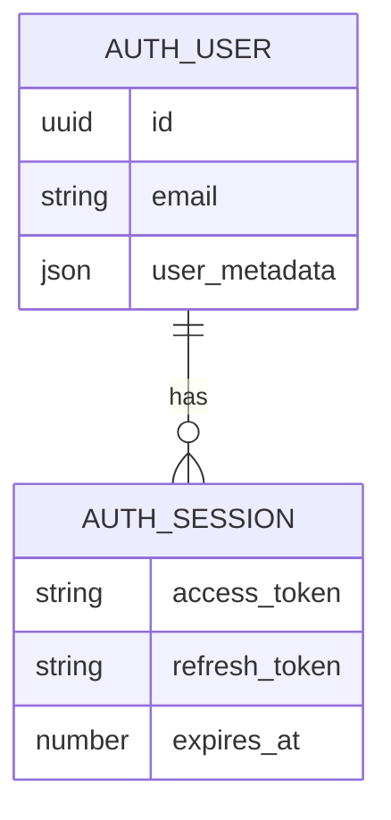

# Data dictionary, authentication API, and integration design

- Project: yoga_studio
- Document ID: YS-TECH-002
- Version: 0.1
- Status: Draft — not formally approved
- Author: Arena project assistant (code-derived draft)
- Proposed accountable owner: Technical maintainer / Supabase administrator — assignment pending
- Reviewer / approver: Not assigned
- Created / last updated: 2026-10-15 (Asia/Calcutta)
- Classification: Internal
- Baseline: application commit `92f42e3`; repository `rajeshlande/yoga_studio`

## 1. Data design and logical ERD
No custom public-schema tables or migrations exist. Supabase Auth manages its internal user schema; the app accesses it through the SDK, not direct SQL. The logical relationship below is descriptive and does not propose a migration.

## 2. Data dictionary and storage
| Field/key | Format / limits | Storage and usage |
|---|---|---|
| Auth user ID | Provider UUID | Supabase identity; not a client-assigned role |
| email | Provider-validated email | Read-only in Profile; used for sign-in and recovery |
| `user_metadata.full_name` | UI signup 80 max; profile trims and rejects blank | Editable display name; never an authorization attribute |
| `user_metadata.bio` | UI 250 max | Editable profile biography |
| `yoga-profile` | JSON `{name,email,bio}` | localStorage demo profile; remains after logout until cleared |
| `yoga-demo-session` | String `true` or absent | sessionStorage demo flag; cleared by demo logout |
| `session` / profile state | JS objects | In-memory UI; SDK persists real auth sessions by default |
| App cache | `yoga-studio-v2` | Cache Storage containing same-origin shell/assets |

The Supabase JS default persisted-session mechanism is browser storage; exact SDK key naming is an implementation detail. Passwords are sent through the SDK but not intentionally persisted by application code. UI length limits are not a backend data policy. Email/password must never enter analytics or support logs.

## 3. Supported API contract (SDK is authoritative)
Base project: `<SUPABASE_PROJECT_URL>`. Underlying routes below describe typical Supabase Auth HTTP mapping; the app calls SDK methods, not handwritten requests. Provider settings/version govern exact wire details.

| App action | SDK call / input | Typical HTTP mapping | Consumed result |
|---|---|---|---|
| Session initialization | `auth.getSession()` | Local session read; refresh may call Auth | `data.session`, `error` |
| Login | `signInWithPassword({email,password})` | POST `/auth/v1/token?grant_type=password` | Session/auth event; provider error |
| Signup | `signUp({email,password,options:{data:{full_name},emailRedirectTo:origin}})` | POST `/auth/v1/signup` | Session or email confirmation required |
| Request password reset | `resetPasswordForEmail(email,{redirectTo:origin})` | POST `/auth/v1/recover` | Error or neutral success |
| Update password | `updateUser({password})` | PUT `/auth/v1/user` with authenticated session | Error or completion |
| Update profile | `updateUser({data:{full_name,bio}})` | PUT `/auth/v1/user` | Error or updated metadata |
| Logout | `signOut()` | POST `/auth/v1/logout` when online/session applicable | Error or signed-out event |
| Subscribe | `onAuthStateChange(callback)` | SDK event stream, not custom HTTP endpoint | Session changes, recovery event |

Headers, bearer tokens, refresh, and public API key are SDK-managed. Never document live session tokens. Use synthetic example identity such as `qa@example.test`, not a user's real password or email. No custom REST API, class CRUD, upload API, search, or pagination endpoints exist.

## 4. Error handling and dependency behavior
HTML validation prevents some malformed submissions; the app disables busy submits and shows returned errors. Missing key produces an explicit setup error without pretending an account was created. Reset-email success uses non-enumerating wording. Network/rate-limit/invalid-login/expired-link failures require manual and automated integration validation. No explicit application retry, timeout, offline queue, or idempotency layer exists; SDK internals must not be described as app-owned guarantees. No centralized audit logging or monitoring exists.

## 5. Authorization boundaries and retention
Visitor: public auth views. Signed-in member: dashboard, own name/bio updates, own email reset request. Demo visitor: local preview only. Project admin: external Supabase console, not an application role. User metadata is self-editable, not trustworthy for permissions.

Retention/deletion of real Auth records, email events, backups, and sessions depends on project settings and approved privacy policy; neither has been provided. Demo profile can be removed through browser site-data controls. App has no account-deletion or export UI. Any custom table requires an approved schema, owner isolation and RLS, migration/rollback plan, and deletion rules before implementation.

## Document control

Source of truth: current code, `.env.example`, `package-lock.json`, and automated evidence where cited. Proposed controls are not statements of implementation. Approval and owner assignment are pending.

| Version | Date | Author | Change |
|---|---|---|---|
| 0.1 | 2026-10-15 | Arena project assistant | Initial code-derived draft; review pending |
