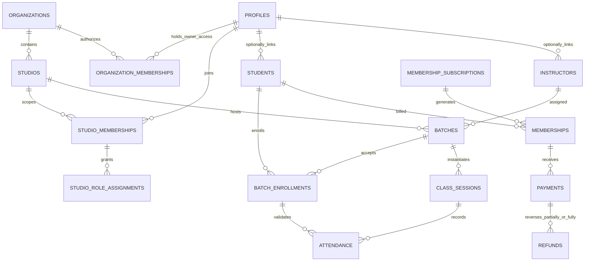

# Yoga Studio Management PWA — Consolidated Implementation Plan

<a id="plan-overview"></a>

**Plan version:** 0.4 · **Updated:** 16 October 2026 · **Status:** Proposed; approval required before implementation
**Current app baseline:** Yoga Studio 1.1.1, commit `f72bee4`
**Scope of this deliverable:** planning only. No application features, database migrations, roles, jobs, or policies have been deployed by this plan.

## Navigation

[Overview and roles](#plan-overview) · [P0/P1 and operational Co-Owner](#governance-and-readiness) · [Core fields](#core-schema) · [Supporting contracts](#supporting-contracts) · [Attendance](#attendance-workflow) · [RPC/call policy](#database-functions)

## 1. Decisions confirmed with the owner

| Topic | Confirmed direction | Consequence |
|---|---|---|
| Business structure | Multiple studios/branches under an Owner | Every studio record needs tenant scoping; an Owner must not be a platform-wide superuser. |
| Architecture | Retain React/Vite and GitHub Pages | All business-data reads/writes use typed Supabase RPCs; Edge Functions handle privileged/external workflows. No direct client table calls or Next.js server runtime. |
| Database access efficiency | Function-only data access; avoid unnecessary calls | Screen-oriented reads, paginated results, mutation patches, in-memory dedupe and explicit call budgets; preserve RLS/transactions/audit. |
| Membership billing | Support calendar-month and joining-date monthly billing | Store the selected policy and original billing anchor; preserve historical invoice snapshots. |
| Identity | Owner, operational Co-Owner, Admin, Instructor, Student | Database-backed, scoped role assignments; never trust editable Auth metadata for privileges. |
| Attendance workflow | Auto-select Today’s Class; instructor marking; audited Instructor/Owner/Co-Owner corrections | No student self-check-in or QR workflow; Admin attendance access requires explicit Owner/Co-Owner delegation. |
| Existing experience | Retain Yoga Studio branding and responsive/PWA foundation | Evolve the existing application instead of replacing it with another demo. No sample accounts, seeded business data or access bypasses. |

**Recommended baseline assumptions, not yet approved:** INR as initial transaction currency; studio timezone defaults to `Asia/Kolkata`; every class lasts exactly 60 elapsed minutes; manual cash/UPI/card/bank-transfer recording precedes gateway integration; a membership may cover multiple batches according to its plan. Owners may control several branches in an organization. A user may belong to several organizations, but permissions never cross those boundaries.

## 2. Target outcome and boundaries

Deliver a studio-management system with separate role-aware portals, recurring batch schedules, transactional enrollment, actual dated class sessions, attendance, monthly membership charges, auditable payment recording, and owner oversight across branches.

### Initial management release

- Owner: organizations/branches, trusted staff provisioning, scoped admin assignment, policy setup, consolidated permitted reports and audit review.
- Admin: assigned-branch student/instructor records, batches, enrollment, class exceptions, attendance corrections only with explicit Owner/Co-Owner delegation, memberships and verified manual payment entry.
- Instructor: assigned classes, minimum necessary student roster, attendance entry and own class history.
- Student: own enrolled batches, timetable, attendance, membership periods, dues, payment/receipt history and approved personal details.
- Shared: verified authentication, password recovery, profile, settings, mobile/desktop layouts, safe PWA shell, tenant selection, access-denied/error states.

### Deferred unless separately approved

Student QR/self-check-in, geofencing/biometric attendance, OpenWA/unofficial WhatsApp integration, online payment gateway, automated messaging/reminders, push notifications, payroll, instructor compensation, medical records, family wallets, student self-booking/waitlists, complex tax engines, native apps and cross-organization financial consolidation. Reports and controlled receipt downloads are included; offline private-data synchronization is not.

## 3. Architecture and trust boundaries


### Frontend

Keep Vite, current visuals and domain-root/repository-subpath support. Adopt TypeScript incrementally with strict checks, a centralized typed RPC layer, bounded query pagination and targeted in-memory updates from mutation responses. Keep existing CSS/tokens initially; a Tailwind rewrite is not required to implement this plan. Maintain role-aware navigation derived from trusted database context, not locally stored roles.

For Pages-compatible links, use a root-path query-based view selector or another explicitly tested static routing approach. Do not introduce server routes that require Pages rewrites. Supabase must consume recovery fragments before app navigation handles them; do not mix router hashes with password-recovery tokens without integration tests. URLs never authorize access.

### Backend

- **PostgreSQL constraints/RLS:** durable tenant isolation, ownership checks, financial invariants and concurrency-safe writes.
- **Typed RPCs for every business-data read and write:** context, profile, dashboards, rosters, directories, statements, enrollment, batch/session edits, attendance, manual payments and role operations. No component-level `.from(...)`, direct table REST calls or generic SQL/table RPCs. Screen-oriented reads and mutation responses avoid unnecessary round trips.
- **Edge Functions:** Auth administration/invitations, payment-provider verification when added, controlled exports/documents and trusted job entry points. Verify caller identity, active role and target tenant inside every privileged function; use approved business RPCs rather than ad-hoc table CRUD. Auth/Storage provider operations remain explicit non-table exceptions.
- **Jobs:** session generation, upcoming membership-period generation and reconciliation. Database roles and service credentials stay in server-managed secrets only.
- **Storage:** private buckets for generated receipts/exports if needed; no public student or financial files. Use short-lived, authorization-checked links. Initials avatars can remain; document upload is not a prerequisite.

GitHub Pages cannot keep runtime server secrets. Public Supabase configuration remains inspectable in the browser. Environment secrecy does not replace RLS. Do not restore removed hardcoded project identifiers or put real values in planning documents.

## 4. Owner, operational Co-Owner and studio role model

### 4.1 Authority model

A single `profiles.role` cannot describe a person who is Owner in organization A, Instructor in a branch of B, and Student in another branch. Keep `profiles` as global identity/basic preferences. Put authoritative roles in scoped membership/assignment tables.

- **Organization Owner:** authority over that organization's branches only; not `service_role`, not a database superuser, and not a platform operator.
- **Operational Co-Owner:** organization-scoped operational access across branches, including staff, billing/reports and older retained attendance corrections. Cannot appoint/remove/promote Owner/Co-Owner, transfer ownership or change ownership/security policy. A Co-Owner does not replace the required final active Owner.
- **Branch Admin:** assigned studios only. Cannot appoint/dismiss Owners, transfer ownership, grant themselves branches, change their own authority or silently erase financial records.
- **Instructor:** explicitly assigned studios/classes, with historical session assignments respected even after a batch's instructor changes.
- **Student:** own records in a studio; a branch record must be linked to their verified identity before portal access is granted.
- **Multiple roles:** allowed through separate assignments. The backend evaluates effective permissions; a portal switch is presentation, not authority.
- **Authorization:** active accepted Owner/Co-Owner organization membership authorizes the permitted organization route without a local studio role; staff/student access requires active accepted studio membership plus an appropriate active branch role, not an Owner-only organization row. Owner-only operations still reject Co-Owner. See [the exact predicate](#governance-and-readiness).
- **Suspension:** every request rechecks its actual authorization route. Revocation removes inherited rights immediately; suspend-all also suspends explicit branch memberships. Cached context never grants authority.

**Role notation:** in operational core-field access notes, Owner shorthand includes operational Co-Owner within the same organization. Explicit Owner-only ownership/security controls do not include Co-Owner. Granting an approved staff capability is not changing the security policy or capability model.

### 4.2 Permission matrix

| Action | Owner | Operational Co-Owner | Admin | Instructor | Student |
| --- | --- | --- | --- | --- | --- |
| Create organization/initial owner | Trusted bootstrap only | No; Owner-only protected workflow | No | No | No |
| Manage own organization's studios | Yes | Yes | Read assigned settings only | Limited assigned location info | Own class location only |
| Invite/revoke branch admins | Yes, with reauthentication/MFA | Yes, own organization; audited and fresh auth | No | No | No |
| Invite instructor/student access | Yes | Yes | Assigned studio, constrained workflow | No | Request/accept invitation only |
| Assign/transfer ownership | Dedicated trusted workflow; preserve last owner | No; Owner-only protected workflow | No | No | No |
| Manage students/instructors | Own organization; audited | Own organization; audited | Assigned studio; approved fields | Minimum roster fields only | Own approved fields only |
| Create/edit batches and enrollments | Yes | Yes | Assigned studio | Read assigned | Read own |
| Generate/change/cancel sessions | Yes | Yes | Assigned studio | Read; limited own completion if approved | Read own |
| Mark attendance | Own organization | Own organization | Explicit attendance.mark grant; normal marking window only | Own assigned session; eligible enrollment; normal window | Read own only |
| Correct saved/finalized attendance | Own organization; reason/audit | Own organization; reason/audit | Explicit attendance.correct grant through session correction cutoff only | Own session through 24h after end by default; reason/audit | No |
| Correct after instructor cutoff | Own organization; reason/audit | Own organization; reason/audit | No; refer to Owner/Co-Owner | No; request Owner/Co-Owner correction | No |
| Set plans/billing policy | Yes | Yes | Owner-delegated settings only | No | No |
| Issue membership charges | Yes | Yes | Assigned studio, approved plan/rules | No | Read own |
| Post verified manual payments | Yes | Yes | Assigned studio, audited | No | Read own; cannot mark paid |
| Approve refunds/write-offs/credits | Yes, reason and authorization | Yes, reason and authorization | Request only by default | No | Request support only |
| Read finances | Own organization | Own organization | Assigned studio | No | Own only |
| Export personal/financial records | Scoped, justified and audited | Scoped, justified and audited | Scoped limited export if delegated | No bulk export by default | Own permitted receipt/download only |
| Change audit history | No | No | No | No | No |

**Owner safeguards:** first Owner provisioned through an audited operator-controlled bootstrap, never a public signup dropdown. Ownership transfers require fresh authentication, MFA/assurance-level checks, recipient verification, explicit acceptance, notification and audit. A transaction/lock must prevent removing the final active Owner; Co-Owner does not count as that Owner. Only an Owner can change ownership/security policy or appoint/remove/promote an Owner/Co-Owner. Recovery of a lost Owner is a documented support procedure, not a hidden master password.

## 5. Data model — nine core tables, plus necessary support

The nine requested tables remain the core. They are not sufficient alone for multi-branch authority, recurrence, auditable refunds and history. Supporting entities are explicit rather than hidden in unvalidated JSON.

### 5.1 Core table responsibilities

| Core table | Detailed responsibility | Key design changes from the supplied example |
|---|---|---|
| `profiles` | Global user-facing identity, contact preferences and profile version | Auth user FK; no authoritative global role; never expose Auth email/password/session tables as a directory. |
| `students` | Studio-specific registration, status, contact/guardian/emergency references and consent linkage | Scoped student number; optional pending login link; restricted internal notes; no medical data dumping. |
| `instructors` | Studio-specific instructor identity, qualifications/specializations, availability status and public bio | Scoped instructor number; linked verified identity before teaching access; salary/bank data excluded. |
| `batches` | Versioned 60-minute recurring schedule, branch/room, instructor, weekdays, dates and capacity | Unique/valid weekdays; transactional schedule-conflict checks; changes do not rewrite past sessions. |
| `batch_enrollments` | Effective-dated student/batch membership, reserved seat, status and change reasons | Re-enrollment/history allowed; prevent overlapping intervals; concurrency-safe capacity checks. |
| `class_sessions` | Actual dated class, assigned instructor snapshots, timezone, capacity, status and cancellation | End = start + 60 minutes; unique batch/date; instance-level conflict controls and edit locks. |
| `attendance` | Eligible student's status for one actual class, timestamps, actor and corrections | Composite FKs prove same batch/student/tenant; unmarked is not automatically absent; no silent edits/deletes. |
| `memberships` | One billed membership period with plan/policy/price/tax snapshots, dates, due date and issued charge | Half-open periods; calendar/anniversary anchors; financial settlement derived separately from service status. |
| `payments` | Positive receipt/payment facts, verification, allocation to membership, idempotency and receipt references | Append-oriented confirmed records; refunds/credits are separate records; never trust browser success. |

**Full field definitions, types, nullability, constraints, access/privacy, defaults and validation are in [the integrated core dictionary](#core-schema) and the derived workbook.** These are proposed design contracts, not an applied migration.

### 5.2 Common integrity conventions

- All studio-owned core rows carry `organization_id` and `studio_id`; `profiles` is global. Bind `(organization_id, studio_id)` to a real studio using a composite FK.
- Tenant-owned tables have a unique key such as `(organization_id, studio_id, id)`. Cross-table FKs carry the same tenant columns, not only a globally unique UUID.
- A linked `profile_id` must correspond to active/valid studio membership through a validated provisioning/linking workflow. Linking cannot be performed by editing an arbitrary UUID in the browser.
- Use server timestamps, server-derived actor IDs and `row_version` optimistic concurrency where appropriate. A stale edit must return a conflict instead of silently overwriting another user.
- Contacts belong in scoped contact tables, not unrestricted free text. Use separate restricted tables for any necessary guardian/consent information. Do not collect national IDs, card PAN/CVV, detailed health records or bank credentials by default.
- Use positive integer minor currency units (`bigint`, e.g. paise) and currency codes. In TypeScript represent values safely as validated decimal strings or `bigint`; serialize money as strings in API contracts, not JS floating-point arithmetic. Initial rollout is INR; multi-currency settlement/FX is out of scope. RPC/view contracts must cast monetary bigints to text before JSON serialization; do not assume a raw PostgREST bigint JSON number survives JavaScript parsing without precision loss.
- No business-history cascade deletion. Auth account deletion must be orchestrated with retention/anonymization rules; never erase financial/attendance facts by deleting a login.
- Store only stable business facts. Balances, overdue flags, occupancy and reporting totals should be derived/reconciled, not independently editable copies.

### 5.3 Supporting entities

**Mandatory foundation:** `organizations`, `organization_memberships` (Owner assignments), `studios`, `studio_memberships`, `studio_role_assignments`, `studio_permission_grants` for explicit Admin attendance delegation, `invitations`, `audit_events`, **`idempotency_requests` from Phase 1 before the first mutation**.

**Required by operations/billing:** `student_contacts`, `consent_records`, `instructor_qualifications` where qualification tracking is required, `studio_rooms` if multiple rooms, `enrollment_events`, `attendance_changes`, `membership_plans`, `membership_subscriptions`, `financial_adjustments`, `refunds`, `document_sequences`, `job_runs`.

**Gateway/export gates:** `provider_events` and payment-order mapping before online payments; `export_jobs`/document metadata before bulk exports. Optional future features must not create unused sensitive data stores just because they appear in a plan.

### 5.4 Logical relationships



## 6. Fix the supplied SQL before using it

The sample is useful as an outline but should **not** be pasted into production unchanged.

1. **No tenant scoping:** UUID uniqueness is not organization/branch authorization. Add composite tenant relationships, scoped uniqueness and branch-aware RLS.
2. **Global profile role:** cannot support cross-branch/multiple roles safely. Use dedicated assignments; self-editable profile metadata must never grant Owner/Co-Owner/Admin.
3. **Broad profile updates:** the example initially permits updating one's own row, including role. Revoke broad table UPDATE and expose approved profile fields through a constrained typed RPC, with only reviewed underlying grants where its security mode requires them. There is no profile-role column in the recommended model.
4. **Policy recursion:** `students`, `batches`, `instructors` and `batch_enrollments` read policies join each other and can trigger recursive RLS evaluation. Design narrowly scoped, fixed-search-path helpers over trusted tables and test actual policy execution under ordinary user roles.
5. **Unsafe grant narrative:** table grants cannot distinguish individual users sharing `authenticated`. Blanket revocation of writes for `authenticated` also removes direct admin writes. Use approved typed RPCs for all business reads and writes; underlying grants depend on reviewed execution mode, not frontend role labels.
6. **Attendance consistency:** read-policy joins alone do not prevent an admin/privileged write from linking the wrong enrollment/session. Enforce same-tenant, same-batch and student consistency in FKs/triggers and write functions.
7. **Capacity and clashes:** `count < capacity` in the browser races. Apply database locks/constraints and validate future date intervals and actual sessions.
8. **Recurring weekdays:** array containment/cardinality alone does not guarantee distinct weekdays or reject null elements. Validate a non-null, duplicate-free set of integers 0–6.
9. **One-hour classes:** `end_at > start_at` is insufficient. Require exactly 60 elapsed minutes and consistent timezone/local-date mapping for generated sessions.
10. **Financial invariants:** an amount/status field is not a ledger. Separate receipt/refund/credit facts, constrain tenant/currency, enforce idempotency, derive totals and prohibit silent payment deletion.
11. **Billing overlaps/history:** uniqueness on exactly `(student, start, end)` still permits overlapping periods. Choose a non-overlap rule per subscription/product and protect issued snapshots.
12. **Provisioning/deletion:** profile triggers, invite acceptance, final-owner protection, retained audit/finance records and account-erasure workflows must be designed explicitly.

## 7. RLS, grants and privileged API strategy

### 7.1 Default-deny design

Enable RLS on every application table, including internal/non-exposed tables, and revoke default privileges. Proposed layout: business tables in non-exposed `app_data`, reviewed user RPCs in exposed `api`, helpers/jobs in non-exposed `private`. Browser application-data access is RPC-only; no public table/view endpoints. Grant only approved RPC execution and the narrowly justified underlying privileges required by each reviewed invoker/definer mode. Anonymous users get no business data. No ordinary application role receives `BYPASSRLS` or a service key.

See [Function-only data access and call policy](#database-functions) for contracts, schema exposure, execution-mode risks, call budgets and DBF-01–DBF-12 acceptance gates. Auth SDK calls remain separate from business-table operations.

Default to invoker execution where its underlying grants/RLS are appropriate; use a constrained definer only when required. A definer uses its owner’s privileges and does not automatically preserve the caller’s RLS; table-owner/BYPASSRLS behavior and effective-role policies must be reviewed/tested per function.

Keep security helpers in a non-exposed schema with `search_path = ''`, fully qualified objects, explicit EXECUTE grants and no caller-controlled dynamic SQL. Definer functions must validate `auth.uid()`, target tenant, active membership, role, allowed field transitions and actor attribution. Avoid relying on `auth.uid()` in unauthenticated scheduled jobs; use a separate narrowly authorized job path.

`can_operate_org(org_id)` (Owner/Co-Owner operations), `is_owner_in_org(org_id)` (Owner-only ownership/security), `admin_in_studio(studio_id)`, `owns_student(student_id)`, `assigned_to_session(session_id)` and eligible-roster checks are examples of logical helpers—not permission to expose unrestricted helper results. Test with the same client roles used in production, not the SQL editor's privileged session.

### 7.2 Read scope

- Owner/Co-Owner: own organization/branches, with financial/contact exports separately controlled and logged.
- Admin: assigned studios only; no organization-wide data by default.
- Instructor: only assigned sessions and eligible student roster/attendance; no fees, payments, private notes, guardian/legal records or unrelated profiles.
- Student: records linked to their identity, including historical attendance/financial periods even after an enrollment ends where retention permits.
- Profile directories expose minimum display fields through typed, safe, scoped read RPCs, never the whole global profile or Auth tables.
- Reporting projections stay behind authorized RPCs and use caller-safe semantics and explicit RLS/authorization; do not accidentally expose owner-privileged materialized results to other roles.

**Column privacy must also be enforced.** RLS hides rows, not fields. Since all app users normally share the database `authenticated` role, do not grant unrestricted base-table SELECT and expect a safe UI projection to hide `internal_notes`, contact details or correction reasons. Do not expose base-table reads to the browser. All screen reads use narrowly scoped, explicitly authorized RPCs with fixed typed/allowlisted outputs; underlying column grants remain least-privilege according to each function’s execution mode. Restricted extensions may additionally live in separately protected tables. Instructors must fail when directly querying forbidden columns, not merely when clicking a hidden UI control. Apply the same principle to attendance notes, financial exception reasons and exports.

### 7.3 Planned operations

| Operation | Trusted path | Required validation |
|---|---|---|
| Create organization/first Owner | Controlled bootstrap | Operator identity, verified recipient, audit, no public role selection |
| Invite/promote/revoke staff | Edge Function + transactional database operation | Caller scope, fresh authentication, MFA for privileged changes, anti-escalation, idempotency |
| Transfer ownership | Dedicated accepted transfer | Verified recipient, last-owner lock, consent, fresh assurance, immutable audit |
| Upsert batch/schedule exception | RPC | Tenant/role, 60-min rule, dates, instructor/room conflicts, schedule version |
| Enroll/pause/withdraw student | RPC | Student/batch scope/status, eligibility, seat policy, capacity, date conflicts |
| Generate sessions | Idempotent job/RPC | Studio timezone, horizon, schedule versions, no duplicate/overlap, retain cancellations |
| Resolve Today’s Class | `get_today_attendance` RPC | Actual dated session, active authority, studio context, server time; chooser for ambiguity |
| Mark/correct/finalize attendance | RPC | Assigned session or Owner/explicitly delegated Admin; eligible enrollment; normal/correction window; version/reason/audit |
| Generate/issue monthly period | Job/RPC | Subscription policy, anchor, period uniqueness/non-overlap, immutable price snapshot |
| Record manual payment | RPC | Role, amount/currency, invoice state, idempotency, receipt number, audit |
| Post refund/credit | Owner-controlled RPC/Edge workflow | Original payment, remaining refundable amount, approval/reason, accounting effect |
| Verify online payment | Future Edge webhook | Signature, provider/account/order/amount/currency, dedupe, replay safety, transaction |
| Produce receipt/export | Authorized Edge workflow | Recheck scope, safe template/CSV, no cross-tenant rows, private storage, expiry/audit |

Every mutation returns a structured success or safe error code such as `FORBIDDEN`, `CAPACITY_FULL`, `SCHEDULE_CONFLICT`, `STALE_VERSION`, `PERIOD_EXISTS`, `PAYMENT_DUPLICATE` or `ATTENDANCE_LOCKED`. A client-side role check is a convenience only.

### 7.4 Request efficiency requirements

Cold authenticated navigation normally uses one context RPC plus one requested-screen RPC; warm screen loads use one bounded screen RPC. Attendance selection includes server time, permissions, windows, counts and a paginated roster in the same response. Mutations return changed safe fields, counts and revisions so the UI does not reread all records. No per-card/per-student fetches, whole-organization preloads or clock queries every second. Auth traffic and necessary pagination are counted separately. Deduplicate reads, debounce filters, bound retries, stop polling when hidden and invalidate only affected memory. All writes reauthorize even if display context is cached. One network call can still run inefficient SQL: require indexed query-plan/load evidence.

## 8. Scheduling, enrollment and attendance rules

### 8.1 Recurrence and actual sessions

A batch is a schedule template; a session is a dated occurrence. Store weekdays using Sunday=0 through Saturday=6, start local time, effective dates and version. Interpret the recurrence in the studio's IANA timezone. Persist each session's actual UTC start/end plus timezone/instructor/capacity snapshots so later policy or instructor changes do not rewrite history.

Generate a configurable rolling horizon, initially proposed as 28 days, in short idempotent jobs. Unique batch/local-date keys stop duplicate generation. Record run ID, target studio/date range, version, attempt/result and sanitized failure. Never resurrect a cancelled session on retry. Schedule edits affect only explicitly chosen future sessions and must report conflicts before applying atomically.

For daylight-saving zones, define behavior for nonexistent/ambiguous local times; recommended default is to reject ambiguous schedule edits until an explicit offset/resolution is chosen. India has no current DST changes, but the model must not assume every studio uses the same timezone. Sessions always last 60 elapsed minutes.

### 8.2 Conflict and capacity integrity

Use database exclusion constraints over half-open time ranges `[start_at, end_at)` for actual instructor/room occupancy where practical. Conflict checks for an instructor apply across that organization's studios using the person's linked identity—not only a branch-local instructor row. Do not reveal another tenant's private class details in a conflict error. Recurrence changes require horizon checks and a documented policy for farther-future conflicts.

Enrollment must lock the batch row (and affected resources in a stable order), validate effective dates/active status, prevent duplicate overlapping enrollment, and recompute occupancy before committing. Historical eligibility must use date-effective enrollment/pause events, not today’s status alone. Retrospective changes affecting recorded attendance require a coordinated, audited correction instead of silently changing history. All writers that change capacity, pauses, dates or reservations must use the same locking discipline. Future-dated capacity checks must examine relevant interval boundaries/session dates rather than count today's active rows alone. A concurrency test with the final seat and simultaneous requests is mandatory.

Recommended default: pausing does **not** automatically release the student's seat or create a billing credit. Both rules are explicit studio policies; changes require tested capacity and billing consequences. Prevent student timetable overlap when enrolling unless an authorized exception with a reason is approved. Waitlists and makeup-class entitlements are deferred.

### 8.3 Attendance — agreed workflow update

The detailed contract is in [Attendance workflow and corrections](#attendance-workflow).

**Normal flow:** instructor opens the app → Today’s Class is selected automatically → instructor taps roster statuses → reviews and finalizes. No QR, student self-marking, GPS or biometric step is included. The instructor checks physical presence; no software promise of complete protection against staff collusion is made.

Select actual dated sessions using the authenticated scope, studio timezone and server time. Normal marking opens **10 minutes before start** and remains open through **15 minutes after end** by configurable default. If no class matches, show the next class; if several match, show a small chooser. A finalized class defaults to a read-only summary with a correction action for eligible users. Cancelled classes cannot be marked. The PWA selects a class when opened/foregrounded; it cannot reliably launch itself at class time. Server checks, not the phone clock, enforce every write. `get_today_attendance` returns the class decision, server time, boundaries, counts and first roster page in one bounded response; UI timers do not repeatedly query the clock.

No row means **Unmarked**, never automatically Absent. Stored statuses remain Present, Absent and Late. Finalization reviews unmarked students and must not silently convert them to Absent.

**Corrections:** the assigned Instructor can fix missed/saved/finalized attendance until **24 hours after class end** by default. The Owner or operational Co-Owner can correct older retained sessions within their own organization. Admin writes require an **explicit Owner/Co-Owner-granted studio attendance capability**; being an Admin is insufficient. Admin correction authority ends at the session Instructor cutoff; older corrections are Owner/Co-Owner only. Students are read-only. Correcting a saved status, a finalized class or a missed mark outside the normal window requires a short reason: Forgot to mark, Wrong status, Student arrived late, or Other (brief detail required). Finalization does not eliminate the Instructor correction window.

Every write verifies active authority, same tenant/batch/student, historical enrollment eligibility, non-cancelled session, applicable time boundary and expected versions. Original marks/finalization evidence remain; corrections append previous/new status, actor, server time and reason atomically. A missed mark's previous state is null/Unmarked. Conflicting concurrent edits return a conflict, not silent last-write-wins. Saved mutations return changed rows/counts/revisions for an in-memory patch rather than a complete roster/profile refetch. Private rosters and attendance writes are not cached/queued offline.

## 9. Billing and payment model

### 9.1 Both monthly policies

A `membership_subscription` selects the plan, billing policy, original anchor, activation/end dates and renewal behavior. Each `memberships` row is one billed service period with frozen plan/price/policy snapshots. A plan change creates a new effective-dated subscription/rule; it must not retroactively alter issued periods.

Use **half-open local-date periods** `[period_start, period_end)` consistently in DB, APIs, reports and UI. The UI can display the inclusive final service date while storing the next boundary internally. Due-date cutoff is defined in the snapshot timezone, not by the browser timezone.

| Model | Period rule | Required edge handling |
|---|---|---|
| Calendar month | First of month to first of next month | Mid-month first period, optional proration, leap years, joining on final day |
| Joining-date monthly | Start anchor to same anchor next month | Clamp day 29/30/31 to the month's last day; calculate each boundary from the original anchor, not the previous clamped date |

**Illustrative design example, not seed data:** original anchor 31 January → 28 February → 31 March in a non-leap year. This avoids drifting permanently to day 28. A leap year may produce 29 February. Fixed 30-day periods are not equivalent to calendar monthly billing.

Recommended calendar proration: covered local dates / actual dates in that month × monthly net charge; round once using a documented currency rounding rule, proposed half-up to the minor unit. Discounts/tax sequencing and inclusive/exclusive tax are explicit policies reviewed by an accountant; do not assume GST registration or tax treatment. Joining-date subscriptions normally bill the full agreed monthly amount unless a separate approved proration rule applies.

### 9.2 Issuance and dues

Idempotent jobs create upcoming periods a configurable number of days before service starts. Issued membership charges get a unique documented number, plan snapshot, covered dates, amounts, currency, due date and terms. No overlapping live periods for the same subscription. A student may hold multiple independent products only if explicitly configured; prevent overlapping active subscriptions for the same student/product family and make plan switches effective-dated. Do not double-charge a plan covering several batches by creating one invoice per enrollment.

Keep **service lifecycle** (`pending/active/cancelled/expired`) separate from **settlement** (`unpaid/partial/paid`, derived) and **overdue** (derived from a positive outstanding balance past due date). Grace periods/admission restrictions are business policies, not a payment status written by the browser.

Suggested calculation:

`adjusted charge = issued gross charge + posted debit adjustments − posted credit adjustments`

`net collected = confirmed receipts − settled refunds`

`outstanding = adjusted charge − net collected`

A refund and a credit are different: returning cash without reducing the charge can reopen a balance; cancellation usually requires an approved credit adjustment as well. Never silently clamp a negative balance to zero and lose accounting information. Initial policy should reject overpayments beyond the amount due; adding customer-credit wallets requires a separate ledger design. If a credit would leave an already-paid period with a credit balance, require a coordinated approved refund/adjustment workflow and expose the temporary liability explicitly rather than inventing an untracked wallet balance.

### 9.3 Payment integrity

Manual collection is the first supported release. An authorized Admin/Owner records amount, method, reference as applicable, actual received time, actor, evidence and idempotency key. The posting transaction verifies invoice state/tenant/currency, locks relevant balance rows, assigns a receipt number and posts an audit event. Verification source identifies manual confirmation; it must not falsely claim provider verification.

Confirmed payments cannot be silently edited/deleted. Corrections are traceable void/reversal/refund/credit operations according to lifecycle. Refunds are positive separate records linked to the original payment; concurrent refunds cannot exceed the remaining refundable amount. Require Owner approval by default and a reason. Retain original receipt and correction linkage; never overwrite a failed transaction as a different successful one.

Online payments are a later gate. The browser cannot mark them successful. Verify provider webhook signature and expected order/account/amount/currency, deduplicate event IDs, and handle out-of-order/replayed events. Store minimal sanitized provider evidence with controlled retention; never collect PAN/CVV or bank credentials. Reconcile provider settlement/refunds separately from browser redirects.

## 10. Screen and navigation plan

| Portal | Screens / primary actions | Visibility limits |
|---|---|---|
| Shared | Login/signup/recovery, invite acceptance, profile/settings, accessible studio/role context selector | Verified signup alone grants no studio data; show awaiting access until trusted membership/invitation; no owner/admin dropdown grants |
| Owner / operational Co-Owner | Organization overview, branches, staff/access, financial overview, billing policies/plans, approvals, audit, controlled exports | Own organization only; branch filters preserved server-side |
| Admin | Today's sessions, students/instructors, batches/enrollment, Owner-delegated attendance corrections, memberships/dues, manual collections/receipts | Assigned studios only; no ownership/security authority |
| Instructor | Automatically selected Today’s Class, one-tap roster, finalize, history and reasoned corrections | Minimal roster, no finances or private notes |
| Student | My batches/timetable, own attendance, membership dates/dues, payments/receipts, profile/contact requests | Own linked identity only |

Keep the pastel visual direction but verify contrast, text sizes and touch targets. Empty states must show real absence of data, not fake metrics or examples. Use accessible validation, confirmation for financial/role actions, visible loading/stale/conflict states and explicit active-branch context. Persist no cross-tenant private query cache when switching branches or accounts. Disable disk persistence for roster/attendance/financial query caches; clear in-memory queries and subscriptions on account/branch switches. Supabase session-token persistence is a separately reviewed authentication concern, not permission to cache business data in localStorage or the service worker.

## 11. Implementation phases and dependencies

The estimates below are provisional engineering ranges for one experienced full-stack developer with available database/security review and part-time QA. They are not delivery promises; access, business decisions and review capacity can change them. Tests/security controls are part of every phase, not deferred entirely to the end.

| Phase | Scope | Dependencies | Exit gate | Rough effort |
|---|---|---|---|---|
| 0 — Design approval | Confirm authority, data dictionary, billing/seat/refund/retention policies; threat model and fixtures | Owner decisions and reviewers | Signed design/requirements and migration test plan | 2–4 days |
| 1 — Tenant/security foundation | TypeScript/RPC boundaries, Owner/Co-Owner/staff predicates, organizations/studios, trusted provisioning, last-Owner safeguards, audit and Phase 1 idempotency | Phase 0 | GOV-01–GOV-10 isolation/ownership/idempotency plus RPC exposure/execution-mode tests pass | 10–15 days |
| 2 — Studio records/enrollment | Students/instructors/contacts, plans groundwork, batch CRUD, enrollment and capacity/conflicts | Phase 1 | Concurrent final-seat tests, cross-branch isolation, no leaked roster fields | 10–15 days |
| 3 — Classes/attendance | Idempotent sessions, automatic current-class selection, instructor roster/finalization, timed corrections and audit | Phase 2 | One-hour/timezone/auto-selection/window/delegation/correction tests; role-based UAT | 10–15 days |
| 4 — Monthly memberships | Plan/subscription rules, both billing policies, period generation, proration/snapshots/dues | Phase 1–3 policies | Golden billing cases, period non-overlap and retry tests pass | 10–15 days |
| 5 — Collections/owner reports | Manual payment posting, receipts, refunds/adjustments, scoped dashboards, reconciliation/export controls | Phase 4 | Money/invariant/concurrency/audit tests; accountant/Owner review | 10–15 days |
| 6 — Release hardening | Access/security/a11y/load tests, PWA leak checks, monitoring, restore/rollback drills, role-based UAT | All core phases | Every mandatory quality gate signed or formally blocked | 10–15 days |
| 7 — Optional later | Signed online payment callbacks, automated reminders/push where approved | Separate provider/privacy approvals | Additional gateway/notification release gates | Estimate separately |

Core rough total: **62–94 engineering days**, approximately **13–19 working weeks**, excluding external approval delays and optional Phase 7. Parallel staffing can reduce calendar time but does not remove data/security dependencies. Each phase should be independently deployable behind real access checks, with no partially secure feature enabled.

Recommended release numbering is proposed, not a promised roadmap: patch current defects in 1.1.x; introduce approved tenant/role changes in a deliberate versioned release; increment minor versions for compatible management capabilities and major versions for incompatible API/data contracts. Do not silently couple an application version bump to destructive migrations.

## 12. Enterprise quality gates — mandatory release evidence

| Area | Required implementation/evidence | Blocking failures |
|---|---|---|
| Authentication | Verified accounts, confirmation/recovery/session/logout tests; rate-limit and abuse review; fresh-auth privileged actions; optional Admin MFA and recommended mandatory Owner MFA approved as policy | Unverified escalation, broken recovery, credential leakage |
| Authorization | Default-deny RLS, explicit grants, scoped assignments, no metadata authority, ordinary-user isolation tests for every read/write path; revoked role/session tests | Any cross-organization/branch/peer leakage or privilege escalation |
| Data integrity | Composite tenant FKs; same-batch attendance; exact 60-minute sessions; effective-date uniqueness; enrollment/financial locks; negative and concurrent tests | Overbooking, instructor clashes, mismatched attendance, overlapping charges |
| Financial records | Minor-unit arithmetic, immutable posted facts, adjustment/refund trails, idempotency, receipt uniqueness, provider proof before online success, daily reconciliation | Silent deletion, duplicate/forged payment, excessive refund, inconsistent balance |
| Performance | RPC-only screen reads/writes, call budgets, no N+1, server pagination, indexes with query-plan evidence, scoped aggregation, bounded jobs; connection pooling for direct DB clients where appropriate; agreed load dataset/concurrency | Unbounded queries/exports, N+1 roster fetches, unacceptable measured latency |
| Auditability | Append-only scoped audit records for roles, batch/enrollment changes, attendance edits, invoice/payment/refund/export events; actor/time/reason/correlation ID | User-editable audit, missing money/role change trail |
| Privacy | Field minimization, guardian/consent review if minors admitted, least-privilege views, approved retention and erasure/anonymization, private exports/backups, no sensitive logs | Unrestricted personal data, unsafe exports, unapproved sensitive collection |
| PWA | HTTPS, scoped static-only caches, no private API/roster/payment/attendance cache; account/branch switch purge of in-memory data; install/update/offline tests | Private shared caching, stale cross-account data, broken recovery navigation |
| Quality assurance | Unit/integration/RLS/concurrency/a11y/browser/load suites, real-provider staging acceptance, role-based UAT | Passing only mocked UI tests, missing isolation coverage, unreviewed accessibility findings |
| Operations | Separate environments, reviewed forward migrations/backups, CI/CD, monitoring/alerts, restore and rollback evidence, incident owners/runbooks; agreed RTO/RPO | Unrecoverable migration, untested restore, absent incident owner/credentials process |

No gate is currently claimed passed for the proposed management system. Existing auth/PWA checks are a useful starting point, not proof of enterprise readiness.

### 12.1 Proposed performance and reliability targets for approval

Use realistic branch/student/session volumes and measure before committing to an SLA. Starting targets: p95 indexed list reads under 500 ms of backend time at an agreed concurrent workload; p95 transactional mutations under 1 s excluding external providers; server-paginated lists default 25/maximum 100; dashboard queries bounded by explicit tenant/date range; no long-running export on an interactive request. Mobile web-vital targets can retain proposed LCP ≤2.5 s, INP ≤200 ms, CLS ≤0.1 at p75 for an agreed device/network cohort. These are **proposals, unmeasured**.

Connection pooling is relevant to jobs/functions using direct Postgres connections; browser PostgREST RPC traffic must not be given a database connection string. RTO/RPO depend on plan, budget and verified restore capabilities; no untested default is a commitment.

### 12.2 Initial query/index design to validate

| Query/workflow | Proposed index/constraint direction |
|---|---|
| Active studio memberships/roles | Unique scoped profile membership and scoped assignment keys; index active membership/assignment lookup |
| Branch student/instructor lists | Tenant + status + stable sort key; keyset pagination for large directories; do not rely on unbounded name scans |
| Batch instructor assignments | Tenant + instructor + status/effective dates; actual session exclusion checks handle dated clashes |
| Eligible roster on class date | Tenant + batch + enrollment effective dates/status; plan/measure historical event joins |
| Instructor today/upcoming | Organization + instructor identity + start_at; branch/date query indexes where needed |
| Student attendance history | Tenant + student + session/date lookup; unique session/enrollment; measure joined date ordering |
| Membership dues/period history | Tenant + student + due_date/period_start; subscription-period uniqueness and non-overlap controls |
| Payments/refunds/reconciliation | Tenant + membership/payment + status/received_at; unique idempotency and provider-event keys |
| Jobs and audit | Scoped job type + idempotency boundary/status; tenant + event time/target for bounded audit reads |

Index all frequently joined tenant FKs deliberately; verify plans with representative data rather than adding every possible index. Apply row/field authorization before aggregation. Test exclusion-constraint extension availability and actual concurrent behavior in the target database. Reporting caches must preserve caller scope and have an explicit refresh/reconciliation policy.

## 13. Test strategy and negative-case matrix

- **Pure/unit:** billing anchor/proration/rounding, money validation, timezone boundaries, policy transitions, permissions presentation and safe error mapping.
- **Database integration:** fresh migrations, constraints, immutable issued records, cross-table FKs, audit triggers/functions and exact transaction outcomes.
- **RLS isolation:** two organizations, at least two studios in one organization, separate Owners/Admins/Instructors/Students, multi-role identities, pending/suspended/revoked membership and unrelated logged-in user. Test every read/write RPC and blocked direct table access using ordinary JWTs, never only the SQL-editor owner.
- **Concurrency:** final seat, simultaneous date changes/capacity reductions, duplicate invoice jobs, payment retries, simultaneous refunds, last-owner removal and receipt sequence allocation.
- **Calendar:** leap years, day 29/30/31 anchors, partial first month, end-exclusive boundaries, timezone midnight, cancelled and rescheduled sessions, duplicate weekdays and DST edge cases where supported.
- **Financial:** split payments, zero-due periods, invalid currency/amount, failed/pending receipts, duplicate references/idempotency, cancellation with/without credit, partial/full refund and reconciliation after retry.
- **Auth/security:** role spoofing via metadata/JSON/URL, forged tenant IDs, expired/reused invites/recovery links, suspension during open session, trusted provisioning checks, MFA/reauthentication, safe logs and secret scans.
- **UI/PWA:** Owner/Co-Owner/Admin/Instructor/Student workflows at 320px and larger; keyboard/screen reader/contrast/reflow; no private cache entries; logout/branch switch; update and offline shell; no fake data.
- **Function-only access:** execute DBF-01–DBF-12 for blocked direct table calls, invoker/definer privileges, scoped RPC reads/writes, network call budgets, pagination, mutation patches, idempotency, private-cache exclusions and measured SQL performance.
- **Attendance contract:** execute ATT-01–ATT-17 from the attendance workflow, including server-time boundaries, finalized-but-correctable records, Admin delegation, missed marks, cancellation, offline failure and concurrent finalization/corrections.
- **UAT:** independently exercise an Owner and operational Co-Owner managing two studios with different ownership powers, a branch Admin without cross-branch powers, an Instructor marking only own attendance and a Student reading only own dues/records. Obtain accountant/Owner approval of billing examples.

Test fixtures belong only in isolated test environments. No synthetic users, class records or payments should be seeded into the live application for presentation.

## 14. Migrations, release and operations

1. Create separate development/staging/production projects and secure configuration; do not copy production personal data to tests.
2. Inventory existing Auth users and their metadata. Back up using supported provider procedures; test restore scope, including Auth. Do not assume all plans include the same recovery features.
3. Add tenant/role tables in internal `app_data`, typed entry RPCs in `api`, helper/job functions in `private`, constraints, RLS and least-privilege function grants in reviewed migrations. Review exposed-schema configuration and existing dependencies before changing it. Bootstrap organization/first Owner through a trusted one-time procedure; public signup must not grant authority.
4. Map existing verified users to explicit memberships with an approved import/invitation process. Do not promote users because their metadata or email resembles an admin.
5. Deploy expand-first schema/RPC contracts, then compatible frontend changes, then remove obsolete paths only after verification. Use dry runs, staged backfill and reconciliation counts.
6. CI: formatting/typecheck, unit tests, migration/constraint/RLS tests, security scanning, UI tests, Pages artifact checks and function checks; deploy staging before approved production.
7. Deploy database/functions/jobs through a separate controlled path from the static Pages artifact. A frontend rollback is not a database rollback. Prefer reviewed forward fixes; destructive restore requires authorized downtime/data-loss decisions.
8. Schedule jobs using a server-managed identity and tenant-local policy; track failures/retries, prevent duplicate runs and reconcile missed periods after outages. Rate-limit export/invite endpoints.
9. Monitor auth failures, policy denials, job lag/errors, duplicate-event rejections, payment reconciliation differences, attendance correction rates, DB/Edge latency and export activity. Log no passwords, tokens, health details or complete provider payloads.
10. Complete restore/rollback drills, access review, support/incident ownership and signed go-live approval before enabling management features for real members.

Finalize every FK delete action before migrations. Account erasure must revoke memberships, detach/anonymize permitted live identity links and preserve legally required business/audit facts through a reviewed pseudonymous reference strategy; deleting Auth must neither silently cascade financial history nor fail unexpectedly against retained references. Test the complete erasure flow with privacy/accounting approval.

Receipts/exports require server-side authorization, appropriate expiry and retention. Protect CSV exports from formula injection. Owner visibility is not permission for unrestricted data harvesting; log purpose and scope. Define backup encryption/access and data-erasure behavior with appropriate privacy/accounting advice.

## 15. Decisions still required before schema freeze

| Decision | Recommended starting position | Approval owner |
|---|---|---|
| Owner / operational Co-Owner | User selected operational Co-Owner; Owner-only ownership/security control; at least one active Owner; Co-Owner never substitutes for last Owner | Selected direction; implementation/security tests pending |
| Organization vs independent studios | Branches belong to one organization; no shared cross-organization student directory | Business Owner |
| Student admission/minors | Admit minors only after guardian/consent and retention workflow approval | Owner + privacy reviewer |
| Membership scope | Explicit plan entitlements; one charge covers permitted batches, not automatic per-batch billing | Owner/accountant |
| Mid-month price/proration | Calendar rule explicit; joining-date full month by default | Owner/accountant |
| Pauses/seat holding | Preserve seat by default; no automatic credit; exceptional release via validated operation | Owner/operations |
| Instructor clashes | Enforce organization-wide person-level conflicts and room conflicts | Owner/operations |
| Attendance defaults | Normal -10/+15 min; Instructor and explicitly correction-delegated Admin through session cutoff (+24h default); Owner/Co-Owner older retained corrections; independent mark/finalize/correct grants | Specified; implementation/boundary tests pending |
| Refund/write-off powers | Owner approval by default; no hard delete of posted facts | Owner/accountant |
| Taxes/document numbers | Accountant defines applicable rules, fiscal-year numbering and retention | Accountant + Owner |
| MFA | Recommended mandatory Owner; Admin policy optional pending risk approval | Owner + security reviewer |
| Historic records after departure | Retain scoped historical facts per approved schedule; remove inappropriate live access | Privacy/operations |
| Scale/SLA/RTO/RPO | Set against actual dataset, provider plan and budget; prove with tests | Owner + technical/operations leads |
| Owner recovery | Verified, audited operator procedure; no undocumented bypass | Owner + security reviewer |

## 16. Single-document structure and readiness

This README is the **single authoritative management-plan document**. Detailed content formerly split across companion Markdown files is integrated below. Workbook and CSVs are derived review/tracking formats, not separate policies.

- [Governance, P0/P1 resolutions, Co-Owner, billing examples and phase readiness](#governance-and-readiness)
- [Nine core table field dictionaries](#core-schema)
- [Typed supporting-entity contracts by phase](#supporting-contracts)
- [Attendance workflow and ATT acceptance cases](#attendance-workflow)
- [Function-only Supabase access, RPC catalog and DBF gates](#database-functions)
- [Planning workbook](yoga-studio-management-plan.xlsx)
- [Implementation backlog](implementation-backlog.csv) and [blocking decision/evidence register](readiness-register.csv)

P0/P1 **documentation specifications** are consolidated here. Production approval, legal/accounting decisions, migration implementation, live-provider acceptance, performance measurements and restore evidence remain pending. Complete the phase entry checks before implementation in an isolated environment; no live deployment is authorized by this document. The provisional 62–94 engineering-day estimate must be reassessed after foundation implementation.

## 17. Planning revision history

| Version | Date | Change |
|---|---|---|
| 0.1 | 2026-10-15 | Initial multi-studio management plan, core dictionary and quality gates |
| 0.2 | 2026-10-15 | Automatic class selection and audited attendance corrections |
| 0.3 | 2026-10-16 | Function-only Supabase business reads/writes and bounded call contracts |
| 0.4 | 2026-10-16 | Single-document consolidation; operational Co-Owner; exact authorization; Phase 1 idempotency; granular Admin attendance; typed support contracts; P1 billing/recovery/performance/readiness/retention specifications |

<a id="governance-and-readiness"></a>

## 18. Governance, Co-Owner and P0/P1 readiness

### Closure register and source of truth

“Resolved in documentation” means an explicit design contract and acceptance criteria now exist. It does **not** mean a control is implemented, a test passed, or a person approved a policy. Unmeasured performance, legal/accounting decisions and restore evidence cannot be closed by editing a document.

| Item | Documentation resolution | Execution / approval state |
|---|---|---|
| P0-01 Authorization paths | Exact organization-operator vs branch-staff predicates in the authorization contract | RPC/RLS implementation and isolation tests not run |
| P0-02 Phase 1 idempotency | Required from the first business mutation; transaction/replay and external-workflow rules in the Phase 1 idempotency contract | Database/concurrency/reconciliation tests not run |
| P0-03 Supporting-table contracts | Typed fields, scope, constraints, indexes, access and delete rules in #supporting-contracts, introduced per phase | Phase-specific SQL/grant/security review remains an implementation entry gate |
| P0-04 Admin attendance limits | Three separate capabilities, explicit time boundaries and revocation rules in the Admin capability contract | Enforcement and boundary tests not run |
| P1-01 Documentation contradictions | Current scope, architecture, API, requirements and developer guides aligned; historical evidence separately labelled | Documentation consistency checked; old execution evidence is not rerun evidence |
| P1-02 Billing examples | Expected-result matrix in the billing golden cases | Accountant/Owner approval and implementation tests pending |
| P1-03 Migration recovery | Recovery state machine and scenario actions in the migration recovery contract | Staging migration/recovery rehearsal pending |
| P1-04 Measurable performance | Dataset, workload, payload, latency and cost evidence protocol in the performance protocol | Proposed benchmark; no measured results or SLA |
| P1-05 Phase readiness | Single entry/exit/evidence/approver matrix in the phase-readiness matrix | No phase is approved or deployed by this update |
| P1-06 Retention/operations | Data-class handling, accountable roles, approval record and recovery checklist in the retention/operations contract | Named people, legal retention durations and recovery commitments pending |

For current behavior use code, package.json and the project README. For future scope use the management plan; for authority use the governance contract; for attendance use [the attendance section](#attendance-workflow); for business data access use [the RPC section](#database-functions). Detailed supporting fields are in [the supporting contracts](#supporting-contracts). The workbook and CSVs mirror these specifications, not separate policies.

### P0-01 — organization operators and branch staff

#### Operational Co-Owner — selected by the user

Store `owner` and `co_owner` in `organization_memberships.role`, never in editable Auth metadata or studio roles. Both roles operate across their own organization's branches without needing a local studio membership.

| Capability | Owner | Operational Co-Owner |
|---|---|---|
| Branches, students, instructors, batches and enrollment | Own organization | Same operational scope |
| Invite/revoke branch Admins and ordinary staff | Yes, constrained/audited | Yes, constrained/audited |
| Grant approved branch attendance capabilities to Admins | Yes | Yes; cannot change capability definitions or time-limit policy |
| Membership plans, billing operations, financial reports and approved refunds | Own organization | Same operational scope and financial safeguards |
| Older retained-session attendance corrections | Yes | Yes; same eligibility/reason/audit checks |
| Controlled exports and operational audit review | Scoped, purpose-limited | Same; never unrestricted data harvesting |
| Appoint/remove/promote Owners or Co-Owners; transfer ownership | Protected Owner-only workflow | Denied |
| Change ownership/security/MFA policy or grant new categories of authority | Owner only, reviewed | Denied |
| Modify/delete audit history or bypass tenant/integrity rules | Denied | Denied |

Co-Owner assignment/removal requires an active Owner, verified recipient acceptance, fresh authentication and the approved assurance policy. A Co-Owner cannot promote themselves, create another Co-Owner, remove an Owner or use a staff-management RPC to obtain those powers. Operational staff grants do not authorize changing the authorization model.

**Last-Owner invariant:** retain at least one active, accepted **Owner**. A Co-Owner does not count as the final Owner. All Owner removals/transfers/status changes lock the organization row and verify the post-transaction invariant. Activate the accepted replacement Owner before demoting the outgoing Owner in the same transaction. Do not schedule expiry of the final Owner. Auth account deletion must not evade this check.

#### Exact authorization predicate

For an ordinary organization/branch business operation:

1. Derive the subject from a verified Supabase user JWT (`auth.uid()`), never a supplied role/actor. Require the assurance level appropriate to the action. A valid session alone grants no studio data.
2. Resolve the actual target and tenant relationship on the server. Reject cross-organization/studio IDs before reading or mutating private fields. The organization's lifecycle must permit the operation.
3. Evaluate one of these routes:
   - **Organization route:** an active, accepted `organization_memberships` row for the subject and organization, with role `owner` or `co_owner`. No `studio_memberships` or branch role is required. Owner-only operations additionally require `role = owner`.
   - **Staff/student route:** an active, accepted `studio_memberships` row for the subject and target studio, plus an active `studio_role_assignments` row permitting the operation. Staff do **not** need an Owner/Co-Owner organization-membership row. Instructor session assignment, Student identity linkage and delegated Admin attendance permissions remain additional checks.
4. Apply the action's field projection, lifecycle, effective-date, server-time, version and integrity checks. Being an organization operator does not authorize audit deletion, early attendance or financial invariant violations.

New operational writes require an active branch. Historical reads and retrospective attendance corrections in an archived branch require explicitly named retained-history paths available to authorized organization operators; suspension/security quarantine is not an archive bypass. Cancelled classes remain unmarkable.

Revoking an organization role removes inherited authority immediately. Separately valid branch roles do not become organization-wide authority; they may retain only their explicitly granted branch rights. “Suspend all organization access” must atomically suspend that person's organization role and all studio memberships in that organization. Suspending one branch membership does not accidentally revoke a still-active organization's Owner role. Every write rechecks current authority; context caches and portal selection are presentation only.

Read helper names must reflect meaning: `is_owner_in_org` is Owner-only; `can_operate_org` permits Owner/Co-Owner operational scope. Never broaden an Owner-only helper silently. Bootstrap, scheduled jobs and emergency operator recovery use separate non-public, explicitly authorized paths, not a browser exception to this predicate.

### P0-04 — precise delegated Admin attendance

Replace the broad proposed `attendance.manage` grant with one row per capability in `studio_permission_grants`:

| Capability | Permitted action | Boundary |
|---|---|---|
| `attendance.mark` | Create an initial mark on an unfinalized class; no saved-status correction | Inclusive session `attendance_marking_opens_at` through `attendance_marking_closes_at` |
| `attendance.finalize` | Review and finalize the whole eligible roster; never manufacture Absent marks | Same normal marking window; expected session revision required |
| `attendance.correct` | Correct a saved/finalized status, or add a missed mark on the correction path | Not before marking opens and no later than the session's snapshotted `instructor_correction_until` (24h after end by default) |

Capabilities are independent: marking does not imply finalizing/correcting; finalizing does not imply marking; correction can apply to finalized attendance without a finalize grant. A missing mark inside the ordinary window on an unfinalized class is an initial mark and requires `attendance.mark`. A missed mark outside that window, or on a finalized class, requires `attendance.correct` and a reason. Existing saved-status edits require correction authority even inside the ordinary window.

After `instructor_correction_until`, only Owner/operational Co-Owner can correct older retained sessions. An Admin cannot receive unlimited retrospective authority through these capabilities. The legacy/wildcard `attendance.manage` string grants nothing; no silent migration to all three permissions. There are no live legacy grants claimed to exist.

Owner/Co-Owner grants are explicit, studio-scoped, revocable and audited. The recipient must have an active Admin assignment and studio membership. A grant has `valid_from`, optional `valid_until`, granting actor/reason, revocation evidence and row version. Effective grant intervals use `[valid_from, valid_until)`; attendance window endpoints are inclusive. Revoked/expired grants or suspended Admin assignments fail immediately, including retries and open tabs. Admin cannot grant themselves permissions. Changes to the capability model or attendance authorization time policy remain Owner-only security policy.

Every role still needs same-tenant eligible enrollment, a non-cancelled actual session and atomic audit/version checks. No one may pre-mark future attendance. Reasons are required for corrections; Other requires brief non-sensitive detail. Instructor and Student rights otherwise remain as already specified.

### P0-02 — idempotency from Phase 1

`idempotency_requests` is Phase **1**, before organization/staff provisioning, membership/role changes, profile mutations or invitations—not Phase 2. All business mutations use a stable bounded key; pure reads do not create idempotency rows. Auth login/refresh/recovery remain provider operations.

- Unique request identity: server-derived scope + actor key + versioned operation + request key. Scope cannot be switched by a client to evade dedupe. User actor keys come from verified identity; jobs/bootstrap use registered server identities through private entry points.
- Bind a SHA-256 digest of canonical, allowlisted request data, including expected versions; exclude tokens/transport metadata. Serialize money as strings. Same key/different payload returns `IDEMPOTENCY_CONFLICT` with no write. Canonicalization is a versioned API contract, not raw JSON key ordering.
- In a normal database mutation, reserve/lock the key, validate current authority, change business data, append audit and mark the result succeeded in **one transaction**. On rollback, no partial business/audit/success record remains. Concurrent duplicates wait for the same transaction or return bounded `REQUEST_IN_PROGRESS`, never execute twice.
- Same key/same payload after success returns only an authorized minimal result/reference with `replayed = true`. Reauthorize before returning it. Do not replay contact/financial snapshots to a revoked user; do not patch a newer UI row with an older replayed revision.
- Domain uniqueness remains durable beyond request-record cleanup: organization bootstrap identity, invitation acceptance, issued periods, receipts, provider events and attendance/session uniqueness are separate constraints.
- Do not purge unresolved workflows, live leases or records needed for reconciliation. Completed-request retention is configurable only after the approved retry/recovery window; cleanup cannot remove durable business uniqueness.

#### External Auth/email/file actions

An Edge Function plus several RPCs is not a transaction. Reserve a durable operation with states `pending → external_pending → succeeded`, or `needs_reconciliation` / `failed` before any external call. Store an opaque provider reference, lease and safe error code—not credentials or raw provider payloads.

If an external call's result is uncertain, do not repeat account creation, invitation delivery or document issuance merely because a lease expires. Reconcile the expected verified recipient/provider operation, then complete the scoped business transaction or mark it for authorized manual recovery. An Auth identity left without business membership receives no organization data. No role is granted based on unverified email/metadata. A failed external action never silently restores revoked privileges.

Before an organization exists, private bootstrap uses a server-owned deployment/bootstrap scope and operation identity; it is not a public RPC accepting arbitrary prospective Owners. Pre-tenant idempotency rows are not visible to user RPCs. See the special scope contract in the supporting dictionary.

### P1-02 — billing golden cases

The following are **design fixtures**, not seed data or proof of an implemented calculator. Baseline examples use INR, a monthly net charge of `300000` minor units (₹3,000), no discount/tax, half-open local-date periods and half-up rounding once to minor units. This baseline must be approved by Owner/accountant before live billing; do not infer tax registration or actual tax liability.

| ID | Input / scenario | Expected result |
|---|---|---|
| BIL-01 | Calendar 2026-10-01 to 2026-11-01 | Charge `300000`; display service through October 31 |
| BIL-02 | First calendar period 2026-10-11 to 2026-11-01 | 21/31 × `300000` = `203226` |
| BIL-03 | First period 2027-02-15 to 2027-03-01 | 14/28 × `300000` = `150000` |
| BIL-04 | First period 2028-02-15 to 2028-03-01 | 15/29 × `300000` = `155172` |
| BIL-05 | Original joining anchor 2027-01-31 | Boundaries Jan 31 → Feb 28 → Mar 31; each full period `300000`, no anchor drift |
| BIL-06 | Original joining anchor 2028-01-31 | Jan 31 → Feb 29 → Mar 31 |
| BIL-07 | Original joining anchor February 28 | Next boundary March 28, not automatically March 31 |
| BIL-08 | One plan explicitly covers two batches | One `300000` charge per subscription period, not two charges |
| BIL-09 | Issued `300000`; confirmed receipt `50000` | Outstanding `250000`; settlement partial |
| BIL-10 | Due `300000`; attempt receipt `300001` | Reject overpayment; no receipt/audit-success partial commit |
| BIL-11 | Paid `300000`; settled refund `50000`, no credit | Net collected `250000`; outstanding reopens to `50000` |
| BIL-12 | Paid `300000`; approved credit `50000` plus refund `50000` | Adjusted charge and net collected both `250000`; outstanding `0` |
| BIL-13 | Paid period credited without matching refund | Expose negative outstanding/refund liability; require approved coordinated workflow; never clamp to zero or invent a wallet |
| BIL-14 | Effective-dated price/plan change | Existing issued snapshot unchanged; new terms only from approved boundary; no overlapping product-family subscription |
| BIL-15 | Pause under proposed retain-seat/no-auto-credit policy | Seat remains reserved; no automatic charge reduction; exception explicitly approved |
| BIL-16 | Duplicate generation/payment/refund request; concurrent refunds | One business event per domain/request identity; refund commitments never exceed refundable amount |

Add approved tax/discount sequencing, due-date/grace policy and fiscal-numbering fixtures before those policies are enabled. DST/local-midnight fixtures apply to actual approved studio timezones. These unresolved policy approvals are release blockers, not guessed accounting rules.

### P1-03 — existing-user/profile migration and recovery

Use expand → dry-run map → backfill → reconcile → staging acceptance → compatible frontend cutover → remove old path. Preserve approved name/bio values; business profile becomes authoritative only after cutover. No duplicate Auth metadata/database profile write per save.

| Scenario | Required recovery / acceptance |
|---|---|
| Existing Auth identity has no studio access | Map only through an approved invitation/import; show awaiting access, not automatic Student/Admin authority |
| Auth create succeeds; membership RPC fails | Record needs_reconciliation; account gets no branch data; reconcile verified recipient before completing the original operation |
| Timeout after database commit | Reconcile/retry original key; return one result; no second role/payment/profile event |
| Invite expires or recipient email/identity does not match | Reject; only authorized reissue with new delivery token and linked operation; never relink arbitrary UUID |
| Duplicate/backfill rerun | Stable identity mapping and unique tenant/profile constraints; no duplicate registrations or ownership promotion |
| Conflicting name/bio sources | Produce restricted exception report; keep existing authoritative value until reviewed; do not overwrite by timestamp guess |
| Backfill checkpoint fails | Resume bounded approved batch; reconcile counts and exceptions; never replay all external email operations |
| Frontend rollback after schema expansion | Use compatible prior artifact; retain schema/data. Do not restore stale metadata as authoritative or run destructive reverse migration |
| Account erasure requested | Revoke access first; block raw Auth deletion until reviewed retain/detach/anonymize procedure preserves required facts and last-Owner invariant |

Record source/target counts, mapping exceptions, duplicates, profile-value comparison, access-negative results, job/request IDs and recovery disposition without tokens or exported personal payloads in public evidence. Technical maintainer performs; DB/security reviewer verifies; Owner approves mappings. Real confirmation/recovery/mailbox tests require an approved staging account and project—mocked UI tests cannot close them.

### P1-04 — measurable performance protocol

All values below are **proposed benchmark settings**, not measured capacity, provider guarantees or production SLAs. Technical/operations lead and Owner must approve them against the actual Supabase plan and budget before using them as release commitments.

| Profile | Organizations / total studios | Students / attendance rows | Concurrent authenticated users |
|---|---|---|---|
| Small | 2 / 4 | 1,000 / 30,000 | 5 |
| Target | 2 / 10 | 10,000 / 500,000 | 25 |
| Stress / diagnostic | 2 / 20 | 25,000 / 1,500,000 | 75 |

Use isolated synthetic staging fixtures only. Include different roles, revoked assignments, tenant skew, 25-row and 100-row pages, selective/broad allowed filters and five concurrent class rosters. Warm up for 2 minutes, measure 10 minutes, repeat 3 times; separately report cold-cache runs and database/Edge/network time. Record actual provider plan, region, indexes, dataset distribution, test revision and time window.

Proposed target-profile gates: backend p95 list/dashboard reads <500ms and transactional mutations <1s excluding providers; no correctness/security failures; no unexpected 5xx/timeouts in the benchmark. Report p50/p95/p99, sample counts, throughput, failure categories, payload bytes, lock waits and query plans. Do not discard error samples or treat p95 as proof of tail reliability. Stress results are diagnostic, not a promise of that supported capacity.

Keep one context + one screen RPC cold / one screen RPC warm, 25 default /100 maximum list rows, no N+1, bounded date ranges, and at most one visible attendance fallback poll per 60s. Proposed response budgets: 256 KiB for a screen and 64 KiB for a mutation result; split/paginate authorized content rather than omit required students. Bulk marks are explicit and capped at 100 with all-or-nothing semantics. Scope counts and apply authorization before aggregation.

Capture Edge invocations, database compute/IO, storage/egress and estimated monthly cost at observed usage. Owner sets the actual spending ceiling and alert recipients; configure alerts and a bounded-work response before launch. Do not invent an approved budget. Never log arguments wholesale or send private roster data into public performance reports.

### P1-05 — one phase-readiness checklist

| Phase / package | Entry requirements | Exit evidence | Accountable approval role |
|---|---|---|---|
| 0 / WP-01 | User scope and operational Co-Owner selection recorded | Authority/capability review, applicable contracts and policy/retention decision register; no fake signatures | Owner + security/accounting/privacy as applicable |
| 1 / WP-02 | Phase 0 approved; isolated test projects; foundation table/RPC review | Owner/Co-Owner/staff isolation, protected ownership, idempotency/replay/audit, provisioning recovery and profile migration tests | DB/security reviewer + Owner |
| 2 / WP-03 | Phase 1 tests pass; required contact/consent/seat policy approved | Composite-FK, identity-link, concurrent final-seat/date/capacity tests; safe directories | Technical/QA + operations |
| 3 / WP-04 | Phase 2 passes; session generation/policy snapshots approved | ATT-01–ATT-17 plus delegated-capability boundary tests and full-roster finalization; Instructor/Admin/Co-Owner UAT | QA + operational approver |
| 4 / WP-05 | Approved billing fixtures/tax/numbering/entitlements; no overlap model | BIL cases, immutable snapshots, original-anchor and retry tests; safe statements | Accountant + Owner |
| 5 / WP-06 | Phase 4 passes; refund/export permissions approved | Money/refund concurrency, receipt sequence, reconciliation and private-download tests | Accountant + operational approver |
| 6 / WP-07 | All included phase exits pass | DBF-01–DBF-12; approved target benchmark; five-role UAT; a11y/PWA leak/restore/rollback evidence; named release approval | Security/QA/operations + Owner |
| Later / WP-08 | Separate gateway/messaging/provider/privacy approval | Signed-callback replay/out-of-order tests and provider reconciliation; no unofficial WhatsApp | Separately assigned approvers |

Every evidence entry records requirement/test ID, environment, commit/migration/API version, command/scenario, actual result, safe evidence location, reviewer and date. Allowed states: Specified / Implemented / Verified / Approved / Blocked / Not run. No phase closes on documentation alone; estimates remain provisional 62–94 engineering days and must be reassessed after foundation implementation and review.

### P1-06 — retention, accountability and recovery

#### Data-class handling

| Data class | Required handling before production | Retention decision / accountability |
|---|---|---|
| Profiles, contacts, guardian/consent | Purpose-minimized fields; restricted projections; verified linkage; no health dossier | Privacy reviewer + Owner approve purpose, lawful basis where applicable, durations and erasure exceptions; minors disabled until guardian workflow approved |
| Attendance and corrections | Retain original mark/finalization and append-only corrections; historical enrollment proof | Owner/privacy approve duration; older corrections only while records are lawfully retained |
| Memberships, receipts, adjustments/refunds | No hard delete of posted facts; retain original and linked corrections | Accountant + privacy reviewer approve legal retention, fiscal numbering and pseudonymization; no unsupported fixed-year assumption |
| Role/security audit | Append-only minimal actor/target/action/reason; no tokens or raw private payloads | Security/privacy approve access and duration; do not erase evidence via deleting Auth identity |
| Invitations and idempotency | Hash invitation token; expire/revoke access; keep unresolved operations and durable domain uniqueness | Security/operations approve token lifetime and completed-request cleanup window before activation |
| Private generated documents | Purpose/role-checked delivery, short-lived signed links, expired-object cleanup and download audit | Operations/privacy approve link/object lifetimes and backup behavior; no public buckets |
| Operational logs and staging fixtures | Redacted diagnostics; no provider payload dumps; isolated synthetic data | Operations/privacy approve diagnostic duration, staging purge and access review |
| Backups | Restrict/encrypt as provider supports; include DB, Auth and private object coverage explicitly | Operations/privacy approve schedule, region, retention and deletion limitations; verify actual plan capabilities |

Until an applicable production retention decision is signed, do not enable that data collection/feature or irreversible account deletion. This is a fail-closed release gate, not permission to keep data indefinitely. A deletion request is triaged and access revoked promptly; retained records use an approved pseudonymous-reference design. Auth deletion cannot cascade financial/attendance/audit history. Backup restore must reapply deletion/suspension tombstones and reconcile post-backup activity before reopening access.

#### Operational ownership and approval record

Assign named people (not merely the repository username) to Owner approval, technical migration lead, DB/security reviewer, accountant, privacy reviewer, QA, incident/on-call and recovery lead before production. Store private contact details outside the public repo. Each pending decision records decision ID, proposed value, accountable role, named approver, due date, evidence and actual approval date. Do not prefill signatures.

Recovery scope must explicitly include business DB, Auth/configuration, Edge/job versions and private objects. Operations lead proposes RPO/RTO based on provider plan/budget; Owner approves numeric values. Release remains blocked until values are recorded and a timed restore drill demonstrates them. A frontend rollback alone does not restore DB/Auth/storage.

Run the drill in an isolated environment: restore approved snapshot; reconcile receipts/refunds/jobs and duplicate keys; verify tenant/role isolation and disabled identities; reapply deletions/revocations; check documents; measure observed data-loss window and recovery duration; record exceptions and approval. Keep writes disabled until reconciliation/security checks pass. Incident runbook includes escalation, safe containment, provider outage behavior, failed-job queue, credential rotation and post-incident reconciliation. No hidden recovery backdoor or ownership bypass is allowed.

### New governance acceptance cases

All GOV cases below are **specified, not executed**. Existing ATT and DBF cases remain mandatory.

| ID | Scenario / required result |
|---|---|
| GOV-01 | Owner without local studio membership operates in own organization; unrelated tenant denied |
| GOV-02 | Staff without an Owner/Co-Owner organization row can use only their active assigned studio role |
| GOV-03 | Co-Owner operates across own branches; cannot appoint/remove/promote Owner/Co-Owner, transfer ownership or change security policy |
| GOV-04 | Co-Owner never satisfies last-Owner count; concurrent Owner removals and account deletion cannot remove final active Owner |
| GOV-05 | Org-role revocation removes inherited scope; suspend-all also suspends explicit branch memberships; stale tabs/JWT role claims do not restore access |
| GOV-06 | Initial phase-1 mutations use stable scoped keys; same payload commits once; changed payload conflicts |
| GOV-07 | Concurrent duplicate and rollback produce no duplicate business event, missing audit or false success |
| GOV-08 | External Auth success/database failure enters reconciliation without granting data; ambiguous retry never blindly recreates account/email |
| GOV-09 | Replayed success reauthorizes; revoked actor receives no result; old revision cannot overwrite newer UI state |
| GOV-10 | Every applicable supporting table has typed migration, tenant FK/check/index, explicit delete rule and tested RPC/RLS grants before its phase |
| GOV-11 | Admin mark-only grant cannot edit saved status, correct or finalize; finalize-only grant does not create marks |
| GOV-12 | Admin correction grant handles saved/finalized/missed corrections through inclusive session cutoff; after cutoff only Owner/Co-Owner |
| GOV-13 | Expired/revoked/other-studio grants, missing Admin role and legacy attendance.manage all deny writes |
| GOV-14 | No capability bypasses opening time, cancellation, enrollment eligibility, required reason or revision conflict |
| GOV-15 | Complete approved BIL fixtures, request budgets and benchmark evidence; no mocked/live-performance equivalence |
| GOV-16 | Restore/cutover/erasure drills preserve retained facts, last Owner, revoked access and accounting reconciliation; no release with unsigned blocking decisions |

<a id="core-schema"></a>

## 19. Core field dictionary — nine tables, 232 proposed fields

### Function-only access boundary

All application reads and writes use approved typed Supabase RPCs; no browser direct table CRUD or raw SQL endpoint. Table names here are logical: planned business storage is in non-exposed `app_data`, user RPCs in `api`, helpers/jobs in `private`. Returned fields are role-scoped, paginated/bounded and safe for their caller. Auth SDK operations are an explicit separate provider API, not table access. See [the detailed access and call policy](#database-functions).

### Conventions

- `Required: Conditional` means the write workflow must enforce the stated lifecycle condition; it is not permission to omit evidence.
- Tenant composite keys/FKs are structural, not frontend filters. IDs, actors, scope and timestamps must not be spoofable.
- Dates and occupancy ranges use half-open intervals `[start,end)`. A session is exactly 60 elapsed minutes.
- Money uses positive/nonnegative minor units as applicable, never floating-point accounting. Derived dues/refund totals are not manually editable columns.
- Historical events/financial postings are retained. Do not use blanket cascades or generic soft-delete flags to conceal posted records.
- Optional personal/sensitive fields require purpose, minimum access and approved retention. No government ID, card data, bank credentials or medical dossier is proposed.
- Read/write notes are design intent and must become actual grants/RLS/RPC/projection tests; a table row by itself does not enforce them. RLS is row-level, not field-level: fixed typed RPC outputs and least-privilege internal grants must protect notes/contacts as well as rows. Browser base-table endpoints remain unavailable. Security mode, function ownership and underlying RLS/grants are reviewed per RPC; do not assume definer functions preserve caller RLS.

### `profiles` — 13 proposed fields

| Field | Proposed PostgreSQL type | Required | Default / source | Validation / relationship / meaning | Classification | Permitted readers / writers | Phase |
|---|---|---|---|---|---|---|---|
| id | uuid | Yes | Verified Auth identity | PK/FK auth.users; account deletion uses an orchestrated retention workflow, not cascading business deletion | Identifier | Self; explicitly scoped provisioning service | 1 |
| full_name | text | Yes | User-approved value | Trimmed nonblank; proposed max 120; not a role or legal-identity proof | Personal | Self update via approved fields; scoped display projection only | 1 |
| bio | text | No | Approved existing metadata / null | Trimmed non-sensitive biography, maximum 250 characters; migrate once, then profile RPC only | Personal | Self update; scoped display only if authorized | 1 |
| preferred_name | text | No | None | Trimmed max 80; display preference | Personal | Self; minimum scoped directory view | 1 |
| phone_e164 | text | No | None | Normalize E.164 if needed; do not treat format validation as verification | Contact personal | Self and authorized contact workflow, not unrestricted directory | 1 |
| phone_verified_at | timestamptz | No | Trusted verification result | Server managed; null if no approved verification flow | Restricted | Self / authorized service | Later if verification enabled |
| locale | text | Yes | en-IN proposed | Approved BCP-47 locale; does not change financial snapshots | Preference | Self | 1 |
| preferred_timezone | text | No | Studio default in UI | Valid IANA timezone; studio schedule still uses studio timezone | Preference | Self | 1 |
| avatar_object_path | text | No | None | Private authorized path only; no external arbitrary URL; initials suffice initially | Personal | Self; scoped avatar delivery | Deferred optional |
| last_profile_reviewed_at | timestamptz | No | None | Optional user acknowledgment of current contact details | Internal | Self; server timestamp | 2 optional |
| created_at | timestamptz | Yes | Server now() | Immutable UTC timestamp | Internal | Self / authorized audit projection | 1 |
| updated_at | timestamptz | Yes | Server now() | Authorized update only | Internal | Self / authorized audit projection | 1 |
| row_version | bigint | Yes | 1 | Optimistic concurrency for profile edits | Internal | Self; server increments | 1 |

### `students` — 26 proposed fields

| Field | Proposed PostgreSQL type | Required | Default / source | Validation / relationship / meaning | Classification | Permitted readers / writers | Phase |
|---|---|---|---|---|---|---|---|
| id | uuid | Yes | Server generated | Primary key; add unique organization_id, studio_id, id for composite references | Identifier | Scoped roles; server-derived identity | 2 |
| organization_id | uuid | Yes | Authorized tenant context | FK organizations; together with studio_id must reference a real studio in this organization; immutable | Identifier | Tenant-scoped reads; validated RPC writes only | 2 |
| studio_id | uuid | Yes | Authorized branch context | Composite FK studios(organization_id,id); immutable; never trusted from client alone | Identifier | Assigned studio / Owner scope | 2 |
| created_at | timestamptz | Yes | Server now() | Immutable creation time in UTC | Internal | Scoped readers; server writes | 2 |
| created_by | uuid | Conditional | Server auth.uid() or approved job identity | Human actor required for interactive creation; system job uses explicit job context/audit | Internal | Authorized audit readers; server writes | 2 |
| updated_at | timestamptz | Yes | Server now() | Changed only by authorized mutation; do not let browser set timestamps | Internal | Scoped readers; server writes | 2 |
| updated_by | uuid | Conditional | Server actor | Last interactive actor; system changes also reference job/audit context | Internal | Scoped readers; server writes | 2 |
| row_version | bigint | Yes | 1 | Increment atomically; mutation supplies expected version; stale edit returns conflict | Internal | Scoped readers; validated RPC writes | 2 |
| profile_id | uuid | No until linked | Accepted trusted invitation | FK profiles and matching studio membership when linked; partial unique studio_id, profile_id; no arbitrary client linking | Identifier | Owner/Co-Owner/Admin; self once linked; server-only link operation | 2 |
| student_number | text | Yes | Scoped sequence | Unique per studio; stable non-PII number; no authentication significance | Internal | Scoped Owner/Co-Owner/Admin, assigned roster, self | 2 |
| registration_name | text | Yes | Admin/student-approved registration | Trimmed nonblank max 120; studio-specific record, not automatically overwritten by global profile | Personal | Scoped Owner/Co-Owner/Admin, assigned instructor roster, self | 2 |
| preferred_name | text | No | None | Optional max 80; minimum roster display | Personal | Scoped Owner/Co-Owner/Admin, assigned roster, self | 2 |
| contact_email | text | No | None | Operational contact only; may differ from Auth email; no authority to change login or link an identity | Contact personal | Owner/Co-Owner/Admin and self; not instructor bulk lists | 2 |
| phone_e164 | text | No | None | Optional operational contact; approved self/admin changes and access rules | Contact personal | Owner/Co-Owner/Admin and self; instructor only if explicitly justified | 2 |
| age_group | controlled enum | No | unknown | adult, minor, unknown; collect exact birth date only if approved eligibility/legal need | Personal | Owner/Co-Owner/Admin and self; no broad roster exposure | 2 |
| joined_on | date | Yes | Studio-local registration date | Cannot be after departure; may predate login linking | Internal | Scoped Owner/Co-Owner/Admin and self | 2 |
| status | record_status enum | Yes | active after approval | active, inactive; suspension of login is separate membership authority | Internal | Scoped roles as needed; admin RPC writes | 2 |
| ended_on | date | No | None | Local departure date >= joined_on; does not delete history | Internal | Owner/Co-Owner/Admin and self | 2 |
| exit_reason | text | No | None | Controlled nonmedical reason; proposed max 250; no free-text sensitive dossier | Internal restricted | Owner/Co-Owner/Admin only | 2 |
| emergency_contact_id | uuid | No | Approved contact record | Tenant/student-consistent FK student_contacts; minimum necessary relationship/number | Contact personal | Owner/Co-Owner/Admin; emergency workflow only for instructors | 2 |
| guardian_contact_id | uuid | Conditional | Approved guardian record | Required by approved minor-admission policy; same student/tenant; not an unverified arbitrary person | Restricted personal | Owner/Co-Owner/Admin and approved guardian/self workflow | 2 |
| admission_consent_id | uuid | Conditional | Recorded consent | FK consent_records matching student/tenant and notice version; keep consent history separately | Restricted personal | Owner/Co-Owner/Admin and consent subject workflow | 2 |
| billing_contact_id | uuid | No | Approved contact record | Same student/tenant; use only for authorized billing communication | Contact personal | Owner/Co-Owner/Admin and self | 4 |
| internal_notes | text | No | None | Short operational notes max 1000 proposed; forbid health/identity/payment secrets; restricted projection | Internal restricted | Owner/Co-Owner/Admin only | 2 |
| archived_at | timestamptz | No | Owner/Co-Owner/Admin action | Operational archive only; preserve attendance/financial/audit records and retention controls | Internal | Owner/Co-Owner/Admin | 2 |
| archived_by | uuid | Conditional | Server actor | Required if archived_at set; reason captured in audit | Internal | Owner/Co-Owner/Admin / audit readers | 2 |

### `instructors` — 24 proposed fields

| Field | Proposed PostgreSQL type | Required | Default / source | Validation / relationship / meaning | Classification | Permitted readers / writers | Phase |
|---|---|---|---|---|---|---|---|
| id | uuid | Yes | Server generated | Primary key; add unique organization_id, studio_id, id for composite references | Identifier | Scoped roles; server-derived identity | 2 |
| organization_id | uuid | Yes | Authorized tenant context | FK organizations; together with studio_id must reference a real studio in this organization; immutable | Identifier | Tenant-scoped reads; validated RPC writes only | 2 |
| studio_id | uuid | Yes | Authorized branch context | Composite FK studios(organization_id,id); immutable; never trusted from client alone | Identifier | Assigned studio / Owner scope | 2 |
| created_at | timestamptz | Yes | Server now() | Immutable creation time in UTC | Internal | Scoped readers; server writes | 2 |
| created_by | uuid | Conditional | Server auth.uid() or approved job identity | Human actor required for interactive creation; system job uses explicit job context/audit | Internal | Authorized audit readers; server writes | 2 |
| updated_at | timestamptz | Yes | Server now() | Changed only by authorized mutation; do not let browser set timestamps | Internal | Scoped readers; server writes | 2 |
| updated_by | uuid | Conditional | Server actor | Last interactive actor; system changes also reference job/audit context | Internal | Scoped readers; server writes | 2 |
| row_version | bigint | Yes | 1 | Increment atomically; mutation supplies expected version; stale edit returns conflict | Internal | Scoped readers; validated RPC writes | 2 |
| profile_id | uuid | No until linked | Accepted staff invitation | FK profiles plus matching studio membership; partial unique studio/profile; teaching portal requires active linked identity | Identifier | Owner/Co-Owner/Admin; self; trusted link RPC only | 2 |
| instructor_number | text | Yes | Scoped sequence | Unique per studio; stable staff identifier, never a credential | Internal | Scoped Owner/Co-Owner/Admin and self | 2 |
| registration_name | text | Yes | Staff-approved value | Trimmed nonblank max 120; student directory exposes approved display only | Personal | Owner/Co-Owner/Admin, self; limited enrolled-student display | 2 |
| preferred_name | text | No | None | Optional max 80; roster/timetable display | Personal | Scoped display projection | 2 |
| contact_email | text | No | None | Operational staff contact; not Auth credential or login update | Contact personal | Owner/Co-Owner/Admin and self | 2 |
| phone_e164 | text | No | None | E.164 format; contact visibility explicitly controlled | Contact personal | Owner/Co-Owner/Admin and self | 2 |
| specializations | text[] | No | Empty list | Controlled taxonomy; bounded unique values; no unreviewed medical claims | Professional | Scoped Owner/Co-Owner/Admin, self, approved student directory | 2 |
| public_bio | text | No | None | Optional approved max 1000; no private employment details | Professional | Approved studio directory; self/admin review | 2 |
| qualification_summary | text | No | None | Short professional summary; use instructor_qualifications for expiry/evidence if required | Professional | Owner/Co-Owner/Admin and self; approved display subset | 2 |
| qualification_reviewed_at | timestamptz | No | Authorized reviewer | Does not itself prove credential authenticity; reviewer audit required | Internal | Owner/Co-Owner/Admin and self | 2 conditional |
| status | record_status enum | Yes | active after approval | active/inactive; deactivation must resolve future assignments, not erase past sessions | Internal | Scoped reads; Owner/Co-Owner/Admin writes | 2 |
| joined_on | date | Yes | Studio-local date | Employment/association start, not payroll data | Internal | Owner/Co-Owner/Admin and self | 2 |
| ended_on | date | No | None | >= joined_on; assigned future-session handling required | Internal | Owner/Co-Owner/Admin and self | 2 |
| internal_notes | text | No | None | Optional operational max 1000; no salary, tax IDs or bank credentials | Internal restricted | Owner/Co-Owner/Admin only | 2 |
| archived_at | timestamptz | No | Authorized archive | Historical classes retain instructor snapshot and audit | Internal | Owner/Co-Owner/Admin | 2 |
| archived_by | uuid | Conditional | Server actor | Required with archive; reason in audit | Internal | Owner/Co-Owner/Admin | 2 |

### `batches` — 24 proposed fields

| Field | Proposed PostgreSQL type | Required | Default / source | Validation / relationship / meaning | Classification | Permitted readers / writers | Phase |
|---|---|---|---|---|---|---|---|
| id | uuid | Yes | Server generated | Primary key; add unique organization_id, studio_id, id for composite references | Identifier | Scoped roles; server-derived identity | 2 |
| organization_id | uuid | Yes | Authorized tenant context | FK organizations; together with studio_id must reference a real studio in this organization; immutable | Identifier | Tenant-scoped reads; validated RPC writes only | 2 |
| studio_id | uuid | Yes | Authorized branch context | Composite FK studios(organization_id,id); immutable; never trusted from client alone | Identifier | Assigned studio / Owner scope | 2 |
| created_at | timestamptz | Yes | Server now() | Immutable creation time in UTC | Internal | Scoped readers; server writes | 2 |
| created_by | uuid | Conditional | Server auth.uid() or approved job identity | Human actor required for interactive creation; system job uses explicit job context/audit | Internal | Authorized audit readers; server writes | 2 |
| updated_at | timestamptz | Yes | Server now() | Changed only by authorized mutation; do not let browser set timestamps | Internal | Scoped readers; server writes | 2 |
| updated_by | uuid | Conditional | Server actor | Last interactive actor; system changes also reference job/audit context | Internal | Scoped readers; server writes | 2 |
| row_version | bigint | Yes | 1 | Increment atomically; mutation supplies expected version; stale edit returns conflict | Internal | Scoped readers; validated RPC writes | 2 |
| code | text | Yes | Scoped business code | Unique per studio; stable reference | Internal | Authorized Owner/Co-Owner/Admin, assigned instructor, own enrolled student | 2 |
| name | text | Yes | Admin input | Trimmed nonblank max 120 | Operational | Authorized branch participants | 2 |
| instructor_id | uuid | Yes | Scoped assignment | Composite FK same-tenant instructors; active/eligible instructor, approved identity linking | Identifier | Authorized branch participants | 2 |
| room_id | uuid | No | Studio default | Composite FK studio_rooms if rooms supported; physical capacity and overlap check | Operational | Authorized branch participants | 2 conditional |
| description | text | No | None | Approved plain text max 1000; no private roster information | Operational | Authorized branch participants | 2 |
| level | controlled text | No | all_levels proposed | Optional approved taxonomy; avoid expanding scope with unmanaged labels | Operational | Authorized branch participants | 2 optional |
| start_local_time | time(0) | Yes | Studio schedule input | Interpreted using studio IANA timezone; no browser-timezone conversion as authority | Operational | Authorized branch participants | 2 |
| duration_minutes | smallint | Yes | 60 | CHECK exactly 60; class_sessions also enforce end-start = 60 minutes | Operational | Authorized branch participants | 2 |
| days_of_week | smallint[] | Yes | Admin schedule | 1–7 unique non-null elements, each 0–6; Sunday=0; reject duplicates/nulls | Operational | Authorized branch participants | 2 |
| capacity | integer | Yes | Approved positive number | >0 and <= applicable room/policy limit; decrease cannot silently overbook active intervals | Operational | Authorized branch participants | 2 |
| effective_from | date | Yes | Studio-local date | Recurrence start inclusive | Operational | Authorized branch participants | 2 |
| effective_until | date | No | None | Exclusive boundary > effective_from; null means open-ended | Operational | Authorized branch participants | 2 |
| status | record_status enum | Yes | active after validation | active/inactive; inactive blocks new enrollment/generation under policy but preserves history | Operational | Authorized branch participants | 2 |
| schedule_version | integer | Yes | 1 | Increment for relevant recurrence edits; future session regeneration is explicit | Internal | Owner/Co-Owner/Admin and jobs; scoped read where needed | 2 |
| archived_at | timestamptz | No | Authorized archive | Do not delete historical sessions/enrollments | Internal | Owner/Co-Owner/Admin | 2 |
| archived_by | uuid | Conditional | Server actor | Required with archive; reason audited | Internal | Owner/Co-Owner/Admin | 2 |

### `batch_enrollments` — 22 proposed fields

| Field | Proposed PostgreSQL type | Required | Default / source | Validation / relationship / meaning | Classification | Permitted readers / writers | Phase |
|---|---|---|---|---|---|---|---|
| id | uuid | Yes | Server generated | Primary key; add unique organization_id, studio_id, id for composite references | Identifier | Scoped roles; server-derived identity | 2 |
| organization_id | uuid | Yes | Authorized tenant context | FK organizations; together with studio_id must reference a real studio in this organization; immutable | Identifier | Tenant-scoped reads; validated RPC writes only | 2 |
| studio_id | uuid | Yes | Authorized branch context | Composite FK studios(organization_id,id); immutable; never trusted from client alone | Identifier | Assigned studio / Owner scope | 2 |
| created_at | timestamptz | Yes | Server now() | Immutable creation time in UTC | Internal | Scoped readers; server writes | 2 |
| created_by | uuid | Conditional | Server auth.uid() or approved job identity | Human actor required for interactive creation; system job uses explicit job context/audit | Internal | Authorized audit readers; server writes | 2 |
| updated_at | timestamptz | Yes | Server now() | Changed only by authorized mutation; do not let browser set timestamps | Internal | Scoped readers; server writes | 2 |
| updated_by | uuid | Conditional | Server actor | Last interactive actor; system changes also reference job/audit context | Internal | Scoped readers; server writes | 2 |
| row_version | bigint | Yes | 1 | Increment atomically; mutation supplies expected version; stale edit returns conflict | Internal | Scoped readers; validated RPC writes | 2 |
| student_id | uuid | Yes | Authorized selection | Composite FK same-tenant students; matching linked or pending roster record | Identifier | Owner/Co-Owner/Admin; session-eligible instructor; own student | 2 |
| batch_id | uuid | Yes | Authorized selection | Composite FK same-tenant batches; active/effective/date eligibility checks | Identifier | Owner/Co-Owner/Admin; assigned instructor; own student | 2 |
| enrollment_number | text | Yes | Scoped sequence | Unique studio reference; not authorization | Internal | Authorized enrollment participants | 2 |
| valid_from | date | Yes | Approved start date | Inclusive local start | Operational | Authorized enrollment participants | 2 |
| valid_until | date | No | None | Exclusive local end > valid_from; null for open-ended; needed for historical eligibility | Operational | Authorized enrollment participants | 2 |
| status | enrollment_status enum | Yes | active | active, paused, completed, withdrawn; transition rules + enrollment_events audit | Operational | Scoped reads; validated Owner/Co-Owner/Admin RPC writes | 2 |
| reserves_seat | boolean | Yes | Studio pause policy via RPC | Not an arbitrary client toggle; capacity checks include reservation intervals | Internal | Owner/Co-Owner/Admin; limited capacity projection | 2 |
| pause_from | date | No | None | Current pause interval only; multiple pauses retained in enrollment_events | Operational | Owner/Co-Owner/Admin and own student | 2 |
| pause_until | date | No | None | Exclusive boundary > pause_from; may be open-ended under approved policy | Operational | Owner/Co-Owner/Admin and own student | 2 |
| pause_reason | controlled text | No | None | Short operational reason, not medical narrative | Restricted internal | Owner/Co-Owner/Admin and own student where appropriate | 2 |
| withdrawn_at | timestamptz | No | Server transition time | Withdrawal must not delete earlier attendance | Internal | Owner/Co-Owner/Admin and own student | 2 |
| status_reason | text | Conditional | Required for exceptional change | Bounded max 250; reason copied to immutable event/audit | Restricted internal | Owner/Co-Owner/Admin | 2 |
| membership_subscription_id | uuid | No | Plan linkage | Composite FK matching same student/tenant when required; do not issue duplicate charges per batch | Financial identifier | Owner/Co-Owner/Admin and own student; not instructor | 4 |
| eligibility_override_by | uuid | No | Authorized exception | Owner/Co-Owner/Admin under explicit policy; not an authority bypass; audit reason required | Restricted internal | Owner/Co-Owner/Admin | 2 conditional |

### `class_sessions` — 31 proposed fields

| Field | Proposed PostgreSQL type | Required | Default / source | Validation / relationship / meaning | Classification | Permitted readers / writers | Phase |
|---|---|---|---|---|---|---|---|
| id | uuid | Yes | Server generated | Primary key; add unique organization_id, studio_id, id for composite references | Identifier | Scoped roles; server-derived identity | 3 |
| organization_id | uuid | Yes | Authorized tenant context | FK organizations; together with studio_id must reference a real studio in this organization; immutable | Identifier | Tenant-scoped reads; validated RPC writes only | 3 |
| studio_id | uuid | Yes | Authorized branch context | Composite FK studios(organization_id,id); immutable; never trusted from client alone | Identifier | Assigned studio / Owner scope | 3 |
| created_at | timestamptz | Yes | Server now() | Immutable creation time in UTC | Internal | Scoped readers; server writes | 3 |
| created_by | uuid | Conditional | Server auth.uid() or approved job identity | Human actor required for interactive creation; system job uses explicit job context/audit | Internal | Authorized audit readers; server writes | 3 |
| updated_at | timestamptz | Yes | Server now() | Changed only by authorized mutation; do not let browser set timestamps | Internal | Scoped readers; server writes | 3 |
| updated_by | uuid | Conditional | Server actor | Last interactive actor; system changes also reference job/audit context | Internal | Scoped readers; server writes | 3 |
| row_version | bigint | Yes | 1 | Increment atomically; mutation supplies expected version; stale edit returns conflict | Internal | Scoped readers; validated RPC writes | 3 |
| batch_id | uuid | Yes | Generation/template reference | Composite FK same-tenant batch; unique studio,batch,class_date for one daily occurrence | Identifier | Authorized session participants | 3 |
| class_date | date | Yes | Studio timezone conversion | Local class date; must match start_at in timezone_snapshot | Operational | Authorized session participants | 3 |
| start_at | timestamptz | Yes | Trusted generation or exception RPC | Persist UTC instant; exact local recurrence mapping and conflict checks | Operational | Authorized session participants | 3 |
| end_at | timestamptz | Yes | start_at + 60 minutes | CHECK exact 60 elapsed minutes; half-open occupancy interval | Operational | Authorized session participants | 3 |
| timezone_snapshot | text | Yes | Studio IANA timezone at scheduling | Valid timezone; preserve original interpretation after settings change | Operational | Authorized session participants | 3 |
| instructor_id | uuid | Yes | Batch assignment / explicit substitute | Composite FK same-tenant instructor; session history does not follow later batch reassignment | Identifier | Authorized session participants | 3 |
| instructor_profile_id | uuid | Yes for scheduled/live class | Trusted linked identity snapshot | Must match assigned instructor via composite relationship/trigger; organization-wide person conflict key | Identifier | Scoped visibility; server writes only | 3 |
| room_id | uuid | No | Batch snapshot | Same-tenant room; conflict/capacity validation if enabled | Operational | Authorized session participants | 3 |
| capacity_snapshot | integer | Yes | Approved batch capacity | >0; exception cannot fall below valid reserved/eligible attendance count without resolution | Operational | Authorized session participants | 3 |
| status | session_status enum | Yes | scheduled | scheduled, in_progress, completed, cancelled; validated transitions | Operational | Scoped reads; authorized workflow writes | 3 |
| schedule_version | integer | Yes | Batch version at creation | Track generation source; never rewrite completed history | Internal | Owner/Co-Owner/Admin, jobs and own instructor | 3 |
| generation_job_id | uuid | No | Trusted job | FK job_runs; null only for approved manual creation | Internal | Owner/Co-Owner/Admin and operators | 3 |
| cancelled_at | timestamptz | Conditional | Server cancellation time | Required for cancelled; retries must not resurrect class | Internal | Authorized session participants | 3 |
| cancelled_by | uuid | Conditional | Server actor | Required for user cancellation; job cancellation uses explicit job evidence | Internal | Owner/Co-Owner/Admin and audit | 3 |
| cancellation_reason | text | Conditional | Bounded approved reason | Required on cancellation; student-visible safe wording separate from private audit notes | Operational | Authorized participants, sanitized | 3 |
| rescheduled_from_session_id | uuid | No | Explicit exception workflow | Same-tenant original session; preserve cancellation/history; enforce no cycles | Identifier | Authorized participants | 3 |
| attendance_marking_opens_at | timestamptz | Yes | start_at minus 10 min default | Server-computed policy snapshot; normal marking inclusive boundary; phone clock never authoritative | Operational | Assigned instructor, Owner, explicitly delegated Admin | 3 |
| attendance_marking_closes_at | timestamptz | Yes | end_at plus 15 min default | Normal marking closes here; later missed marks require correction authority and reason | Operational | Assigned instructor, Owner, explicitly delegated Admin | 3 |
| instructor_correction_until | timestamptz | Yes | end_at plus 24h default | Assigned active Instructor may correct saved/finalized own session through this inclusive cutoff; Owner has no automatic age cutoff | Operational | Assigned instructor, Owner; Admin only explicit delegation | 3 |
| attendance_policy_version | integer | Yes | Studio policy version snapshot | Window settings do not silently alter historical sessions; authorized future resnapshot audited | Internal | Owner/assigned instructor/delegated Admin; server writes | 3 |
| attendance_revision | bigint | Yes | 0 | Increment atomically with marks/corrections/finalization; stale finalize/edit must conflict | Internal | Authorized attendance participants; server-managed | 3 |
| attendance_finalized_at | timestamptz | No | Approved finalization workflow | Original finalization retained; unmarked students remain Unmarked, not auto-Absent; permitted corrections do not erase evidence | Internal | Owner, assigned instructor, explicitly delegated Admin | 3 |
| attendance_finalized_by | uuid | Conditional | Server actor | Required if finalization completed by person | Internal | Owner / assigned instructor / explicitly delegated Admin | 3 |

### `attendance` — 22 proposed fields

| Field | Proposed PostgreSQL type | Required | Default / source | Validation / relationship / meaning | Classification | Permitted readers / writers | Phase |
|---|---|---|---|---|---|---|---|
| id | uuid | Yes | Server generated | Primary key; add unique organization_id, studio_id, id for composite references | Identifier | Scoped roles; server-derived identity | 3 |
| organization_id | uuid | Yes | Authorized tenant context | FK organizations; together with studio_id must reference a real studio in this organization; immutable | Identifier | Tenant-scoped reads; validated RPC writes only | 3 |
| studio_id | uuid | Yes | Authorized branch context | Composite FK studios(organization_id,id); immutable; never trusted from client alone | Identifier | Assigned studio / Owner scope | 3 |
| created_at | timestamptz | Yes | Server now() | Immutable creation time in UTC | Internal | Scoped readers; server writes | 3 |
| created_by | uuid | Conditional | Server auth.uid() or approved job identity | Human actor required for interactive creation; system job uses explicit job context/audit | Internal | Authorized audit readers; server writes | 3 |
| updated_at | timestamptz | Yes | Server now() | Changed only by authorized mutation; do not let browser set timestamps | Internal | Scoped readers; server writes | 3 |
| updated_by | uuid | Conditional | Server actor | Last interactive actor; system changes also reference job/audit context | Internal | Scoped readers; server writes | 3 |
| row_version | bigint | Yes | 1 | Increment atomically; mutation supplies expected version; stale edit returns conflict | Internal | Scoped readers; validated RPC writes | 3 |
| session_id | uuid | Yes | Authorized session | Composite FK includes tenant and batch_id; unique session_id,enrollment_id | Identifier | Owner/Co-Owner/Admin, assigned session instructor, own student | 3 |
| enrollment_id | uuid | Yes | Eligible enrollment | Composite FK includes tenant,batch_id,student_id; valid on class date | Identifier | Owner/Co-Owner/Admin, eligible session instructor, own student | 3 |
| batch_id | uuid | Yes | Server-derived consistency key | Must agree with BOTH session and enrollment; never trusted unchecked from browser | Identifier | Scoped readers; server writes | 3 |
| student_id | uuid | Yes | Server-derived from enrollment | Composite relationship proves identity; efficient own-data RLS | Identifier | Owner/Co-Owner/Admin, assigned instructor, own student | 3 |
| status | attendance_status enum | Yes | Explicit action, no default assumption | present, absent, late; no row means unmarked; not automatic present | Personal operational | Scoped readers; approved marking RPC | 3 |
| late_minutes | smallint | No | Optional instructor input | If provided for late: >0 and bounded; null for other statuses | Personal operational | Authorized attendance participants | 3 |
| first_marked_at | timestamptz | Yes | Server now() | Original mark time immutable | Internal | Authorized attendance participants | 3 |
| first_marked_by | uuid | Yes | auth.uid() | Authorized human actor; browser may not spoof; system finalization has explicit attribution policy | Internal | Owner/Co-Owner/Admin, assigned instructor; own student safe display | 3 |
| last_marked_at | timestamptz | Yes | Server now() | Last committed mark; detailed changes append in attendance_changes | Internal | Authorized attendance participants | 3 |
| last_marked_by | uuid | Yes | Server actor | Revalidated on each change | Internal | Authorized attendance participants | 3 |
| correction_reason_code | controlled enum | Conditional | Required for saved/finalized/out-of-window correction | forgot_to_mark, wrong_status, arrived_late, other; initial normal-window mark needs no correction reason | Restricted internal | Owner, assigned instructor, explicitly delegated Admin; not automatic student disclosure | 3 |
| correction_reason | text | Conditional | Required detail only when code is other | Brief non-sensitive detail; optional for standard codes; immutable correction event retains approved history | Restricted internal | Owner, assigned instructor, explicitly delegated Admin; not automatic student disclosure | 3 |
| notes | text | No | None | Optional short operational note; no health diagnoses or broad dossier | Restricted internal | Owner/Co-Owner/Admin and assigned instructor only | 3 |
| source | controlled enum | Yes | instructor/owner/delegated_admin workflow | Assigned instructor or Owner; Admin only explicit active studio grant; no QR or student write | Internal | Owner/Co-Owner/Admin / assigned instructor | 3 |

### `memberships` — 38 proposed fields

| Field | Proposed PostgreSQL type | Required | Default / source | Validation / relationship / meaning | Classification | Permitted readers / writers | Phase |
|---|---|---|---|---|---|---|---|
| id | uuid | Yes | Server generated | Primary key; add unique organization_id, studio_id, id for composite references | Identifier | Scoped roles; server-derived identity | 4 |
| organization_id | uuid | Yes | Authorized tenant context | FK organizations; together with studio_id must reference a real studio in this organization; immutable | Identifier | Tenant-scoped reads; validated RPC writes only | 4 |
| studio_id | uuid | Yes | Authorized branch context | Composite FK studios(organization_id,id); immutable; never trusted from client alone | Identifier | Assigned studio / Owner scope | 4 |
| created_at | timestamptz | Yes | Server now() | Immutable creation time in UTC | Internal | Scoped readers; server writes | 4 |
| created_by | uuid | Conditional | Server auth.uid() or approved job identity | Human actor required for interactive creation; system job uses explicit job context/audit | Internal | Authorized audit readers; server writes | 4 |
| updated_at | timestamptz | Yes | Server now() | Changed only by authorized mutation; do not let browser set timestamps | Internal | Scoped readers; server writes | 4 |
| updated_by | uuid | Conditional | Server actor | Last interactive actor; system changes also reference job/audit context | Internal | Scoped readers; server writes | 4 |
| row_version | bigint | Yes | 1 | Increment atomically; mutation supplies expected version; stale edit returns conflict | Internal | Scoped readers; validated RPC writes | 4 |
| student_id | uuid | Yes | Trusted subscription | Composite FK same-tenant student | Identifier | Owner/Co-Owner/Admin and own student; no instructor finance access | 4 |
| subscription_id | uuid | Yes | Membership subscription | Composite FK same student/tenant; period overlaps checked per subscription/product | Identifier | Owner/Co-Owner/Admin and own student | 4 |
| plan_id | uuid | Yes | Approved plan | Same-tenant plan/version; cannot mutate issued snapshots by changing plan | Financial identifier | Owner/Co-Owner/Admin and own student | 4 |
| plan_name_snapshot | text | Yes | Plan at issuance | Immutable issued display/terms; bounded | Financial | Owner/Co-Owner/Admin and own student | 4 |
| billing_policy | billing_policy enum | Yes | Subscription snapshot | calendar_month or anniversary_month; immutable for issued period | Financial | Owner/Co-Owner/Admin and own student | 4 |
| original_anchor_date | date | Yes | Subscription original start | Preserve original anchor for future period calculation | Financial | Owner/Co-Owner/Admin and own student | 4 |
| billing_anchor_day | smallint | Conditional | Original local day | 1–31 for anniversary policy; calendar uses first-of-month boundaries | Financial | Owner/Co-Owner/Admin and own student | 4 |
| period_start | date | Yes | Policy calculation | Inclusive local service start | Financial | Owner/Co-Owner/Admin and own student | 4 |
| period_end | date | Yes | Policy calculation | Exclusive boundary > period_start; nonoverlap among issued active periods of same subscription | Financial | Owner/Co-Owner/Admin and own student | 4 |
| period_timezone | text | Yes | Studio IANA snapshot | Used for service boundaries and due cutoff; not browser timezone | Financial | Owner/Co-Owner/Admin and own student | 4 |
| subtotal_minor | bigint | Yes | Approved price/proration | >=0; INR minor units; no JS float arithmetic; immutable after issue | Financial | Owner/Co-Owner/Admin and own student | 4 |
| discount_minor | bigint | Yes | 0 or approved concession | >=0 and <=subtotal; approver/reason required for nonstandard concession | Financial | Owner/Co-Owner/Admin and own student | 4 |
| tax_minor | bigint | Yes | 0 unless approved tax policy | >=0; tax rules reviewed by accountant; no assumed GST treatment | Financial | Owner/Co-Owner/Admin and own student | 4 |
| amount_due_minor | bigint | Yes | subtotal-discount+tax | CHECK arithmetic equality and >=0; adjusted balance derives from separate postings | Financial | Owner/Co-Owner/Admin and own student | 4 |
| currency | char(3) | Yes | INR proposed | Supported ISO currency code; matching payments; no FX/multi-currency settlement initially | Financial | Owner/Co-Owner/Admin and own student | 4 |
| proration_rule_snapshot | controlled text | Yes | Approved plan/policy | none or approved actual-days rule; immutable versioned description | Financial | Owner/Co-Owner/Admin and own student | 4 |
| rounding_policy_snapshot | controlled text | Yes | half_up_minor_unit proposed | Freeze rounding rule; calculate once per approved line/period | Financial | Owner/Co-Owner/Admin and own student | 4 |
| due_date | date | Yes | Plan due policy | Local date in period_timezone; overdue derived from cutoff plus outstanding | Financial | Owner/Co-Owner/Admin and own student | 4 |
| lifecycle_status | membership_lifecycle enum | Yes | pending | pending, active, cancelled, expired; NOT payment settlement/overdue state | Operational financial | Owner/Co-Owner/Admin and own student; no instructor finance access | 4 |
| issue_status | issue_status enum | Yes | draft | draft, issued, voided; issued charge fields protected; void requires history/reason | Financial | Owner/Co-Owner/Admin and own student | 4 |
| invoice_number | text | Conditional | Scoped document sequence | Required/unique after issuance; numbering policy approved by accountant | Financial | Owner/Co-Owner/Admin and own student | 4 |
| issued_at | timestamptz | Conditional | Server issuance | Required for issued; immutable | Financial | Owner/Co-Owner/Admin and own student | 4 |
| issued_by | uuid | Conditional | Server actor or approved job context | Job-generated issue records retain job ID and audit | Financial internal | Owner/Co-Owner/Admin; own student limited display | 4 |
| generation_job_id | uuid | No | Trusted recurrence job | FK job_runs; periods idempotent by subscription+boundary | Internal | Owner/Co-Owner/Admin / operations | 4 |
| terms_snapshot | jsonb | Conditional | Versioned approved schema | Strict schema/size validation; only business terms, no arbitrary PII/provider payloads | Financial | Owner/Co-Owner/Admin and own student | 4 |
| concession_reason | text | Conditional | Authorized exception | Required for nonstandard discount; bounded and non-sensitive | Restricted financial | Owner/Co-Owner/Admin; safe invoice reason only if approved | 4 |
| concession_approved_by | uuid | Conditional | Scoped authorized approver | Server verified; no self-approved authority from client | Restricted financial | Owner/Co-Owner/Admin and audit | 4 |
| cancelled_at | timestamptz | No | Approved cancellation | Does not erase issued invoice or automatically refund payment | Financial internal | Owner/Co-Owner/Admin and own student | 4 |
| cancellation_reason | text | Conditional | Approved bounded reason | Credit/refund effects separate; audit and student-safe wording | Financial | Owner/Co-Owner/Admin and own student safe subset | 4 |
| invoice_document_path | text | No | Trusted document generation | Private Storage path, no public URL; signed scoped delivery | Financial personal | Owner/Co-Owner/Admin and own student | 5 |

### `payments` — 32 proposed fields

| Field | Proposed PostgreSQL type | Required | Default / source | Validation / relationship / meaning | Classification | Permitted readers / writers | Phase |
|---|---|---|---|---|---|---|---|
| id | uuid | Yes | Server generated | Primary key; add unique organization_id, studio_id, id for composite references | Identifier | Scoped roles; server-derived identity | 5 |
| organization_id | uuid | Yes | Authorized tenant context | FK organizations; together with studio_id must reference a real studio in this organization; immutable | Identifier | Tenant-scoped reads; validated RPC writes only | 5 |
| studio_id | uuid | Yes | Authorized branch context | Composite FK studios(organization_id,id); immutable; never trusted from client alone | Identifier | Assigned studio / Owner scope | 5 |
| created_at | timestamptz | Yes | Server now() | Immutable creation time in UTC | Internal | Scoped readers; server writes | 5 |
| created_by | uuid | Conditional | Server auth.uid() or approved job identity | Human actor required for interactive creation; system job uses explicit job context/audit | Internal | Authorized audit readers; server writes | 5 |
| updated_at | timestamptz | Yes | Server now() | Changed only by authorized mutation; do not let browser set timestamps | Internal | Scoped readers; server writes | 5 |
| updated_by | uuid | Conditional | Server actor | Last interactive actor; system changes also reference job/audit context | Internal | Scoped readers; server writes | 5 |
| row_version | bigint | Yes | 1 | Increment atomically; mutation supplies expected version; stale edit returns conflict | Internal | Scoped readers; validated RPC writes | 5 |
| membership_id | uuid | Yes | Authorized charge allocation | Composite FK same-tenant membership; payment belongs to its student/currency | Financial identifier | Owner/Co-Owner/Admin and own student | 5 |
| amount_minor | bigint | Yes | Confirmed entered/provider amount | >0; positive receipt fact; overpayment rejected initially unless separately approved ledger policy | Financial | Owner/Co-Owner/Admin and own student | 5 |
| currency | char(3) | Yes | Membership snapshot | Must match membership currency; no client FX conversion | Financial | Owner/Co-Owner/Admin and own student | 5 |
| method | payment_method enum | Yes | Approved source | cash, upi, card, bank_transfer, other; store no card/bank credentials | Financial | Owner/Co-Owner/Admin and own student | 5 |
| status | payment_status enum | Yes | pending | pending, confirmed, failed, voided; posted amount immutable; refunds recorded separately | Financial | Owner/Co-Owner/Admin and own student | 5 |
| transaction_reference | text | Conditional | Manual/provider reference | Required for supported noncash methods; bounded/sanitized; unique rules provider/method scoped, not naive global match | Financial restricted | Owner/Co-Owner/Admin and own student safe display | 5 |
| received_at | timestamptz | Conditional | Actual collection time | Required for confirmed manual payment; backdating requires approved reason; not client-set server posting time | Financial | Owner/Co-Owner/Admin and own student | 5 |
| recorded_by | uuid | Conditional | Server auth.uid() | Required for manual collection; provider flow uses explicit verified source/job | Financial internal | Owner/Co-Owner/Admin; receipt-safe self projection | 5 |
| confirmed_at | timestamptz | Conditional | Server posting transaction | Required for confirmed; immutable; status transition audited | Financial | Owner/Co-Owner/Admin and own student | 5 |
| confirmed_by | uuid | Conditional | Server verified actor | Human for manual confirmation; provider verification identified separately | Financial internal | Owner/Co-Owner/Admin and audit; limited receipt display | 5 |
| verification_source | controlled enum | Yes | Manual workflow initially | admin_manual or provider_webhook; browser cannot claim provider validation | Financial internal | Owner/Co-Owner/Admin and own receipt summary | 5 |
| receipt_number | text | Conditional | Scoped document sequence | Required/unique after confirmed posting; preserve corrections and numbering history | Financial | Owner/Co-Owner/Admin and own student | 5 |
| idempotency_key | text | Yes | Validated request key | Unique by defined tenant/operation; same payload retry returns original result; different payload conflicts | Internal | Server and authorized operations; not broad export | 5 |
| provider | controlled text | No | Approved provider | Only when gateway enabled; no credentials | Financial internal | Owner/Co-Owner/Admin; safe receipt subset | Later gateway |
| provider_order_id | text | Conditional | Trusted server order | Required for gateway; match expected membership/account/amount/currency | Financial restricted | Owner/Co-Owner/Admin and trusted service | Later gateway |
| provider_payment_id | text | Conditional | Verified callback | Unique with provider/account scope; no browser-success authority | Financial restricted | Owner/Co-Owner/Admin and own safe receipt reference | Later gateway |
| provider_event_id | uuid | No | Dedupe event record | FK provider_events; signature and replay verification before posting | Restricted internal | Trusted service / audit only | Later gateway |
| failure_code | controlled text | No | Sanitized verification result | No raw stack traces, secret URLs or personal provider response body | Financial internal | Owner/Co-Owner/Admin and own safe error summary | 5 |
| voided_at | timestamptz | No | Authorized preposting/correction lifecycle | No silent void of a posted settled receipt; approved reversal/credit/refund workflow | Financial internal | Owner/Co-Owner/Admin and own linked correction | 5 |
| voided_by | uuid | Conditional | Server actor | Required with void where allowed; reason and audit | Financial internal | Owner/Co-Owner/Admin / audit | 5 |
| correction_reason | text | Conditional | Approved action | Required for void/reversal request; original facts retained | Restricted financial | Owner/Co-Owner/Admin; safe student explanation | 5 |
| receipt_document_path | text | No | Trusted receipt generation | Private object path; short-lived authorized access, not a shared public link | Financial personal | Owner/Co-Owner/Admin and own student | 5 |
| reconciled_at | timestamptz | No | Approved reconciliation | Independent evidence; does not rewrite original receipt | Financial internal | Owner/Co-Owner/Admin / finance reviewers | 5 |
| reconciled_by | uuid | Conditional | Authorized reviewer/system evidence | Server attribution; auditable reconciliation result | Financial internal | Owner/Co-Owner/Admin / finance reviewers | 5 |

### Supporting tables / entities

| Entity | Phase | Key fields | Purpose | Access / note |
|---|---|---|---|---|
| organizations | 1 | id, legal/display name, status, default locale/currency, created_at | Owner tenant boundary; global platform authority is separate | Private trusted bootstrap only; Owner/Co-Owner operate within approved scope, no public bootstrap |
| organization_memberships | 1 | organization_id, profile_id, role=owner/co_owner, status, valid_from/until, accepted_at, granted_by | At least one active Owner; ownership change locked/audited | Owner/Co-Owner operational inheritance only within this organization; ownership/security changes Owner-only |
| studios | 1 | organization_id, id, code, name, timezone, location/contact, status, billing policy; attendance -10/+15 minute marking, 1440-minute correction defaults and policy version | Unique organization/code; valid IANA timezone; scoped branches | Owner/Co-Owner operational settings; ownership/security policy Owner-only; Admin explicitly delegated fields only |
| studio_memberships | 1 | organization_id,studio_id,profile_id,status,invited/accepted/suspended times | Unique studio/profile; independent active membership check on every request | Trusted invitation/link/suspension workflow |
| studio_permission_grants | 1/3 | tenant,studio_membership_id,capability attendance.mark/finalize/correct,validity,grant/revoke actors and times,row_version | Independent capabilities; Admin correction ends at session cutoff; no legacy wildcard | Owner/Co-Owner grant/revoke to active Admin; no self-grant |
| studio_role_assignments | 1 | studio_membership_id,role admin/instructor/student,status,granted/revoked actors/times | No local owner role; multiple explicit roles; no self-escalation | Owner/Co-Owner grants admins; branch Admin can invite only instructor/student |
| invitations | 1 | scope, recipient hash/contact, intended allowed role, token_hash, expiry, accepted_at, inviter | Store token hash, not plaintext token; verified acceptance, one-time/idempotent | Trusted scoped function; no arbitrary caller-chosen privileged role |
| audit_events | 1 | tenant,actor,action,target,occurred_at,correlation_id,reason,allowlisted before/after summary | Append-only; no credentials, unrestricted payloads or sensitive note duplication | Restricted Owner/security review; no client update/delete |
| student_contacts | 2 | tenant,student_id,relationship,name,phone/email,contact purpose,status | Emergency/guardian/billing purposes separated; no unrelated contact directory | Minimum necessary purpose-based access |
| consent_records | 2 | tenant,student_id,subject/guardian,notice_version,purpose,decision,recorded/revoked times,evidence reference | Versioned proof; withdrawal history; minor-admission/legal review required | Restricted authorized access; no inferred universal consent |
| instructor_qualifications | 2 conditional | tenant,instructor_id,type,issuer,reference,expiry,reviewer,private evidence path | Use only if real qualification verification is required; no arbitrary document dump | Owner/Co-Owner/Admin/self; no student bulk evidence access |
| studio_rooms | 2 conditional | tenant,room code,name,physical capacity,status | Required if more than one room or room conflict checks needed | Branch-scoped operations; no public building access secrets |
| enrollment_events | 2 | tenant,enrollment_id,from/to status,effective interval,seat action,actor,reason | Append-only pause/rejoin/withdrawal history; stable capacity semantics | Owner/Co-Owner/Admin; own safe status history |
| attendance_changes | 3 | tenant,attendance/session/enrollment IDs,old status nullable,new status,reason code/detail,actor/authority,server time,versions,request ID | Atomic append-only correction; null old status for missed mark; retain original mark/finalization | Owner/Co-Owner; assigned Instructor within window; Admin only explicit scoped grant |
| membership_plans | 4 | tenant,plan/version,product_family_key,name,price_minor,currency,entitlements,tax/proration/rounding policy,status | Versioned approved terms; no retroactive invoice change; entitlements validated | Owner/Co-Owner ordinary billing policy; Admin delegated use; student own-plan description |
| membership_subscriptions | 4 | tenant,student_id,plan/version,billing policy,original anchor,renewal dates,status,due policy | No overlapping live subscription for same student/product family; effective-dated plan changes; one subscription can cover multiple batches | Owner/Co-Owner/Admin; student read own; jobs scoped |
| financial_adjustments | 5 | tenant,membership_id,debit/credit,amount_minor,currency,reason,approver,posted_at | Append-only posted adjustments; correct charge independently of cash refunds | Owner/Co-Owner financial approval; own student safe statement |
| refunds | 5 | tenant,payment_id,amount_minor,currency,status,reason,requested/approved/settled actors/times,provider reference | Cumulative settled/pending commitments cannot exceed refundable original amount; locking/idempotency | Owner/Co-Owner financial approval; Admin request only |
| document_sequences | 4/5 | tenant,document type,fiscal period,prefix,next value | Transaction-safe unique numbering; accountant-approved gap/correction rules | Trusted issuance only; not public writable |
| job_runs | 3 | tenant,job type,period/horizon key,attempt,started/ended,result,safe error code | Bounded retries; visibility/alerting; no PII or secret logs | Operations/Owner appropriate summaries |
| idempotency_requests | 1 onward | tenant,operation,key,payload hash,result reference,status,expiry | Replay same request result; reject key reuse with changed payload; retention approved | Trusted transactional operations only |
| provider_events | Later gateway | provider/account,event id,signature result,received_at,processing status,sanitized payload reference | Deduped/replay-safe; minimal encrypted evidence; no raw credentials/card details | Edge verification service; restricted audit |
| payment_orders | Later gateway | tenant,membership_id,expected amount/currency,provider order,state,idempotency key | Trusted expected amount, account and invoice binding before callback | Server-only creation; user reads own safe checkout context |
| export_jobs | 5 conditional | tenant,requester,purpose,allowed filters,status,private object path,expiry,download audit | Bounded size; CSV formula protection; reauthorize delivery; automatic expiry | Scoped Owner/delegated Admin; own-student documents separate |

### Derived views/projections — not independently editable facts

- Student/instructor safe directory projections: minimum scoped display fields, not global contact/notes access.
- Occupancy by batch and effective date/session; available seats include the approved reservation/pause policy.
- Instructor's eligible session roster using historical session assignment and enrollment dates.
- Membership statement: immutable issued charge plus posted adjustments, confirmed receipts and settled refunds.
- Settlement and overdue projections, kept separate from service lifecycle.
- Tenant/date-scoped dashboards and collection reports; typed scoped aggregate RPC with reviewed RLS/privileges, not a global owner-view exposed to every role.

### Schema review questions

Confirm exact enums, retention periods, minor/guardian rules, plan entitlements, pause/seat semantics, correction deadlines, numbering/tax policy and cross-branch schedule conflict policy before SQL generation. The approved migration must add tenant FKs, non-overlap/uniqueness rules, restricted grants, RLS, validated RPCs and tests together. Do not implement this dictionary as unchecked direct client CRUD.

<a id="supporting-contracts"></a>

## 20. Supporting-entity contracts by phase

These are complete minimum **planning contracts**, not SQL or proof of deployment. Add the required entities only in their phase; optional qualification/room/gateway/export stores remain disabled until approved. All names are logical business tables in non-exposed `app_data`. No direct browser or Edge table CRUD.

#### Shared fields, scope and security

Every table has `id uuid NOT NULL PRIMARY KEY DEFAULT gen_random_uuid()` and immutable `created_at timestamptz NOT NULL DEFAULT now()`. Mutable tables additionally have `updated_at timestamptz NOT NULL DEFAULT now()` and `row_version bigint NOT NULL DEFAULT 1 CHECK(row_version>=1)`, changed by approved functions only. Append-only tables have no client-update path.

Organization scope adds `organization_id uuid NOT NULL` referencing organizations(id), and unique(organization_id,id). Studio scope adds that column plus `studio_id uuid NOT NULL`, composite FK (organization_id,studio_id) → studios(organization_id,id), and unique(organization_id,studio_id,id). These scope keys are server-resolved, never proof supplied by callers. Root organizations has no parent tenant key. Invitations/audit can have a nullable studio only for an explicit organization operation; NULL is never a permission bypass. The special idempotency scope below handles pre-tenant bootstrap explicitly.

Every declared business/actor FK uses ON DELETE RESTRICT. Scoped references carry the same tenant columns into the referenced table's unique scope key, not an unscoped UUID-only FK. Reference fields identified as profiles point to profiles(id). Auth account deletion is blocked until the approved retention/detachment procedure is implemented and tested; no business cascades. Runtime hard deletion of these business/history tables is not exposed. Cleanup of expired technical requests/private objects needs separately authorized retention review, preserves unresolved evidence and durable uniqueness, and cannot silently break request references.

In the field tables, `Yes` means NOT NULL; `No` defaults to NULL. Unless explicitly stated, required business fields have no SQL default and must be validated by the approved RPC. All `*_at`, actor, tenant, version and result-state fields are server/provider-derived, not client authority. Actor fields referencing profiles retain only the authorized identifier; jobs use a separately validated registered service actor where explicitly supported. Currency is uppercase validated ISO code, money is bigint minor units returned as decimal strings, short reasons <=250 characters, opaque reference/code strings <=128 unless otherwise constrained. No unrestricted free-form JSON; each JSON shape is versioned, allowlisted and bounded.

Enable RLS on each table. Approved user RPCs expose fixed role-safe outputs; ordinary users get no direct supporting-table privileges through the Data API. For privileged support functions choose reviewed SECURITY DEFINER ownership with a non-login/non-BYPASSRLS executor distinct from table owner, fixed empty search_path and qualified references, explicit actor/tenant/capability checks and policies for its actual effective role. Invoker functions are allowed only with reviewed minimal grants and caller-safe RLS. Revoke PUBLIC/default EXECUTE; grant only approved signatures. Private job/bootstrap functions have separate restricted executors and are not callable by ordinary authenticated users. Table hiding alone is not authorization.

Per-phase migration review must prove every required field/check/FK, actor attribution, temporal/uniqueness lock, index, delete restriction and negative RPC/RLS test. A proposed contract cannot be used to claim those tests passed.

#### `organizations` — Phase 1; root scope; mutable

| Field | PostgreSQL type | Required | Default / source |
|---|---|---|---|
| name | text | Yes | Validated RPC input / server-controlled where applicable |
| legal_name | text | No | NULL |
| status | text | Yes | Validated RPC input / server-controlled where applicable |
| default_currency | text | Yes | Validated RPC input / server-controlled where applicable |
| default_locale | text | Yes | Validated RPC input / server-controlled where applicable |

**Integrity and indexes:** status active/suspended/archived; trimmed name 1–120; currency INR initially, locale en-IN proposed; index(status,id). Initial creation is private bootstrap only.

**Authorized RPC/access contract:** get_app_context / get_settings; update_organization; ownership/security settings Owner-only, ordinary approved operations Owner/Co-Owner.

**Deletion/security:** shared RESTRICT, no runtime hard-delete, fixed projections and reviewed RPC/RLS execution apply.

#### `organization_memberships` — Phase 1; organization scope; mutable

| Field | PostgreSQL type | Required | Default / source |
|---|---|---|---|
| profile_id | uuid | Yes | Validated RPC input / server-controlled where applicable |
| role | text | Yes | Validated RPC input / server-controlled where applicable |
| status | text | Yes | Validated RPC input / server-controlled where applicable |
| accepted_at | timestamptz | No | NULL |
| valid_from | timestamptz | Yes | Validated RPC input / server-controlled where applicable |
| valid_until | timestamptz | No | NULL |
| granted_by | uuid | Yes | Validated RPC input / server-controlled where applicable |
| revoked_by | uuid | No | NULL |
| revoked_at | timestamptz | No | NULL |
| reason | text | Yes | Validated RPC input / server-controlled where applicable |

**Integrity and indexes:** FK profile_id/granted_by/revoked_by → profiles; unique(organization_id,profile_id). Role owner/co_owner; status pending/active/suspended/revoked. Active requires acceptance, valid_from <= server time and no ended validity. No scheduled final-Owner expiry. Lock organization for ownership changes; Co-Owner excluded from last-Owner count. Index(profile_id,status,organization_id).

**Authorized RPC/access contract:** get_app_context; protected change_organization_access / transfer_ownership; Owner-only, fresh auth/assurance and verified recipient acceptance; no branch Admin path.

**Deletion/security:** shared RESTRICT, no runtime hard-delete, fixed projections and reviewed RPC/RLS execution apply.

#### `studios` — Phase 1; organization scope; mutable

| Field | PostgreSQL type | Required | Default / source |
|---|---|---|---|
| code | text | Yes | Validated RPC input / server-controlled where applicable |
| name | text | Yes | Validated RPC input / server-controlled where applicable |
| timezone | text | Yes | Validated RPC input / server-controlled where applicable |
| status | text | Yes | Validated RPC input / server-controlled where applicable |
| attendance_open_before_minutes | integer | Yes | Validated RPC input / server-controlled where applicable |
| attendance_close_after_minutes | integer | Yes | Validated RPC input / server-controlled where applicable |
| instructor_correction_window_minutes | integer | Yes | Validated RPC input / server-controlled where applicable |
| attendance_policy_version | bigint | Yes | Validated RPC input / server-controlled where applicable |

**Integrity and indexes:** Unique(organization_id,code); code/name trimmed 1–40/1–120. Timezone valid IANA; Asia/Kolkata proposed. Status active/suspended/archived. Attendance defaults 10/15/1440, bounded nonnegative minutes and correction deadline not earlier than marking close; version >=1. Trigger/RPC validates all derived boundaries before future-session generation. Index(organization_id,status,id).

**Authorized RPC/access contract:** get_app_context / get_settings; save_studio (Owner/Co-Owner operations); update_studio_attendance_security_policy Owner-only. No silent historic-session resnapshot.

**Deletion/security:** shared RESTRICT, no runtime hard-delete, fixed projections and reviewed RPC/RLS execution apply.

#### `studio_memberships` — Phase 1; studio scope; mutable

| Field | PostgreSQL type | Required | Default / source |
|---|---|---|---|
| profile_id | uuid | Yes | Validated RPC input / server-controlled where applicable |
| status | text | Yes | Validated RPC input / server-controlled where applicable |
| invited_at | timestamptz | No | NULL |
| accepted_at | timestamptz | No | NULL |
| suspended_at | timestamptz | No | NULL |
| revoked_at | timestamptz | No | NULL |

**Integrity and indexes:** FK profile_id → profiles; unique(organization_id,studio_id,profile_id). Status pending/active/suspended/revoked; active requires accepted_at. Organization operators do not require this row. Index(profile_id,status,organization_id,studio_id).

**Authorized RPC/access contract:** get_app_context; accept_invitation / set_studio_access; Owner/Co-Owner or constrained invitation acceptance. No caller-selected profile linkage.

**Deletion/security:** shared RESTRICT, no runtime hard-delete, fixed projections and reviewed RPC/RLS execution apply.

#### `studio_role_assignments` — Phase 1; studio scope; mutable

| Field | PostgreSQL type | Required | Default / source |
|---|---|---|---|
| studio_membership_id | uuid | Yes | Validated RPC input / server-controlled where applicable |
| role | text | Yes | Validated RPC input / server-controlled where applicable |
| status | text | Yes | Validated RPC input / server-controlled where applicable |
| granted_by | uuid | Yes | Validated RPC input / server-controlled where applicable |
| granted_at | timestamptz | Yes | Validated RPC input / server-controlled where applicable |
| revoked_by | uuid | No | NULL |
| revoked_at | timestamptz | No | NULL |

**Integrity and indexes:** Composite tenant FK membership → studio_memberships; actors → profiles. Unique active(membership,role); role admin/instructor/student only, never owner/co_owner. Status active/revoked. Revocation evidence required; index(studio_membership_id,status,role).

**Authorized RPC/access contract:** get_app_context; assign_studio_role / revoke_studio_role; Owner/Co-Owner can manage Admin; Admin may only use constrained Instructor/Student invite flow.

**Deletion/security:** shared RESTRICT, no runtime hard-delete, fixed projections and reviewed RPC/RLS execution apply.

#### `studio_permission_grants` — Phase 1; studio scope; mutable

| Field | PostgreSQL type | Required | Default / source |
|---|---|---|---|
| studio_membership_id | uuid | Yes | Validated RPC input / server-controlled where applicable |
| capability | text | Yes | Validated RPC input / server-controlled where applicable |
| valid_from | timestamptz | Yes | Validated RPC input / server-controlled where applicable |
| valid_until | timestamptz | No | NULL |
| granted_by | uuid | Yes | Validated RPC input / server-controlled where applicable |
| granted_at | timestamptz | Yes | Validated RPC input / server-controlled where applicable |
| grant_reason | text | Yes | Validated RPC input / server-controlled where applicable |
| revoked_by | uuid | No | NULL |
| revoked_at | timestamptz | No | NULL |

**Integrity and indexes:** Composite FK membership → studio_memberships; actors → profiles. Capability exactly attendance.mark, attendance.finalize or attendance.correct. End > start; intervals half-open. Prevent overlapping unrevoked intervals for membership/capability under a membership lock; index(membership,capability,valid_from,valid_until). Active Admin role required at grant and use.

**Authorized RPC/access contract:** get_app_context / attendance permission result; grant_attendance_capability / revoke_attendance_capability; Owner/Co-Owner only. No attendance.manage wildcard or arbitrary permissions JSON.

**Deletion/security:** shared RESTRICT, no runtime hard-delete, fixed projections and reviewed RPC/RLS execution apply.

#### `invitations` — Phase 1; organization scope; mutable

| Field | PostgreSQL type | Required | Default / source |
|---|---|---|---|
| studio_id | uuid | No | NULL |
| recipient_email | text | Yes | Validated RPC input / server-controlled where applicable |
| recipient_digest | text | Yes | Validated RPC input / server-controlled where applicable |
| intended_role | text | Yes | Validated RPC input / server-controlled where applicable |
| token_hash | text | Yes | Validated RPC input / server-controlled where applicable |
| expires_at | timestamptz | Yes | Validated RPC input / server-controlled where applicable |
| accepted_by | uuid | No | NULL |
| accepted_at | timestamptz | No | NULL |
| revoked_at | timestamptz | No | NULL |
| invited_by | uuid | Yes | Validated RPC input / server-controlled where applicable |
| operation_id | uuid | Yes | Validated RPC input / server-controlled where applicable |

**Integrity and indexes:** Optional studio has composite FK; actors → profiles; operation_id → idempotency_requests with validated same organization. Unique token_hash; token hash only, recipient contact restricted, no raw token. owner/co_owner requires studio null and Owner-only issuance/acceptance; admin/instructor/student requires studio. Acceptance is one-time, verified-subject and expiry checked. Index(organization_id,expires_at) and recipient_digest.

**Authorized RPC/access contract:** Authorized Edge invitation workflow → scoped invitation RPCs + Auth Admin only when needed; accept_invitation verifies actual authenticated recipient. Never return token_hash/contact in directories.

**Deletion/security:** shared RESTRICT, no runtime hard-delete, fixed projections and reviewed RPC/RLS execution apply.

#### `audit_events` — Phase 1; organization scope; append-only

| Field | PostgreSQL type | Required | Default / source |
|---|---|---|---|
| studio_id | uuid | No | NULL |
| actor_profile_id | uuid | No | NULL |
| actor_service_key | text | No | NULL |
| action | text | Yes | Validated RPC input / server-controlled where applicable |
| target_type | text | Yes | Validated RPC input / server-controlled where applicable |
| target_id | uuid | Yes | Validated RPC input / server-controlled where applicable |
| occurred_at | timestamptz | Yes | Validated RPC input / server-controlled where applicable |
| correlation_id | uuid | Yes | Validated RPC input / server-controlled where applicable |
| reason | text | No | NULL |
| safe_summary | jsonb | Yes | Validated RPC input / server-controlled where applicable |

**Integrity and indexes:** Optional studio composite FK; actor profile FK when present; exactly one verified user actor or registered service actor. Target is an allowlisted polymorphic reference validated when written, not a pretend FK. Summary allowlisted and <=16 KiB; no raw PII/provider payloads. Index(organization_id,studio_id,occurred_at,id), target lookup. No runtime update/delete, including Owner.

**Authorized RPC/access contract:** list_audit_events returns operationally authorized projection; private append_audit only within business transaction. Ownership/security-sensitive events Owner-only projection, other operational events Co-Owner scoped.

**Deletion/security:** shared RESTRICT, no runtime hard-delete, fixed projections and reviewed RPC/RLS execution apply.

#### `idempotency_requests` — Phase 1; special scope; mutable

| Field | PostgreSQL type | Required | Default / source |
|---|---|---|---|
| organization_id | uuid | No | NULL |
| studio_id | uuid | No | NULL |
| scope_kind | text | Yes | Validated RPC input / server-controlled where applicable |
| scope_id | uuid | Yes | Validated RPC input / server-controlled where applicable |
| actor_key | text | Yes | Validated RPC input / server-controlled where applicable |
| operation | text | Yes | Validated RPC input / server-controlled where applicable |
| request_key | text | Yes | Validated RPC input / server-controlled where applicable |
| payload_hash | text | Yes | Validated RPC input / server-controlled where applicable |
| status | text | Yes | Validated RPC input / server-controlled where applicable |
| result_ref | jsonb | No | NULL |
| provider_ref | text | No | NULL |
| lease_until | timestamptz | No | NULL |
| completed_at | timestamptz | No | NULL |
| expires_at | timestamptz | No | NULL |
| safe_error_code | text | No | NULL |

**Integrity and indexes:** scope organization/studio/bootstrap; tenant FKs when present. Bootstrap uses private server deployment scope with no organization; ordinary RPC cannot access it. Actor key server-derived user UUID or registered job/bootstrap identity. Unique(scope_kind,scope_id,actor_key,operation,request_key); key 1–128, operation allowlisted/versioned, SHA-256 digest 64 hex. Status pending/external_pending/succeeded/needs_reconciliation/failed; result reference <=16 KiB. Index(status,lease_until) and completed_at. Never purge unresolved requests.

**Authorized RPC/access contract:** Internal reserve/complete/reconcile helpers invoked by typed mutations from Phase 1; no direct user listing. Replay reauthorizes and uses same payload/key; external ambiguity requires reconciliation, not blind re-execution.

**Deletion/security:** shared RESTRICT, no runtime hard-delete, fixed projections and reviewed RPC/RLS execution apply.

#### `student_contacts` — Phase 2; studio scope; mutable

| Field | PostgreSQL type | Required | Default / source |
|---|---|---|---|
| student_id | uuid | Yes | Validated RPC input / server-controlled where applicable |
| purpose | text | Yes | Validated RPC input / server-controlled where applicable |
| relationship | text | Yes | Validated RPC input / server-controlled where applicable |
| full_name | text | Yes | Validated RPC input / server-controlled where applicable |
| phone_e164 | text | No | NULL |
| email | text | No | NULL |
| status | text | Yes | Validated RPC input / server-controlled where applicable |

**Integrity and indexes:** Composite student FK; purpose guardian/emergency/billing, approved relationship set; name 1–120, at least one contact channel, validated E.164/email if supplied. Status active/inactive. Index(organization_id,studio_id,student_id,purpose).

**Authorized RPC/access contract:** get_student_detail safe role-gated subset; save_student_contact / archive_student_contact via operational staff; no Instructor contact directory.

**Deletion/security:** shared RESTRICT, no runtime hard-delete, fixed projections and reviewed RPC/RLS execution apply.

#### `consent_records` — Phase 2; studio scope; append-only

| Field | PostgreSQL type | Required | Default / source |
|---|---|---|---|
| student_id | uuid | Yes | Validated RPC input / server-controlled where applicable |
| contact_id | uuid | No | NULL |
| purpose | text | Yes | Validated RPC input / server-controlled where applicable |
| notice_version | text | Yes | Validated RPC input / server-controlled where applicable |
| decision | text | Yes | Validated RPC input / server-controlled where applicable |
| recorded_at | timestamptz | Yes | Validated RPC input / server-controlled where applicable |
| recorded_by | uuid | Yes | Validated RPC input / server-controlled where applicable |
| evidence_path | text | No | NULL |
| supersedes_id | uuid | No | NULL |

**Integrity and indexes:** Composite student/contact/self FKs; contact, when supplied, must belong to same student. decision granted/withdrawn; evidence private controlled path. Consent changes append a new record linked to prior record; index(student_id,purpose,recorded_at,id). No universal/inferred consent.

**Authorized RPC/access contract:** Restricted student/guardian consent workflow through record_consent and authorized detail projection; purpose/notice/guardian approval required before minors enabled.

**Deletion/security:** shared RESTRICT, no runtime hard-delete, fixed projections and reviewed RPC/RLS execution apply.

#### `instructor_qualifications` — Phase 2 conditional; studio scope; mutable

| Field | PostgreSQL type | Required | Default / source |
|---|---|---|---|
| instructor_id | uuid | Yes | Validated RPC input / server-controlled where applicable |
| qualification_type | text | Yes | Validated RPC input / server-controlled where applicable |
| issuer | text | Yes | Validated RPC input / server-controlled where applicable |
| reference | text | No | NULL |
| expires_on | date | No | NULL |
| reviewed_by | uuid | No | NULL |
| reviewed_at | timestamptz | No | NULL |
| private_evidence_path | text | No | NULL |

**Integrity and indexes:** Composite instructor FK; reviewer profile FK; constrained qualification type and validated private object path, reviewer/time both or neither. Index(instructor_id,expires_on). Enable only for approved real qualification verification; no document dump.

**Authorized RPC/access contract:** save_instructor_qualification; restricted get_instructor_detail evidence projection for operational reviewers/self; no bulk Student access.

**Deletion/security:** shared RESTRICT, no runtime hard-delete, fixed projections and reviewed RPC/RLS execution apply.

#### `studio_rooms` — Phase 2 conditional; studio scope; mutable

| Field | PostgreSQL type | Required | Default / source |
|---|---|---|---|
| code | text | Yes | Validated RPC input / server-controlled where applicable |
| name | text | Yes | Validated RPC input / server-controlled where applicable |
| physical_capacity | integer | Yes | Validated RPC input / server-controlled where applicable |
| status | text | Yes | Validated RPC input / server-controlled where applicable |

**Integrity and indexes:** Unique(organization_id,studio_id,code); capacity >0; status active/inactive. Referencing batch/session uses tenant FK; room occupancy exclusion/locking prevents overlap. Index(studio_id,status,code).

**Authorized RPC/access contract:** list_studio_rooms / save_studio_room via authorized operational roles; used only when room allocation required.

**Deletion/security:** shared RESTRICT, no runtime hard-delete, fixed projections and reviewed RPC/RLS execution apply.

#### `enrollment_events` — Phase 2; studio scope; append-only

| Field | PostgreSQL type | Required | Default / source |
|---|---|---|---|
| enrollment_id | uuid | Yes | Validated RPC input / server-controlled where applicable |
| from_status | text | No | NULL |
| to_status | text | Yes | Validated RPC input / server-controlled where applicable |
| effective_from | date | Yes | Validated RPC input / server-controlled where applicable |
| effective_until | date | No | NULL |
| seat_action | text | Yes | Validated RPC input / server-controlled where applicable |
| actor_profile_id | uuid | Yes | Validated RPC input / server-controlled where applicable |
| reason | text | Yes | Validated RPC input / server-controlled where applicable |

**Integrity and indexes:** Composite enrollment FK; actor profile FK. Status values match core enrollment contract; end > start; seat_action retain/release/reserve, reason 1–250. Append under same batch/resource lock as enrollment capacity transition. Index(enrollment_id,effective_from,id).

**Authorized RPC/access contract:** enroll/pause/withdraw RPC writes event atomically; own safe history or authorized operational history. Backdating cannot silently invalidate recorded attendance or billing.

**Deletion/security:** shared RESTRICT, no runtime hard-delete, fixed projections and reviewed RPC/RLS execution apply.

#### `attendance_changes` — Phase 3; studio scope; append-only

| Field | PostgreSQL type | Required | Default / source |
|---|---|---|---|
| attendance_id | uuid | Yes | Validated RPC input / server-controlled where applicable |
| session_id | uuid | Yes | Validated RPC input / server-controlled where applicable |
| enrollment_id | uuid | Yes | Validated RPC input / server-controlled where applicable |
| old_status | text | No | NULL |
| new_status | text | Yes | Validated RPC input / server-controlled where applicable |
| reason_code | text | Yes | Validated RPC input / server-controlled where applicable |
| reason_detail | text | No | NULL |
| actor_profile_id | uuid | Yes | Validated RPC input / server-controlled where applicable |
| authority | text | Yes | Validated RPC input / server-controlled where applicable |
| occurred_at | timestamptz | Yes | Validated RPC input / server-controlled where applicable |
| old_version | bigint | Yes | Validated RPC input / server-controlled where applicable |
| new_version | bigint | Yes | Validated RPC input / server-controlled where applicable |
| request_id | uuid | Yes | Validated RPC input / server-controlled where applicable |

**Integrity and indexes:** Composite attendance/session/enrollment FKs prove same student/batch/session. Actor FK; request_id references scoped idempotency row; keep the minimal referenced request for as long as this FK requires it. Pruning must not detach a required reference or weaken durable operation identity. old null means Unmarked; statuses present/absent/late; four reason codes, Other detail 1–250; version increment exactly one. Index(session_id,occurred_at,id), attendance_id.

**Authorized RPC/access contract:** save_attendance_marks writes atomically with official mark and audit; authorized history projection hides unnecessary detail. Co-Owner same retrospective operational rights as Owner.

**Deletion/security:** shared RESTRICT, no runtime hard-delete, fixed projections and reviewed RPC/RLS execution apply.

#### `job_runs` — Phase 3; studio scope; mutable

| Field | PostgreSQL type | Required | Default / source |
|---|---|---|---|
| job_type | text | Yes | Validated RPC input / server-controlled where applicable |
| job_key | text | Yes | Validated RPC input / server-controlled where applicable |
| attempt | integer | Yes | Validated RPC input / server-controlled where applicable |
| status | text | Yes | Validated RPC input / server-controlled where applicable |
| started_at | timestamptz | Yes | Validated RPC input / server-controlled where applicable |
| completed_at | timestamptz | No | NULL |
| cursor | jsonb | No | NULL |
| safe_error_code | text | No | NULL |

**Integrity and indexes:** Unique(organization_id,studio_id,job_type,job_key,attempt); attempt >=1; status queued/running/succeeded/failed/reconciliation_required. Cursor bounded typed shape <=4 KiB; end >= start. Index(studio_id,status,started_at). Domain uniqueness prevents repeat sessions/periods across attempts.

**Authorized RPC/access contract:** Private registered job RPCs only; get_job_summary operational projection. Phase 1 external reconciliation is already durably tracked by idempotency_requests, not dependent on this later job table.

**Deletion/security:** shared RESTRICT, no runtime hard-delete, fixed projections and reviewed RPC/RLS execution apply.

#### `membership_plans` — Phase 4; studio scope; mutable

| Field | PostgreSQL type | Required | Default / source |
|---|---|---|---|
| plan_code | text | Yes | Validated RPC input / server-controlled where applicable |
| plan_version | integer | Yes | Validated RPC input / server-controlled where applicable |
| product_family_key | text | Yes | Validated RPC input / server-controlled where applicable |
| name | text | Yes | Validated RPC input / server-controlled where applicable |
| price_minor | bigint | Yes | Validated RPC input / server-controlled where applicable |
| currency | text | Yes | Validated RPC input / server-controlled where applicable |
| entitlement_batch_ids | uuid[] | Yes | Validated RPC input / server-controlled where applicable |
| proration_policy | text | Yes | Validated RPC input / server-controlled where applicable |
| rounding_policy | text | Yes | Validated RPC input / server-controlled where applicable |
| tax_policy_snapshot | jsonb | Yes | Validated RPC input / server-controlled where applicable |
| status | text | Yes | Validated RPC input / server-controlled where applicable |

**Integrity and indexes:** Unique(organization_id,studio_id,plan_code,plan_version); version >=1, price >=0, currency INR initially. Entitlement array non-null, distinct non-null IDs, 1–100 entries. It is NOT an array FK: an integrity trigger validates/locks same-tenant batch references and prevents deleting a referenced batch; no runtime batch hard-delete. Posted version immutable; clone new version for changes. Tax JSON is versioned, allowlisted and <=4 KiB. Status draft/active/retired. Index(product_family_key,status).

**Authorized RPC/access contract:** save_membership_plan / publish_membership_plan; Owner/Co-Owner ordinary billing policy, not security policy. get_membership_statement returns own safe description; no automatic per-batch charge.

**Deletion/security:** shared RESTRICT, no runtime hard-delete, fixed projections and reviewed RPC/RLS execution apply.

#### `membership_subscriptions` — Phase 4; studio scope; mutable

| Field | PostgreSQL type | Required | Default / source |
|---|---|---|---|
| student_id | uuid | Yes | Validated RPC input / server-controlled where applicable |
| membership_plan_id | uuid | Yes | Validated RPC input / server-controlled where applicable |
| product_family_key | text | Yes | Validated RPC input / server-controlled where applicable |
| billing_policy | text | Yes | Validated RPC input / server-controlled where applicable |
| original_anchor_date | date | Yes | Validated RPC input / server-controlled where applicable |
| starts_on | date | Yes | Validated RPC input / server-controlled where applicable |
| ends_on | date | No | NULL |
| due_offset_days | integer | Yes | Validated RPC input / server-controlled where applicable |
| status | text | Yes | Validated RPC input / server-controlled where applicable |

**Integrity and indexes:** Composite student/plan FKs; family matches plan. billing_policy calendar_month/joining_date; anchor immutable; end > start, bounded due offset; status pending/active/paused/cancelled/ended. Prevent overlapping live half-open intervals per student/product family using exclusion constraint or proved transactional equivalent. Index(student_id,starts_on,id).

**Authorized RPC/access contract:** issue/change/cancel subscription RPCs; authorized own statement. Effective plan changes cannot rewrite issued periods.

**Deletion/security:** shared RESTRICT, no runtime hard-delete, fixed projections and reviewed RPC/RLS execution apply.

#### `financial_adjustments` — Phase 5; studio scope; append-only

| Field | PostgreSQL type | Required | Default / source |
|---|---|---|---|
| membership_id | uuid | Yes | Validated RPC input / server-controlled where applicable |
| direction | text | Yes | Validated RPC input / server-controlled where applicable |
| amount_minor | bigint | Yes | Validated RPC input / server-controlled where applicable |
| currency | text | Yes | Validated RPC input / server-controlled where applicable |
| reason | text | Yes | Validated RPC input / server-controlled where applicable |
| approved_by | uuid | Yes | Validated RPC input / server-controlled where applicable |
| posted_at | timestamptz | Yes | Validated RPC input / server-controlled where applicable |
| request_id | uuid | Yes | Validated RPC input / server-controlled where applicable |

**Integrity and indexes:** Composite membership FK; actor profile FK; scoped request reference. Direction debit/credit, amount >0, exact currency match. Append posted facts only, lock statement balance and coordinate credit/refund liabilities. Index(membership_id,posted_at,id).

**Authorized RPC/access contract:** approve_financial_adjustment Owner/Co-Owner with assurance/reason; Admin request only. Own safe statement excludes internal notes.

**Deletion/security:** shared RESTRICT, no runtime hard-delete, fixed projections and reviewed RPC/RLS execution apply.

#### `refunds` — Phase 5; studio scope; mutable

| Field | PostgreSQL type | Required | Default / source |
|---|---|---|---|
| payment_id | uuid | Yes | Validated RPC input / server-controlled where applicable |
| amount_minor | bigint | Yes | Validated RPC input / server-controlled where applicable |
| currency | text | Yes | Validated RPC input / server-controlled where applicable |
| status | text | Yes | Validated RPC input / server-controlled where applicable |
| reason | text | Yes | Validated RPC input / server-controlled where applicable |
| requested_by | uuid | Yes | Validated RPC input / server-controlled where applicable |
| approved_by | uuid | No | NULL |
| settled_at | timestamptz | No | NULL |
| provider_ref | text | No | NULL |
| request_id | uuid | Yes | Validated RPC input / server-controlled where applicable |

**Integrity and indexes:** Composite payment FK; actor profile FKs; scoped request reference. Positive amount/currency match, status requested/approved/pending/settled/failed/rejected. Approved/pending commitments plus settled amounts cannot exceed refundable original under payment lock. Settled facts immutable; corrections append linked financial events, not overwrite amount. Index(payment_id,status,id).

**Authorized RPC/access contract:** request_refund via authorized staff; approve/settle_refund Owner/Co-Owner or verified provider settlement path, never browser-success authority.

**Deletion/security:** shared RESTRICT, no runtime hard-delete, fixed projections and reviewed RPC/RLS execution apply.

#### `document_sequences` — Phase 4/5; studio scope; mutable

| Field | PostgreSQL type | Required | Default / source |
|---|---|---|---|
| document_type | text | Yes | Validated RPC input / server-controlled where applicable |
| fiscal_period | text | Yes | Validated RPC input / server-controlled where applicable |
| prefix | text | Yes | Validated RPC input / server-controlled where applicable |
| next_value | bigint | Yes | Validated RPC input / server-controlled where applicable |

**Integrity and indexes:** Unique(organization_id,studio_id,document_type,fiscal_period); next_value >=1, bounded prefix <=30 and approved numbering format. Lock sequence with issue transaction; unique document number on issued business row remains durable. Index is scoped uniqueness key.

**Authorized RPC/access contract:** Private allocate_document_number invoked only by issuance/posting RPC; no general user update or public counter endpoint.

**Deletion/security:** shared RESTRICT, no runtime hard-delete, fixed projections and reviewed RPC/RLS execution apply.

#### `provider_events` — Phase Later gateway; studio scope; mutable

| Field | PostgreSQL type | Required | Default / source |
|---|---|---|---|
| provider | text | Yes | Validated RPC input / server-controlled where applicable |
| provider_account_key | text | Yes | Validated RPC input / server-controlled where applicable |
| event_id | text | Yes | Validated RPC input / server-controlled where applicable |
| payload_digest | text | Yes | Validated RPC input / server-controlled where applicable |
| signature_verified_at | timestamptz | Yes | Validated RPC input / server-controlled where applicable |
| status | text | Yes | Validated RPC input / server-controlled where applicable |
| received_at | timestamptz | Yes | Validated RPC input / server-controlled where applicable |
| private_evidence_path | text | No | NULL |

**Integrity and indexes:** Unique(provider,provider_account_key,event_id); gateway disabled until separate approval. Only verified events mapped to trusted order/tenant enter this business table; invalid/unmapped requests get safe rejection diagnostics, not an invented tenant. Status received/processing/posted/failed/reconciliation_required. Index(status,received_at). No credentials/card data/raw public payload.

**Authorized RPC/access contract:** Signed Edge webhook → private ingest/verify/post RPCs; restricted reconciliation projection. Never a browser-write endpoint.

**Deletion/security:** shared RESTRICT, no runtime hard-delete, fixed projections and reviewed RPC/RLS execution apply.

#### `payment_orders` — Phase Later gateway; studio scope; mutable

| Field | PostgreSQL type | Required | Default / source |
|---|---|---|---|
| membership_id | uuid | Yes | Validated RPC input / server-controlled where applicable |
| provider | text | Yes | Validated RPC input / server-controlled where applicable |
| provider_account_key | text | Yes | Validated RPC input / server-controlled where applicable |
| provider_order_id | text | Yes | Validated RPC input / server-controlled where applicable |
| expected_amount_minor | bigint | Yes | Validated RPC input / server-controlled where applicable |
| currency | text | Yes | Validated RPC input / server-controlled where applicable |
| status | text | Yes | Validated RPC input / server-controlled where applicable |
| expires_at | timestamptz | Yes | Validated RPC input / server-controlled where applicable |
| request_id | uuid | Yes | Validated RPC input / server-controlled where applicable |

**Integrity and indexes:** Composite membership FK; scoped request reference. Unique(provider,provider_account_key,provider_order_id); expected amount >0, exact currency/account binding. Status pending/open/paid/expired/cancelled. Index(membership_id,status). Immutable expected binding after provider order creation.

**Authorized RPC/access contract:** Authorized Edge create_payment_order with business RPC plus provider API; get_own_checkout safe projection; webhook verifies expected amount/account/order.

**Deletion/security:** shared RESTRICT, no runtime hard-delete, fixed projections and reviewed RPC/RLS execution apply.

#### `export_jobs` — Phase 5 conditional; studio scope; mutable

| Field | PostgreSQL type | Required | Default / source |
|---|---|---|---|
| requested_by | uuid | Yes | Validated RPC input / server-controlled where applicable |
| purpose | text | Yes | Validated RPC input / server-controlled where applicable |
| export_type | text | Yes | Validated RPC input / server-controlled where applicable |
| allowed_filters | jsonb | Yes | Validated RPC input / server-controlled where applicable |
| status | text | Yes | Validated RPC input / server-controlled where applicable |
| private_object_path | text | No | NULL |
| expires_at | timestamptz | No | NULL |
| downloaded_at | timestamptz | No | NULL |
| request_id | uuid | Yes | Validated RPC input / server-controlled where applicable |

**Integrity and indexes:** Requester profile FK; scoped request reference. Filters typed/allowlisted <=4 KiB, range/row limits; status queued/running/ready/failed/expired. Object/expiry required when ready. Index(requested_by,status,created_at) and expires_at. Delivery reauthorizes; CSV formula injection protection and private-object cleanup required.

**Authorized RPC/access contract:** Authorized Edge request_export/download_export → scoped business/job RPC; Owner/Co-Owner or explicitly delegated operational Admin. Single-student receipts use own restricted delivery, not global export access.

**Deletion/security:** shared RESTRICT, no runtime hard-delete, fixed projections and reviewed RPC/RLS execution apply.


<a id="attendance-workflow"></a>

## 21. Attendance workflow and acceptance tests

### Selected approach

Use **instructor-controlled attendance**, not student QR check-in. The assigned instructor physically checks the roster and marks the students they can see. Students can only view their own attendance. This prevents student-submitted proxy attendance but is not a guarantee against deliberate staff collusion or misidentification.

QR scanning, student self-check-in, geofencing, device binding, facial recognition and biometric verification are outside the current attendance scope. Do not add QR challenge/check-in tables for this workflow. OpenWA is also excluded from the system; no unofficial WhatsApp integration is required for attendance or any other feature.

### Minimal normal workflow

1. The instructor signs in or opens the already-authenticated app.
2. The app automatically selects the eligible **Today’s Class** and displays its roster.
3. The instructor taps a student's status: **Unmarked → Present → Late → Absent**. Provide clear labels and allow direct status selection when correcting.
4. The instructor reviews the counts and chooses **Finalize**.

Do not select a date, batch or session manually when exactly one eligible session is found. Initial marking inside the normal window does not require a correction reason. A successful save must be acknowledged by the server; a failed/offline request must not appear saved. Remaining unmarked students are shown for review, not silently recorded as absent. A deliberate explicit Absent action remains available.

### Automatic Today’s Class selection

Use actual dated `class_sessions`, the studio timezone, server time, authenticated identity and allowed studio scope—not just the batch template or device clock. Apply these configurable default windows:

- Marking opens **10 minutes before `start_at`**.
- Normal marking remains available through the session and **15 minutes after `end_at`**.
- Instructor corrections remain available through **24 hours after `end_at`**, including after finalization. This is a separate window, not an extension of normal class auto-selection.

| Situation | Behavior |
|---|---|
| Exactly one authorized, non-cancelled session is within its marking window | Automatically show its roster, with studio, date, time and instructor visible |
| More than one eligible session | Show a small class chooser; never guess which session to modify |
| No session is currently eligible | Show the next authorized upcoming class; do not open marking early |
| All today’s windows have ended | Show next upcoming class and a clear Attendance history/correction entry point |
| Attendance already finalized | Show the summary read-only by default; eligible users can choose Correct attendance |
| Class cancelled | Show cancellation information; do not permit marking/corrections against the cancelled session |
| No assigned/upcoming class | Show an empty state; do not manufacture a session from the recurring template |
| Owner/Co-Owner opens Today’s Classes | Select automatically only if one eligible session exists in the selected studio context; otherwise show the studio/class chooser |

Re-evaluate on login, app foreground/resume, studio-context change and periodic refresh while the page is visible. Use a current server time response for presentation; every write independently checks database time, so changing a phone clock cannot open a window. Pending/out-of-sync screens must refresh before accepting a mutation.

The PWA selects the class **while it is open or when launched**. It cannot reliably launch itself at class time, and it must never mark students automatically. No background private-data caching or offline attendance-write queue is included.

### Correction permissions

| Role | Allowed access |
|---|---|
| Assigned Instructor | Mark their own session in the normal window; add missed marks/change saved statuses, including finalized attendance, until 24 hours after class end by default |
| Owner / operational Co-Owner | Mark/correct sessions within their own organization, including older retained sessions; no automatic age cutoff, but eligibility, cancellation, tenant and audit checks still apply |
| Admin | No write authority by default; independent attendance.mark/finalize/correct grants from Owner/Co-Owner; initial mark/finalize only normal window; corrections through snapshotted Instructor cutoff; older corrections denied |
| Student | Read own attendance only; no marking, correction, finalization or approval endpoint |

Instructor authority comes from the actual session assignment, not the batch's latest instructor. Active role/membership must still be checked. A revoked instructor cannot regain access through an old open tab. Instructor corrections after the cutoff go to the Owner. Finalization alone does not remove an assigned instructor's permitted correction window.

The Owner’s lack of a retrospective age cutoff does not authorize marking a future class before its normal opening time. No role may pre-mark future attendance as if the student were already present.

Owner/Co-Owner delegation to an Admin must be explicit, revocable and audited. The `admin` role alone must not grant attendance writes. Delegated Admin corrections require attendance.correct and a reason, are limited by the session Instructor cutoff, and never expand the Admin to other studios or ownership powers. Initial marking/finalization require their own grants and the normal window.

### Simple correction flow

1. Open the class roster or attendance history.
2. Tap the student and select Present, Late or Absent.
3. For an already saved status, a finalized class, or a missed mark outside the normal marking window, choose one short reason and **Save correction**.

Reason codes:
- `forgot_to_mark` — Forgot to mark
- `wrong_status` — Wrong status selected
- `arrived_late` — Student arrived late
- `other` — Other; requires a brief non-sensitive explanation

Optional detail is not mandatory for the three standard reasons. No health, medical or sensitive personal narrative should be entered. If a request would not change anything, return a no-op rather than creating misleading correction history.

A missed student with no previous attendance row is still correctable if their enrollment was eligible on the class date. Record the old state as **Unmarked/null** in the correction event; do not invent an earlier absent/present record.

### Backend enforcement and transaction

All attendance reads and writes are function-only. `get_today_attendance` returns the server-time class decision, windows, permissions, counts and the first bounded roster page in one RPC. History is paginated through `get_attendance_history`. `save_attendance_marks` and `finalize_attendance` return safe patches/counts/revisions so the UI avoids per-student reads and whole-roster refetches. Do not poll the server every second for the clock or expose direct attendance table CRUD. See [the RPC/call policy](#database-functions) for DBF acceptance gates.

Use approved attendance RPCs rather than unrestricted table writes. Each mutation must:

1. Verify authenticated identity, active authority and target organization/studio.
2. Confirm the actual session and historic enrollment belong to the same tenant/batch/student, and that enrollment/pause history permits attendance on that class date.
3. Reject cancelled sessions, unauthorized assignment, expired instructor window and missing reasons where required. Owner/Co-Owner corrections do not bypass these integrity checks.
4. Lock/validate the relevant records and compare expected row/session versions. A second device's stale edit must return a conflict, not overwrite silently.
5. Atomically write the official status, increment versions, append any correction event and write an audit event. Derive actor IDs and timestamps on the server; never accept them as authority from the client.
6. Return the saved status, updated counts and version. Duplicate/retried requests must not create duplicate attendance or correction events.

Unique `(session_id, enrollment_id)` enforcement remains. No attendance row means Unmarked. Official stored statuses remain only Present, Absent and Late. Late minutes are optional; if provided for Late they must be positive and absent for other statuses.

Finalization uses the expected session attendance revision and preserves explicit unmarked counts. If a concurrent mark changes that revision, require a refresh/review. Later corrections append history without deleting the original finalization evidence or pretending the correction happened at class time. The visible summary reflects corrected current values and an update indicator.

### Data dictionary changes

#### Studio policy/settings

Proposed validated settings:
- `attendance_open_before_minutes`: 10 by default.
- `attendance_close_after_minutes`: 15 by default.
- `instructor_correction_window_minutes`: 1440 by default.
- `attendance_policy_version`: server-managed version.

Only Owner changes attendance authorization/time-window security policy. Co-Owner may grant the existing approved capabilities, not change the policy.  Snapshot time boundaries/version on each session; a settings edit must not silently change historical windows. Any explicit future-session resnapshot is authorized and audited. The Instructor window is elapsed time from session end, not midnight of the next calendar day.

#### `class_sessions`

- Add `attendance_marking_opens_at` and `attendance_marking_closes_at`.
- Replace the ambiguous proposed `attendance_lock_at` with `instructor_correction_until`.
- Add `attendance_policy_version` and `attendance_revision`.
- Retain `attendance_finalized_at` / `attendance_finalized_by` as original finalization evidence. Finalized does not mean correction history can be erased.

#### `attendance`

- Add `correction_reason_code` with the four approved values when a correction is made.
- Keep `correction_reason` as brief detail, required only for Other.
- Sources are `instructor`, `owner` or `delegated_admin`; QR/student sources are excluded.
- Keep immutable first-mark actor/time and current last-mark actor/time, plus row version.

#### `attendance_changes`

Append-only events include tenant, attendance/session/enrollment references, previous status (nullable for missed marks), new status, reason code/detail, actual actor and effective scoped authority, server time, source, previous/new version and request correlation/idempotency reference. Use allowlisted fields; do not duplicate private free text unnecessarily. Read access is scoped and no client can update/delete audit history.

#### Permission delegation

Use scoped `studio_permission_grants` rows, one per `attendance.mark`, `attendance.finalize` or `attendance.correct`. Owner/Co-Owner grants only to active branch Admins. Check validity/revocation and Admin membership/role on every write. Legacy `attendance.manage` is not a grant. Follow [the exact capability/time rules](#governance-and-readiness); older-than-cutoff corrections are Owner/Co-Owner only.

### Acceptance tests to implement

| ID | Scenario | Expected result |
|---|---|---|
| ATT-01 | One assigned class within its normal window | Correct roster auto-opens; no batch/date selection |
| ATT-02 | Earlier than 10 minutes before start | Upcoming class visible; marking disabled |
| ATT-03 | During class / through 15 minutes after end | Initial marking allowed for authorized instructor |
| ATT-04 | No current session, multiple eligible sessions, cancelled session | Next-class/chooser/cancelled states respectively; no guessing or unauthorized mutation |
| ATT-05 | Phone clock altered; app resumes or changes studio | Server-time and scope checks govern selection and every write |
| ATT-06 | Finalize with unmarked students | Review/counts preserved; no silent automatic Absent entries |
| ATT-07 | Instructor corrects saved/finalized attendance within cutoff | Allowed with approved reason and atomic audit event |
| ATT-08 | Instructor corrects at/after configured cutoff | At cutoff allowed under the stated inclusive rule; after cutoff denied and referred to Owner |
| ATT-09 | Owner corrects an older eligible retained session | Allowed only in own organization; same integrity/audit checks apply |
| ATT-10 | Admin without grant, revoked grant, other-studio grant | Attendance writes denied in all unauthorized cases |
| ATT-11 | Student attempts write; instructor targets another session | Denied at RPC/database layer, not just in UI |
| ATT-12 | Missed mark with no existing attendance row | Previous state recorded as Unmarked/null, not fabricated Absent |
| ATT-13 | Missing reason / Other without detail / sensitive error | Validation error; no partial mutation or misleading audit |
| ATT-14 | Concurrent correction or finalize versus mark | Version conflict/review; no lost updates or duplicate facts |
| ATT-15 | Offline request or PWA background/closed | No false success, private cached roster or promised self-launch |
| ATT-16 | Historical enrollment mismatch, revoked instructor, cancelled class | Denied even for a stale UI; Owner cannot bypass enrollment/tenant integrity |
| ATT-17 | Any role, including Owner, tries to pre-mark before the opening time | Denied; unrestricted retrospective correction age is not permission to pre-mark future presence |

**Boundary convention:** normal initial marking allows `opens_at <= server_now <= closes_at`; instructor corrections allow `server_now <= instructor_correction_until`. Requests after either relevant boundary are rejected or routed to the authorized correction path. A saved/finalized edit still requires a reason even if it occurs inside the normal marking window.

### Status and change control

The workflow is captured as the agreed planning direction, with 10-minute/15-minute/24-hour values as documented configurable defaults. Production enforcement, database migration, RLS/RPC tests, UI implementation, real-user UAT and formal go-live approval are still pending. Do not treat a document update as a deployed attendance feature.

<a id="database-functions"></a>

## 22. Supabase function-only API and call-efficiency policy

### Mandatory rule

**Every application business-data read and write must use an approved Supabase PostgreSQL function exposed as a typed RPC.** Use Supabase Edge Functions for workflows requiring server secrets, Auth administration, external providers, private document delivery or trusted job orchestration. Those functions also call approved business-data RPCs; they must not reintroduce ad-hoc table CRUD.

Do not put business rules or raw database queries in UI components. Avoid unnecessary network calls by returning the data a screen needs in one bounded response and returning the changed state with a mutation. Fewer requests must never mean skipping authorization, returning extra personal data, removing audit records or sacrificing transactional integrity.

#### Explicit exceptions

- Login, signup, password recovery, refresh and logout continue through **Supabase Auth SDK/API**. They are not application-table CRUD and must not be wrapped in a database RPC merely to satisfy this rule.
- Trusted Auth user provisioning uses the **Auth Admin API inside an authorized Edge Function**. The service credential never reaches Pages/browser assets.
- Approved private Storage delivery uses a trusted Edge Function and authorization-checked Storage operations. No database credential is involved in browser file transfer.
- Reviewed migrations, database tests, backup/restore tools and audited emergency DBA operations can execute SQL. They are not normal application runtime access paths.

No browser database connection string, service-role key, generic SQL endpoint or function accepting an arbitrary table name/query/filter expression is permitted.

#### Existing profile migration

The current minimal app stores name/bio through Auth user metadata. When management tables are introduced, migrate approved profile values into the business `profiles` table and make `get_app_context` / `update_my_profile` the authoritative read/write path for those fields. Do not write the same business profile to both Auth metadata and the database on every save, or fetch both copies on every screen. Auth metadata remains untrusted for roles. Account email/password changes remain Auth provider operations. This is a planned migration, not a change already applied to the live app.

### Schema and API boundary

Proposed physical layout:

| Schema | Content | Data API exposure |
|---|---|---|
| `api` | Small, approved, versioned business RPC surface | Exposed for explicitly granted RPC execution only; no base tables or unrestricted views |
| `app_data` | Nine core tables and scoped supporting tables | Not exposed through PostgREST/Data API |
| `private` | Authorization helpers and trusted internal job functions | Not exposed; execution narrowly granted |
| `auth` / Storage-managed schemas | Provider-managed identity/storage internals | Access only through supported provider APIs; do not modify internal schemas directly |

Table names in the planning dictionary are logical names. The reviewed migration will place business tables in `app_data`, not create unrestricted public table endpoints. `profiles` remains linked to Auth identity but its business-table access follows the same RPC rule.

Configure exposed schemas deliberately after verifying existing project dependencies; do not blindly remove an exposed schema needed by another application. Review any legacy public tables/views/functions separately. Test that ordinary and anonymous clients cannot call table endpoints or select an internal schema by changing a request header.

Frontend data service shape, illustrative only:

```ts
// Approved typed wrapper, not component-level table access.
const result = await supabase.schema('api').rpc('get_today_attendance', {
  p_studio_id: selectedStudioId,
  p_selected_session_id: selectedSessionId ?? null,
  p_cursor: null,
  p_limit: 25,
});
```

Arguments select a target, not authority. The function derives the actor from verified identity, checks active scope/permissions and validates every target relationship. A user-supplied role, organization ID or instructor ID is never proof of access.

### Function security modes and grants

RPC-only access is an API boundary, not an automatic authorization mechanism. RLS remains enabled on business tables with explicit grants and tested policies.

- Prefer **SECURITY INVOKER** where the caller has the narrowly justified underlying schema/table/column grants required for the function and RLS enforces its rows. Hiding a schema from the Data API does not remove the need for SQL grants.
- Where broader internal access is necessary without granting it to the caller, use a reviewed **SECURITY DEFINER** function with fixed `search_path = ''`, fully qualified objects, fixed output fields and explicit active-user/tenant/capability checks.
- Do not say a definer function automatically runs under the caller's RLS. It uses the owner's database privileges; table owners or BYPASSRLS roles can bypass policies. Select function ownership deliberately. Where the design relies on RLS inside a function, use an appropriate non-login, non-BYPASSRLS executor distinct from table ownership, and policies that apply to that effective role. Verify the real execution path in integration tests.
- Keep authorization-helper privileges minimal and avoid circular RLS dependencies. Never expose an unrestricted security-definer helper that returns other tenants' records.
- Revoke default/PUBLIC EXECUTE on every business/helper function, including all overloaded signatures. Grant authenticated users only approved user RPCs; job-only functions are not executable by normal users. Anonymous business-data access is denied.
- A service-role call can bypass RLS. Reserve it for explicitly trusted server-only operations that separately validate the initiating user/tenant or trusted job scope. Do not use it as a universal shortcut for screen reads.
- Typed outputs must omit notes, contacts and financial exception fields unless authorized. Do not return `SELECT *`, whole table-row JSON or an unrestricted `SETOF` containing private columns.

The exact mode/owner/grant choice is recorded per RPC during migration review. Neither blanket definer ownership nor blanket table grants are acceptable defaults.

### Screen-oriented read RPC catalog

Names below are proposed contracts, not existing endpoints. All responses are role/tenant scoped, bounded and limited to necessary fields.

| RPC | Purpose / bounded response | Network budget |
|---|---|---|
| `get_app_context` | Own approved profile, permitted organizations/studios/roles/capabilities and policy revision; no roster/finance preload | One after Auth establishes a session; reuse display context until invalidated |
| `get_dashboard` | Authorized summary for one selected scope/date range; bounded today/next-session summaries and aggregate totals | One on dashboard load; no separate call per card |
| `get_today_attendance` | Server time, scope, eligible session/next class or chooser, window/permission decisions, counts and first authorized roster page | One on Attendance load; selected session change is one explicit subsequent request |
| `get_attendance_history` | Paginated own/authorized history with safe class/student display and correction eligibility | One per page/filter change |
| `list_students` | Approved directory projection, stable cursor and page metadata | One per requested page, not one per student |
| `get_student_detail` | One student's safe overview plus bounded current enrollment/membership summaries; sensitive portions based on role | One for the overview; additional history pages only on demand |
| `list_instructors` / `get_instructor_detail` | Authorized staff directory/detail; no unrelated contacts/finance | One per page or explicit detail load |
| `list_batches` / `get_batch_detail` | Scoped schedule/capacity projections and bounded enrollment/session summaries | One per page or overview |
| `get_student_portal` | Own upcoming classes, current attendance/membership summary and safe outstanding/payment overview | One initial overview; history paginated separately |
| `list_memberships` / `get_membership_statement` | Scoped periods/dues or a bounded statement with string-serialized money and safe receipt references | One per list page/statement |
| `list_payments` | Authorized scoped collection/own history page | One per page/filter change |
| `get_settings` | Approved studio/user policy and editable-field capabilities | One when opening Settings; not every field |
| `list_audit_events` | Restricted, tenant/date/target-bounded, cursor-paginated audit projection | On demand only; not loaded on every page |

When a roster/history exceeds a page, return a cursor and fetch another page only when requested. Returning the first page is not permission to silently omit students: show total/unmarked indicators, loading controls and the current filter; finalization validates the entire eligible roster on the server. Do not download the whole organization to avoid pagination.

### Mutation RPC and Edge Function catalog

| Operation | Approved path | Required result / invariant |
|---|---|---|
| Update own business profile | `update_my_profile` RPC | Allowlisted fields, expected version; saved safe profile returned |
| Manage student/instructor records | Scoped create/update/archive RPCs | Validated fields, identity-link restrictions, expected version, minimal updated projection |
| Change staff access / invite / ownership | Authorized Edge Function + scoped database RPC + Auth Admin API when necessary | Reauthentication/MFA where required; no self-escalation; last-Owner protection; external side-effect reconciliation |
| Configure studio/attendance policy | `update_studio_policy` RPC | Owner/delegated authority, validated policy, policy version, safe returned settings |
| Create/change a batch | `save_batch` RPC | Scope, version, 60-minute rule, recurrence/conflict/capacity checks; changed summary |
| Enroll/pause/withdraw | Dedicated enrollment RPCs | Locking and effective-date capacity/eligibility invariants; updated enrollment and capacity summary |
| Mark/correct attendance | `save_attendance_marks` RPC | One deliberate save or bounded explicit batch; reasons/windows/roles/versions; changed rows, counts, server time and new revision |
| Finalize attendance | `finalize_attendance` RPC | Entire eligible roster/version validated; preserve Unmarked; original finalization evidence and returned summary |
| Generate sessions/periods | Private job entry point + transactional business functions | Scoped idempotent generation; safe job summary, no browser job authority |
| Issue membership / change subscription | Dedicated membership/subscription RPCs | Immutable issued snapshots, non-overlap, original-anchor rules, updated statement summary |
| Record manual receipt | `record_manual_payment` RPC | One atomic posting, amount/currency/dues/receipt sequence/audit/idempotency checks; receipt and statement totals returned |
| Approve refund / financial adjustment | Dedicated Owner-controlled RPC, Edge verification if external provider involved | Locks, remaining refundable amount, immutable linked corrections, updated statement |
| Export / receipt generation | Authorized Edge Function -> business RPC -> private Storage | Scope/field restrictions, bounded work/job, safe short-lived authorized delivery and audit |
| Future gateway callback | Signed Edge webhook -> trusted posting RPC | Verified event/order/account/amount/currency; durable dedupe; never browser-success authority |

Keep business changes plus their audit events in the **same database transaction/function**. Several RPCs called in sequence from an Edge Function are not one atomic transaction. External Auth/email/payment/file operations cannot be made atomic with PostgreSQL simply by wrapping them in an Edge Function; use a state machine, outbox/idempotency and reconciliation for partial failures.

### Attendance — avoid extra calls without adding steps

1. After session/context initialization, call `get_today_attendance` once. It computes server time, eligible class selection, marking/correction boundaries, effective permissions, counts and the first bounded roster page.
2. The UI uses returned time/boundaries to display a countdown; it must not query the database every second for the clock. A countdown is advisory; writes always re-check database time.
3. On a deliberate status save, call `save_attendance_marks` once. Return changed row versions, session attendance revision, counts, relevant server time and safe permission state. Patch the in-memory screen instead of rereading every student or the whole roster.
4. The planned instant-save interaction may make one request per saved mark. Do not hide unsaved marks merely to claim fewer calls. A future visible bulk Save can use a bounded array in one transaction, but it must show pending state and use explicit success/failure semantics.
5. Finalize uses one RPC with the expected session revision. It returns the summary; do not automatically reload profile, dashboard, settings and all histories afterward.
6. A stale-version conflict requires one targeted refresh and review; never silently retry by overwriting the other person's correction. Ordinary duplicate retries use the idempotency result, not another correction event.

Today’s Class refresh happens on actual session/branch change, relevant foregrounding or a controlled freshness interval. Proposed attendance fallback polling: no more than once per 60 seconds while visible when no invalidation mechanism exists. Back off after errors and stop when hidden. This is a configurable starting policy, not a guarantee of instant updates; authorize on every write regardless of screen freshness.

### General request-efficiency rules

- Initial authenticated navigation: typically one context RPC plus one requested-screen RPC; Auth transport is counted separately. Do not add `get_role`, `get_profile`, `get_studio`, `get_instructor` and card-count calls in each child component.
- Deduplicate concurrent identical reads and cancel obsolete requests on scope/filter/navigation changes. Avoid accidental production refetch loops from effect dependencies or repeated component mounting.
- Default lists to 25, maximum 100; apply stricter domain-specific limits where needed. Use stable keyset cursors and allowlisted server sort/filter fields. Bound date ranges, search length, mutation batch sizes and payload bytes.
- Debounce search approximately 300–500 ms and reset/reuse cursors correctly. Fetch only the active tab; do not preload all students, payments and attendance history.
- Exact total counts are optional unless the screen needs them; expensive counts must be indexed/aggregated and tenant scoped. Never infer eligibility or finalization completeness from a partial page.
- Scope in-memory query keys by authenticated identity, organization, studio, effective role/context revision and parameters. Clear private memory/subscriptions on account/branch changes. No localStorage/IndexedDB persistence of student, attendance or financial results and no shared service-worker API cache.
- Reuse noncritical display context briefly; proposed ordinary directory freshness is 30–60 seconds. Never reuse cached authority to permit a write. Force targeted refresh after explicit access/policy changes and handle server rejection immediately.
- Mutations return the specific safe updated state and needed totals, not the full organization or unrestricted table rows. Refresh only related views on their next access or targeted invalidation.
- Aggregate dashboard joins/counts in reviewed SQL functions, not N+1 network requests. A single RPC can still be slow: inspect SQL plans, indexes, payloads, locks and workload. Fewer HTTP calls does not necessarily mean fewer database statements or lower cost.
- Do not duplicate authoritative persistent totals merely to avoid a query. If an aggregate cache is justified by measurements, define scope, invalidation, refresh, reconciliation and consistency expectations.
- Jobs process bounded batches with progress/checkpoints, tenant isolation and idempotency. Supabase cron invokes approved job functions/Edge entry points; it does not grant a browser a generic run-SQL API.

### Consistency, errors and retries

User mutations require a bounded payload, server-derived actor, exact tenant/relationship validation and expected versions where relevant. Financial amounts cross the API as strings representing minor units. Choose locks/exclusions/unique constraints before performance shortcuts. Related writes and audit must commit or fail together; do not swallow an exception after a partial business write.

Use a scoped idempotency key and canonical payload hash for retryable mutations. Revalidate caller access before returning an old result; reject the same key with a changed payload. Durable domain uniqueness (payment provider event/receipt/period/session) remains even after a short-lived request cache expires.

Safe error contracts include `UNAUTHENTICATED`, `FORBIDDEN`, `VALIDATION_FAILED`, `STALE_VERSION`, `CAPACITY_FULL`, `SCHEDULE_CONFLICT`, `ATTENDANCE_LOCKED`, `DUPLICATE_REQUEST` and retryable service failure. Do not include SQL statements, internal table dumps, tokens or credentials in client errors.

- Retry eligible reads only with bounded exponential backoff/jitter; proposed maximum two automatic retries.
- Do not retry validation/permission/conflict failures automatically.
- Let the Auth SDK manage session refresh without building multiple competing refresh loops.
- Retry a mutation after uncertain network outcome only with its original idempotency key; first reconcile whether it committed. Do not create a second payment/correction with a new key.
- Offline attendance/payment writes show unavailable/unsaved, not a false success or an unapproved local queue.

### API contract and observability

Record per function: name/API version, caller roles/capabilities, schema, SQL security mode/owner/grants, arguments and bounds, output fields and classification, error behavior, idempotency/version rules, transaction/lock strategy, indexes, timeout and expected call budget. Generate client types/contracts after approved migrations; breaking changes need a compatible versioned rollout.

Use safe correlation IDs and track function call count, p95 duration, payload sizes, lock waits, errors, retry count and repeated-call patterns by operation. Never log argument payloads wholesale, access tokens, personal notes or financial provider secrets. Edge egress to external services needs its own timeout/retry/reconciliation policy.

No arbitrary generic `execute_sql`, `read_table`, `update_any_record` or user-selected schema/table RPC is allowed. The central frontend service only calls an approved function-name allowlist; components cannot construct Data API URLs to bypass it.

### Mandatory acceptance gates

| ID | Evidence required |
|---|---|
| DBF-01 | Source/network tests show no application-table `.from(...)` CRUD or raw table REST/SQL endpoint usage; Auth SDK is an explicit exception. |
| DBF-02 | Internal tables/schemas are not exposed by Data API, and anonymous/ordinary users cannot access them through schema/header/URL manipulation. |
| DBF-03 | Every user RPC rejects forged tenant/role/subject inputs; test suspended/revoked access and two organizations/branches. |
| DBF-04 | Per-function invoker/definer/owner/grants are reviewed; verify effective RLS behavior rather than assuming it. |
| DBF-05 | Cold dashboard/attendance uses context + one screen RPC; warm view one screen RPC; no per-card or per-student N+1 reads. |
| DBF-06 | Attendance save/finalize returns safe patches/counts/revisions; no whole-roster/profile refetch storm; server window checks remain authoritative. |
| DBF-07 | Pagination, bounded filters, sort/cursors and money serialization are tested with representative large datasets. |
| DBF-08 | Concurrency, audit atomicity, idempotency and ambiguous-network retries do not duplicate marks, enrollment, invoices, receipts or refunds. |
| DBF-09 | Read dedupe/backoff/foreground behavior and account/branch-switch memory isolation are tested; no private offline API cache. |
| DBF-10 | Query-plan/load evidence shows measured performance; a single expensive RPC is not accepted solely because its call count is low. |
| DBF-11 | Edge Functions keep secrets server-side, authorize entry, use business RPCs and reconcile external side-effect failure; service role is not a generic read proxy. |
| DBF-12 | Migration/config review confirms existing Auth/Storage/project dependencies are unaffected; implementation is verified in staging before production. |

**Status:** all DBF gates describe future work. This documentation does not claim they are implemented or tested against the live management database.
