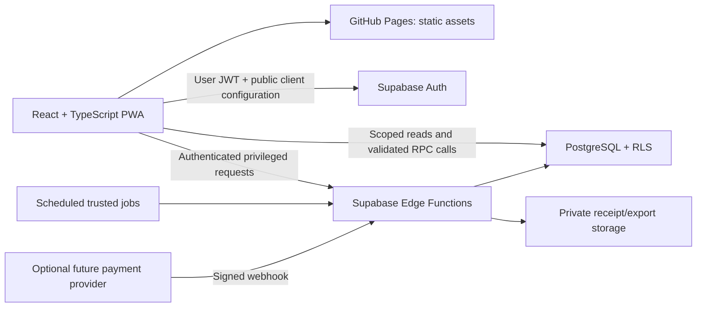
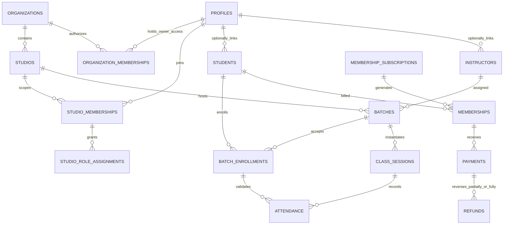

# Yoga Studio Management PWA — Implementation Plan

**Plan version:** 0.2 · **Date:** 15 October 2026 · **Status:** Proposed; approval required before implementation
**Current app baseline:** Yoga Studio 1.1.1, commit `f72bee4`
**Scope of this deliverable:** planning only. No application features, database migrations, roles, jobs, or policies have been deployed by this plan.

## 1. Decisions confirmed with the owner

| Topic | Confirmed direction | Consequence |
|---|---|---|
| Business structure | Multiple studios/branches under an Owner | Every studio record needs tenant scoping; an Owner must not be a platform-wide superuser. |
| Architecture | Retain React/Vite and GitHub Pages | Use Supabase PostgreSQL/RPCs, Edge Functions and scheduled jobs for trusted operations. No Next.js server actions or server runtime on Pages. |
| Membership billing | Support calendar-month and joining-date monthly billing | Store the selected policy and original billing anchor; preserve historical invoice snapshots. |
| Identity | Owner, Admin, Instructor, Student | Database-backed, scoped role assignments; never trust editable Auth metadata for privileges. |
| Attendance workflow | Auto-select Today’s Class; instructor marking; audited Instructor/Owner corrections | No student self-check-in or QR workflow; Admin attendance access requires explicit Owner delegation. |
| Existing experience | Retain Yoga Studio branding and responsive/PWA foundation | Evolve the existing application instead of replacing it with another demo. No sample accounts, seeded business data or access bypasses. |

**Recommended baseline assumptions, not yet approved:** INR as initial transaction currency; studio timezone defaults to `Asia/Kolkata`; every class lasts exactly 60 elapsed minutes; manual cash/UPI/card/bank-transfer recording precedes gateway integration; a membership may cover multiple batches according to its plan. Owners may control several branches in an organization. A user may belong to several organizations, but permissions never cross those boundaries.

## 2. Target outcome and boundaries

Deliver a studio-management system with separate role-aware portals, recurring batch schedules, transactional enrollment, actual dated class sessions, attendance, monthly membership charges, auditable payment recording, and owner oversight across branches.

### Initial management release

- Owner: organizations/branches, trusted staff provisioning, scoped admin assignment, policy setup, consolidated permitted reports and audit review.
- Admin: assigned-branch student/instructor records, batches, enrollment, class exceptions, attendance corrections only with explicit Owner delegation, memberships and verified manual payment entry.
- Instructor: assigned classes, minimum necessary student roster, attendance entry and own class history.
- Student: own enrolled batches, timetable, attendance, membership periods, dues, payment/receipt history and approved personal details.
- Shared: verified authentication, password recovery, profile, settings, mobile/desktop layouts, safe PWA shell, tenant selection, access-denied/error states.

### Deferred unless separately approved

Student QR/self-check-in, geofencing/biometric attendance, OpenWA/unofficial WhatsApp integration, online payment gateway, automated messaging/reminders, push notifications, payroll, instructor compensation, medical records, family wallets, student self-booking/waitlists, complex tax engines, native apps and cross-organization financial consolidation. Reports and controlled receipt downloads are included; offline private-data synchronization is not.

## 3. Architecture and trust boundaries

### Frontend

Keep Vite, current visuals and domain-root/repository-subpath support. Adopt TypeScript incrementally with strict checks, a small validated API layer, query pagination and query invalidation after mutations. Keep existing CSS/tokens initially; a Tailwind rewrite is not required to implement this plan. Maintain role-aware navigation derived from trusted database context, not locally stored roles.

For Pages-compatible links, use a root-path query-based view selector or another explicitly tested static routing approach. Do not introduce server routes that require Pages rewrites. Supabase must consume recovery fragments before app navigation handles them; do not mix router hashes with password-recovery tokens without integration tests. URLs never authorize access.

### Backend

- **PostgreSQL constraints/RLS:** durable tenant isolation, ownership checks, financial invariants and concurrency-safe writes.
- **Validated RPCs:** enrollment, batch/session edits, attendance, manual payment posting and approved role operations where user context can be enforced directly in the database.
- **Edge Functions:** Auth administration/invitations, payment-provider verification when added, controlled exports/documents and trusted job entry points. Verify caller identity, active role and target tenant inside every privileged function.
- **Jobs:** session generation, upcoming membership-period generation and reconciliation. Database roles and service credentials stay in server-managed secrets only.
- **Storage:** private buckets for generated receipts/exports if needed; no public student or financial files. Use short-lived, authorization-checked links. Initials avatars can remain; document upload is not a prerequisite.

GitHub Pages cannot keep runtime server secrets. Public Supabase configuration remains inspectable in the browser. Environment secrecy does not replace RLS. Do not restore removed hardcoded project identifiers or put real values in planning documents.

## 4. Owner and role model

### 4.1 Authority model

A single `profiles.role` cannot describe a person who is Owner in organization A, Instructor in a branch of B, and Student in another branch. Keep `profiles` as global identity/basic preferences. Put authoritative roles in scoped membership/assignment tables.

- **Organization Owner:** authority over that organization's branches only; not `service_role`, not a database superuser, and not a platform operator.
- **Branch Admin:** assigned studios only. Cannot appoint/dismiss Owners, transfer ownership, grant themselves branches, change their own authority or silently erase financial records.
- **Instructor:** explicitly assigned studios/classes, with historical session assignments respected even after a batch's instructor changes.
- **Student:** own records in a studio; a branch record must be linked to their verified identity before portal access is granted.
- **Multiple roles:** allowed through separate assignments. The backend evaluates effective permissions; a portal switch is presentation, not authority.
- **Suspension:** an active session alone is insufficient. Every request checks active organization/studio membership and role assignment. Revocation takes effect without waiting for a stale UI or long-lived role claim to expire.

### 4.2 Permission matrix

| Action | Owner | Admin | Instructor | Student |
|---|---|---|---|---|
| Create organization/initial owner | Trusted bootstrap only | No | No | No |
| Manage own organization's studios | Yes | Read assigned settings only | Limited assigned location info | Own class location only |
| Invite/revoke branch admins | Yes, with reauthentication/MFA | No | No | No |
| Invite instructor/student access | Yes | Assigned studio, constrained workflow | No | Request/accept invitation only |
| Assign/transfer ownership | Dedicated trusted workflow; preserve last owner | No | No | No |
| Manage students/instructors | Own organization; audited | Assigned studio; approved fields | Minimum roster fields only | Own approved fields only |
| Create/edit batches and enrollments | Yes | Assigned studio | Read assigned | Read own |
| Generate/change/cancel sessions | Yes | Assigned studio | Read; limited own completion if approved | Read own |
| Mark attendance | Own organization | Only explicit Owner-granted studio permission | Own assigned session; eligible enrollment; normal window | Read own only |
| Correct saved/finalized attendance | Own organization; reason/audit | Only explicit Owner grant; reason/audit | Own session through 24h after end by default; reason/audit | No |
| Correct after instructor cutoff | Own organization; reason/audit | Only explicit Owner-granted correction authority | No; request Owner correction | No |
| Set plans/billing policy | Yes | Owner-delegated settings only | No | No |
| Issue membership charges | Yes | Assigned studio, approved plan/rules | No | Read own |
| Post verified manual payments | Yes | Assigned studio, audited | No | Read own; cannot mark paid |
| Approve refunds/write-offs/credits | Yes, reason and authorization | Request only by default | No | Request support only |
| Read finances | Own organization | Assigned studio | No | Own only |
| Export personal/financial records | Scoped, justified and audited | Scoped limited export if delegated | No bulk export by default | Own permitted receipt/download only |
| Change audit history | No | No | No | No |

**Owner safeguards:** first Owner provisioned through an audited operator-controlled bootstrap, never a public signup dropdown. Ownership transfers require fresh authentication, MFA/assurance-level checks, recipient verification, explicit acceptance, notification and audit. A transaction/lock must prevent removing the final active Owner. Recovery of a lost Owner is a documented support procedure, not a hidden master password.

## 5. Data model — nine core tables, plus necessary support

The nine requested tables remain the core. They are not sufficient alone for multi-branch authority, recurrence, auditable refunds and history. Supporting entities are explicit rather than hidden in unvalidated JSON.

### 5.1 Core table responsibilities

| Core table | Detailed responsibility | Key design changes from the supplied example |
|---|---|---|
| `profiles` | Global user-facing identity, contact preferences and profile version | Auth user FK; no authoritative global role; never expose Auth email/password/session tables as a directory. |
| `students` | Studio-specific registration, status, contact/guardian/emergency references and consent linkage | Scoped student number; optional pending login link; restricted internal notes; no medical data dumping. |
| `instructors` | Studio-specific instructor identity, qualifications/specializations, availability status and public bio | Scoped instructor number; linked verified identity before teaching access; salary/bank data excluded. |
| `batches` | Versioned 60-minute recurring schedule, branch/room, instructor, weekdays, dates and capacity | Unique/valid weekdays; transactional schedule-conflict checks; changes do not rewrite past sessions. |
| `batch_enrollments` | Effective-dated student/batch membership, reserved seat, status and change reasons | Re-enrollment/history allowed; prevent overlapping intervals; concurrency-safe capacity checks. |
| `class_sessions` | Actual dated class, assigned instructor snapshots, timezone, capacity, status and cancellation | End = start + 60 minutes; unique batch/date; instance-level conflict controls and edit locks. |
| `attendance` | Eligible student's status for one actual class, timestamps, actor and corrections | Composite FKs prove same batch/student/tenant; unmarked is not automatically absent; no silent edits/deletes. |
| `memberships` | One billed membership period with plan/policy/price/tax snapshots, dates, due date and issued charge | Half-open periods; calendar/anniversary anchors; financial settlement derived separately from service status. |
| `payments` | Positive receipt/payment facts, verification, allocation to membership, idempotency and receipt references | Append-oriented confirmed records; refunds/credits are separate records; never trust browser success. |

**Full field definitions, types, nullability, constraints, access/privacy, defaults and validation are in [the schema dictionary](schema-dictionary.md) and the companion workbook.** These are proposed design contracts, not an applied migration.

### 5.2 Common integrity conventions

- All studio-owned core rows carry `organization_id` and `studio_id`; `profiles` is global. Bind `(organization_id, studio_id)` to a real studio using a composite FK.
- Tenant-owned tables have a unique key such as `(organization_id, studio_id, id)`. Cross-table FKs carry the same tenant columns, not only a globally unique UUID.
- A linked `profile_id` must correspond to active/valid studio membership through a validated provisioning/linking workflow. Linking cannot be performed by editing an arbitrary UUID in the browser.
- Use server timestamps, server-derived actor IDs and `row_version` optimistic concurrency where appropriate. A stale edit must return a conflict instead of silently overwriting another user.
- Contacts belong in scoped contact tables, not unrestricted free text. Use separate restricted tables for any necessary guardian/consent information. Do not collect national IDs, card PAN/CVV, detailed health records or bank credentials by default.
- Use positive integer minor currency units (`bigint`, e.g. paise) and currency codes. In TypeScript represent values safely as validated decimal strings or `bigint`; serialize money as strings in API contracts, not JS floating-point arithmetic. Initial rollout is INR; multi-currency settlement/FX is out of scope. RPC/view contracts must cast monetary bigints to text before JSON serialization; do not assume a raw PostgREST bigint JSON number survives JavaScript parsing without precision loss.
- No business-history cascade deletion. Auth account deletion must be orchestrated with retention/anonymization rules; never erase financial/attendance facts by deleting a login.
- Store only stable business facts. Balances, overdue flags, occupancy and reporting totals should be derived/reconciled, not independently editable copies.

### 5.3 Supporting entities

**Mandatory foundation:** `organizations`, `organization_memberships` (Owner assignments), `studios`, `studio_memberships`, `studio_role_assignments`, `studio_permission_grants` for explicit Admin attendance delegation, `invitations`, `audit_events`.

**Required by operations/billing:** `student_contacts`, `consent_records`, `instructor_qualifications` where qualification tracking is required, `studio_rooms` if multiple rooms, `enrollment_events`, `attendance_changes`, `membership_plans`, `membership_subscriptions`, `financial_adjustments`, `refunds`, `document_sequences`, `job_runs`, `idempotency_requests`.

**Gateway/export gates:** `provider_events` and payment-order mapping before online payments; `export_jobs`/document metadata before bulk exports. Optional future features must not create unused sensitive data stores just because they appear in a plan.

### 5.4 Logical relationships

## 6. Fix the supplied SQL before using it

The sample is useful as an outline but should **not** be pasted into production unchanged.

1. **No tenant scoping:** UUID uniqueness is not organization/branch authorization. Add composite tenant relationships, scoped uniqueness and branch-aware RLS.
2. **Global profile role:** cannot support cross-branch/multiple roles safely. Use dedicated assignments; self-editable profile metadata must never grant Owner/Admin.
3. **Broad profile updates:** the example initially permits updating one's own row, including role. Revoke broad table UPDATE and expose approved profile fields through constrained RPC/column grants. There is no profile-role column in the recommended model.
4. **Policy recursion:** `students`, `batches`, `instructors` and `batch_enrollments` read policies join each other and can trigger recursive RLS evaluation. Design narrowly scoped, fixed-search-path helpers over trusted tables and test actual policy execution under ordinary user roles.
5. **Unsafe grant narrative:** table grants cannot distinguish individual users sharing `authenticated`. Blanket revocation of writes for `authenticated` also removes direct admin writes. Prefer scoped reads plus approved RPCs for writes; do not rely on hidden UI buttons.
6. **Attendance consistency:** read-policy joins alone do not prevent an admin/privileged write from linking the wrong enrollment/session. Enforce same-tenant, same-batch and student consistency in FKs/triggers and write functions.
7. **Capacity and clashes:** `count < capacity` in the browser races. Apply database locks/constraints and validate future date intervals and actual sessions.
8. **Recurring weekdays:** array containment/cardinality alone does not guarantee distinct weekdays or reject null elements. Validate a non-null, duplicate-free set of integers 0–6.
9. **One-hour classes:** `end_at > start_at` is insufficient. Require exactly 60 elapsed minutes and consistent timezone/local-date mapping for generated sessions.
10. **Financial invariants:** an amount/status field is not a ledger. Separate receipt/refund/credit facts, constrain tenant/currency, enforce idempotency, derive totals and prohibit silent payment deletion.
11. **Billing overlaps/history:** uniqueness on exactly `(student, start, end)` still permits overlapping periods. Choose a non-overlap rule per subscription/product and protect issued snapshots.
12. **Provisioning/deletion:** profile triggers, invite acceptance, final-owner protection, retained audit/finance records and account-erasure workflows must be designed explicitly.

## 7. RLS, grants and privileged API strategy

### 7.1 Default-deny design

Enable RLS on every exposed application table and revoke default privileges. Anonymous users get no student/roster/billing access. Authenticated roles get only approved selects and RPC execution; write-heavy invariants go through transactional functions. No ordinary application role receives `BYPASSRLS` or a service key.

Keep security helpers in a non-exposed schema with `search_path = ''`, fully qualified objects, explicit EXECUTE grants and no caller-controlled dynamic SQL. Definer functions must validate `auth.uid()`, target tenant, active membership, role, allowed field transitions and actor attribution. Avoid relying on `auth.uid()` in unauthenticated scheduled jobs; use a separate narrowly authorized job path.

`owner_in_org(org_id)`, `admin_in_studio(studio_id)`, `owns_student(student_id)`, `assigned_to_session(session_id)` and eligible-roster checks are examples of logical helpers—not permission to expose unrestricted helper results. Test with the same client roles used in production, not the SQL editor's privileged session.

### 7.2 Read scope

- Owner: own organization/branches, with financial/contact exports separately controlled and logged.
- Admin: assigned studios only; no organization-wide data by default.
- Instructor: only assigned sessions and eligible student roster/attendance; no fees, payments, private notes, guardian/legal records or unrelated profiles.
- Student: records linked to their identity, including historical attendance/financial periods even after an enrollment ends where retention permits.
- Profile directories expose minimum display fields through safe scoped queries/views, never the whole global profile or Auth tables.
- Reporting views use caller-safe semantics and explicit RLS/authorization; do not accidentally expose owner-privileged materialized results to other roles.

**Column privacy must also be enforced.** RLS hides rows, not fields. Since all app users normally share the database `authenticated` role, do not grant unrestricted base-table SELECT and expect a safe UI projection to hide `internal_notes`, contact details or correction reasons. Grant only universally safe columns where direct reads are used; retrieve additional own/Admin/Owner fields through narrowly scoped, explicitly authorized RPCs with fixed typed/allowlisted outputs, or move restricted extensions into separately protected tables. Instructors must fail when directly querying forbidden columns, not merely when clicking a hidden UI control. Apply the same principle to attendance notes, financial exception reasons and exports.

### 7.3 Planned operations

| Operation | Trusted path | Required validation |
|---|---|---|
| Create organization/first Owner | Controlled bootstrap | Operator identity, verified recipient, audit, no public role selection |
| Invite/promote/revoke staff | Edge Function + transactional database operation | Caller scope, fresh authentication, MFA for privileged changes, anti-escalation, idempotency |
| Transfer ownership | Dedicated accepted transfer | Verified recipient, last-owner lock, consent, fresh assurance, immutable audit |
| Upsert batch/schedule exception | RPC | Tenant/role, 60-min rule, dates, instructor/room conflicts, schedule version |
| Enroll/pause/withdraw student | RPC | Student/batch scope/status, eligibility, seat policy, capacity, date conflicts |
| Generate sessions | Idempotent job/RPC | Studio timezone, horizon, schedule versions, no duplicate/overlap, retain cancellations |
| Resolve Today’s Class | Scoped RPC/read service | Actual dated session, active authority, studio context, server time; chooser for ambiguity |
| Mark/correct/finalize attendance | RPC | Assigned session or Owner/explicitly delegated Admin; eligible enrollment; normal/correction window; version/reason/audit |
| Generate/issue monthly period | Job/RPC | Subscription policy, anchor, period uniqueness/non-overlap, immutable price snapshot |
| Record manual payment | RPC | Role, amount/currency, invoice state, idempotency, receipt number, audit |
| Post refund/credit | Owner-controlled RPC/Edge workflow | Original payment, remaining refundable amount, approval/reason, accounting effect |
| Verify online payment | Future Edge webhook | Signature, provider/account/order/amount/currency, dedupe, replay safety, transaction |
| Produce receipt/export | Authorized Edge workflow | Recheck scope, safe template/CSV, no cross-tenant rows, private storage, expiry/audit |

Every mutation returns a structured success or safe error code such as `FORBIDDEN`, `CAPACITY_FULL`, `SCHEDULE_CONFLICT`, `STALE_VERSION`, `PERIOD_EXISTS`, `PAYMENT_DUPLICATE` or `ATTENDANCE_LOCKED`. A client-side role check is a convenience only.

## 8. Scheduling, enrollment and attendance rules

### 8.1 Recurrence and actual sessions

A batch is a schedule template; a session is a dated occurrence. Store weekdays using Sunday=0 through Saturday=6, start local time, effective dates and version. Interpret the recurrence in the studio's IANA timezone. Persist each session's actual UTC start/end plus timezone/instructor/capacity snapshots so later policy or instructor changes do not rewrite history.

Generate a configurable rolling horizon, initially proposed as 28 days, in short idempotent jobs. Unique batch/local-date keys stop duplicate generation. Record run ID, target studio/date range, version, attempt/result and sanitized failure. Never resurrect a cancelled session on retry. Schedule edits affect only explicitly chosen future sessions and must report conflicts before applying atomically.

For daylight-saving zones, define behavior for nonexistent/ambiguous local times; recommended default is to reject ambiguous schedule edits until an explicit offset/resolution is chosen. India has no current DST changes, but the model must not assume every studio uses the same timezone. Sessions always last 60 elapsed minutes.

### 8.2 Conflict and capacity integrity

Use database exclusion constraints over half-open time ranges `[start_at, end_at)` for actual instructor/room occupancy where practical. Conflict checks for an instructor apply across that organization's studios using the person's linked identity—not only a branch-local instructor row. Do not reveal another tenant's private class details in a conflict error. Recurrence changes require horizon checks and a documented policy for farther-future conflicts.

Enrollment must lock the batch row (and affected resources in a stable order), validate effective dates/active status, prevent duplicate overlapping enrollment, and recompute occupancy before committing. Historical eligibility must use date-effective enrollment/pause events, not today’s status alone. Retrospective changes affecting recorded attendance require a coordinated, audited correction instead of silently changing history. All writers that change capacity, pauses, dates or reservations must use the same locking discipline. Future-dated capacity checks must examine relevant interval boundaries/session dates rather than count today's active rows alone. A concurrency test with the final seat and simultaneous requests is mandatory.

Recommended default: pausing does **not** automatically release the student's seat or create a billing credit. Both rules are explicit studio policies; changes require tested capacity and billing consequences. Prevent student timetable overlap when enrolling unless an authorized exception with a reason is approved. Waitlists and makeup-class entitlements are deferred.

### 8.3 Attendance — agreed workflow update

The detailed contract is in [Attendance workflow and corrections](attendance-workflow.md).

**Normal flow:** instructor opens the app → Today’s Class is selected automatically → instructor taps roster statuses → reviews and finalizes. No QR, student self-marking, GPS or biometric step is included. The instructor checks physical presence; no software promise of complete protection against staff collusion is made.

Select actual dated sessions using the authenticated scope, studio timezone and server time. Normal marking opens **10 minutes before start** and remains open through **15 minutes after end** by configurable default. If no class matches, show the next class; if several match, show a small chooser. A finalized class defaults to a read-only summary with a correction action for eligible users. Cancelled classes cannot be marked. The PWA selects a class when opened/foregrounded; it cannot reliably launch itself at class time. Server checks, not the phone clock, enforce every write.

No row means **Unmarked**, never automatically Absent. Stored statuses remain Present, Absent and Late. Finalization reviews unmarked students and must not silently convert them to Absent.

**Corrections:** the assigned Instructor can fix missed/saved/finalized attendance until **24 hours after class end** by default. The Owner can correct older retained sessions within their own organization. Admin writes require an **explicit Owner-granted studio attendance permission**; being an Admin is insufficient. Students are read-only. Correcting a saved status, a finalized class or a missed mark outside the normal window requires a short reason: Forgot to mark, Wrong status, Student arrived late, or Other (brief detail required). Finalization does not eliminate the Instructor correction window.

Every write verifies active authority, same tenant/batch/student, historical enrollment eligibility, non-cancelled session, applicable time boundary and expected versions. Original marks/finalization evidence remain; corrections append previous/new status, actor, server time and reason atomically. A missed mark's previous state is null/Unmarked. Conflicting concurrent edits return a conflict, not silent last-write-wins. Private rosters and attendance writes are not cached/queued offline.

## 9. Billing and payment model

### 9.1 Both monthly policies

A `membership_subscription` selects the plan, billing policy, original anchor, activation/end dates and renewal behavior. Each `memberships` row is one billed service period with frozen plan/price/policy snapshots. A plan change creates a new effective-dated subscription/rule; it must not retroactively alter issued periods.

Use **half-open local-date periods** `[period_start, period_end)` consistently in DB, APIs, reports and UI. The UI can display the inclusive final service date while storing the next boundary internally. Due-date cutoff is defined in the snapshot timezone, not by the browser timezone.

| Model | Period rule | Required edge handling |
|---|---|---|
| Calendar month | First of month to first of next month | Mid-month first period, optional proration, leap years, joining on final day |
| Joining-date monthly | Start anchor to same anchor next month | Clamp day 29/30/31 to the month's last day; calculate each boundary from the original anchor, not the previous clamped date |

**Illustrative design example, not seed data:** original anchor 31 January → 28 February → 31 March in a non-leap year. This avoids drifting permanently to day 28. A leap year may produce 29 February. Fixed 30-day periods are not equivalent to calendar monthly billing.

Recommended calendar proration: covered local dates / actual dates in that month × monthly net charge; round once using a documented currency rounding rule, proposed half-up to the minor unit. Discounts/tax sequencing and inclusive/exclusive tax are explicit policies reviewed by an accountant; do not assume GST registration or tax treatment. Joining-date subscriptions normally bill the full agreed monthly amount unless a separate approved proration rule applies.

### 9.2 Issuance and dues

Idempotent jobs create upcoming periods a configurable number of days before service starts. Issued membership charges get a unique documented number, plan snapshot, covered dates, amounts, currency, due date and terms. No overlapping live periods for the same subscription. A student may hold multiple independent products only if explicitly configured; prevent overlapping active subscriptions for the same student/product family and make plan switches effective-dated. Do not double-charge a plan covering several batches by creating one invoice per enrollment.

Keep **service lifecycle** (`pending/active/cancelled/expired`) separate from **settlement** (`unpaid/partial/paid`, derived) and **overdue** (derived from a positive outstanding balance past due date). Grace periods/admission restrictions are business policies, not a payment status written by the browser.

Suggested calculation:

`adjusted charge = issued gross charge + posted debit adjustments − posted credit adjustments`

`net collected = confirmed receipts − settled refunds`

`outstanding = adjusted charge − net collected`

A refund and a credit are different: returning cash without reducing the charge can reopen a balance; cancellation usually requires an approved credit adjustment as well. Never silently clamp a negative balance to zero and lose accounting information. Initial policy should reject overpayments beyond the amount due; adding customer-credit wallets requires a separate ledger design. If a credit would leave an already-paid period with a credit balance, require a coordinated approved refund/adjustment workflow and expose the temporary liability explicitly rather than inventing an untracked wallet balance.

### 9.3 Payment integrity

Manual collection is the first supported release. An authorized Admin/Owner records amount, method, reference as applicable, actual received time, actor, evidence and idempotency key. The posting transaction verifies invoice state/tenant/currency, locks relevant balance rows, assigns a receipt number and posts an audit event. Verification source identifies manual confirmation; it must not falsely claim provider verification.

Confirmed payments cannot be silently edited/deleted. Corrections are traceable void/reversal/refund/credit operations according to lifecycle. Refunds are positive separate records linked to the original payment; concurrent refunds cannot exceed the remaining refundable amount. Require Owner approval by default and a reason. Retain original receipt and correction linkage; never overwrite a failed transaction as a different successful one.

Online payments are a later gate. The browser cannot mark them successful. Verify provider webhook signature and expected order/account/amount/currency, deduplicate event IDs, and handle out-of-order/replayed events. Store minimal sanitized provider evidence with controlled retention; never collect PAN/CVV or bank credentials. Reconcile provider settlement/refunds separately from browser redirects.

## 10. Screen and navigation plan

| Portal | Screens / primary actions | Visibility limits |
|---|---|---|
| Shared | Login/signup/recovery, invite acceptance, profile/settings, accessible studio/role context selector | Verified signup alone grants no studio data; show awaiting access until trusted membership/invitation; no owner/admin dropdown grants |
| Owner | Organization overview, branches, staff/access, financial overview, billing policies/plans, approvals, audit, controlled exports | Own organization only; branch filters preserved server-side |
| Admin | Today's sessions, students/instructors, batches/enrollment, Owner-delegated attendance corrections, memberships/dues, manual collections/receipts | Assigned studios only; no ownership/security authority |
| Instructor | Automatically selected Today’s Class, one-tap roster, finalize, history and reasoned corrections | Minimal roster, no finances or private notes |
| Student | My batches/timetable, own attendance, membership dates/dues, payments/receipts, profile/contact requests | Own linked identity only |

Keep the pastel visual direction but verify contrast, text sizes and touch targets. Empty states must show real absence of data, not fake metrics or examples. Use accessible validation, confirmation for financial/role actions, visible loading/stale/conflict states and explicit active-branch context. Persist no cross-tenant private query cache when switching branches or accounts. Disable disk persistence for roster/attendance/financial query caches; clear in-memory queries and subscriptions on account/branch switches. Supabase session-token persistence is a separately reviewed authentication concern, not permission to cache business data in localStorage or the service worker.

## 11. Implementation phases and dependencies

The estimates below are provisional engineering ranges for one experienced full-stack developer with available database/security review and part-time QA. They are not delivery promises; access, business decisions and review capacity can change them. Tests/security controls are part of every phase, not deferred entirely to the end.

| Phase | Scope | Dependencies | Exit gate | Rough effort |
|---|---|---|---|---|
| 0 — Design approval | Confirm authority, data dictionary, billing/seat/refund/retention policies; threat model and fixtures | Owner decisions and reviewers | Signed design/requirements and migration test plan | 2–4 days |
| 1 — Tenant/security foundation | TypeScript boundaries, organizations/studios, memberships/roles, trusted provisioning, Owner safeguards, RLS helpers, audit base | Phase 0 | Owner/Admin/Instructor/Student isolation and anti-escalation tests pass | 10–15 days |
| 2 — Studio records/enrollment | Students/instructors/contacts, plans groundwork, batch CRUD, enrollment and capacity/conflicts | Phase 1 | Concurrent final-seat tests, cross-branch isolation, no leaked roster fields | 10–15 days |
| 3 — Classes/attendance | Idempotent sessions, automatic current-class selection, instructor roster/finalization, timed corrections and audit | Phase 2 | One-hour/timezone/auto-selection/window/delegation/correction tests; role-based UAT | 10–15 days |
| 4 — Monthly memberships | Plan/subscription rules, both billing policies, period generation, proration/snapshots/dues | Phase 1–3 policies | Golden billing cases, period non-overlap and retry tests pass | 10–15 days |
| 5 — Collections/owner reports | Manual payment posting, receipts, refunds/adjustments, scoped dashboards, reconciliation/export controls | Phase 4 | Money/invariant/concurrency/audit tests; accountant/Owner review | 10–15 days |
| 6 — Release hardening | Access/security/a11y/load tests, PWA leak checks, monitoring, restore/rollback drills, role-based UAT | All core phases | Every mandatory quality gate signed or formally blocked | 10–15 days |
| 7 — Optional later | Signed online payment callbacks, automated reminders/push where approved | Separate provider/privacy approvals | Additional gateway/notification release gates | Estimate separately |

Core rough total: **62–94 engineering days**, approximately **13–19 working weeks**, excluding external approval delays and optional Phase 7. Parallel staffing can reduce calendar time but does not remove data/security dependencies. Each phase should be independently deployable behind real access checks, with no partially secure feature enabled.

Recommended release numbering is proposed, not a promised roadmap: patch current defects in 1.1.x; introduce approved tenant/role changes in a deliberate versioned release; increment minor versions for compatible management capabilities and major versions for incompatible API/data contracts. Do not silently couple an application version bump to destructive migrations.

## 12. Enterprise quality gates — mandatory release evidence

| Area | Required implementation/evidence | Blocking failures |
|---|---|---|
| Authentication | Verified accounts, confirmation/recovery/session/logout tests; rate-limit and abuse review; fresh-auth privileged actions; optional Admin MFA and recommended mandatory Owner MFA approved as policy | Unverified escalation, broken recovery, credential leakage |
| Authorization | Default-deny RLS, explicit grants, scoped assignments, no metadata authority, ordinary-user isolation tests for every read/write path; revoked role/session tests | Any cross-organization/branch/peer leakage or privilege escalation |
| Data integrity | Composite tenant FKs; same-batch attendance; exact 60-minute sessions; effective-date uniqueness; enrollment/financial locks; negative and concurrent tests | Overbooking, instructor clashes, mismatched attendance, overlapping charges |
| Financial records | Minor-unit arithmetic, immutable posted facts, adjustment/refund trails, idempotency, receipt uniqueness, provider proof before online success, daily reconciliation | Silent deletion, duplicate/forged payment, excessive refund, inconsistent balance |
| Performance | Server pagination, indexes with query-plan evidence, caller-safe aggregation, bounded jobs; connection pooling for direct DB clients where appropriate; agreed load dataset/concurrency | Unbounded queries/exports, N+1 roster fetches, unacceptable measured latency |
| Auditability | Append-only scoped audit records for roles, batch/enrollment changes, attendance edits, invoice/payment/refund/export events; actor/time/reason/correlation ID | User-editable audit, missing money/role change trail |
| Privacy | Field minimization, guardian/consent review if minors admitted, least-privilege views, approved retention and erasure/anonymization, private exports/backups, no sensitive logs | Unrestricted personal data, unsafe exports, unapproved sensitive collection |
| PWA | HTTPS, scoped static-only caches, no private API/roster/payment/attendance cache; account/branch switch purge of in-memory data; install/update/offline tests | Private shared caching, stale cross-account data, broken recovery navigation |
| Quality assurance | Unit/integration/RLS/concurrency/a11y/browser/load suites, real-provider staging acceptance, role-based UAT | Passing only mocked UI tests, missing isolation coverage, unreviewed accessibility findings |
| Operations | Separate environments, reviewed forward migrations/backups, CI/CD, monitoring/alerts, restore and rollback evidence, incident owners/runbooks; agreed RTO/RPO | Unrecoverable migration, untested restore, absent incident owner/credentials process |

No gate is currently claimed passed for the proposed management system. Existing auth/PWA checks are a useful starting point, not proof of enterprise readiness.

### 12.1 Proposed performance and reliability targets for approval

Use realistic branch/student/session volumes and measure before committing to an SLA. Starting targets: p95 indexed list reads under 500 ms of backend time at an agreed concurrent workload; p95 transactional mutations under 1 s excluding external providers; server-paginated lists default 25/maximum 100; dashboard queries bounded by explicit tenant/date range; no long-running export on an interactive request. Mobile web-vital targets can retain proposed LCP ≤2.5 s, INP ≤200 ms, CLS ≤0.1 at p75 for an agreed device/network cohort. These are **proposals, unmeasured**.

Connection pooling is relevant to jobs/functions using direct Postgres connections; browser PostgREST traffic must not be given a database connection string. RTO/RPO depend on plan, budget and verified restore capabilities; no untested default is a commitment.

### 12.2 Initial query/index design to validate

| Query/workflow | Proposed index/constraint direction |
|---|---|
| Active studio memberships/roles | Unique scoped profile membership and scoped assignment keys; index active membership/assignment lookup |
| Branch student/instructor lists | Tenant + status + stable sort key; keyset pagination for large directories; do not rely on unbounded name scans |
| Batch instructor assignments | Tenant + instructor + status/effective dates; actual session exclusion checks handle dated clashes |
| Eligible roster on class date | Tenant + batch + enrollment effective dates/status; plan/measure historical event joins |
| Instructor today/upcoming | Organization + instructor identity + start_at; branch/date query indexes where needed |
| Student attendance history | Tenant + student + session/date lookup; unique session/enrollment; measure joined date ordering |
| Membership dues/period history | Tenant + student + due_date/period_start; subscription-period uniqueness and non-overlap controls |
| Payments/refunds/reconciliation | Tenant + membership/payment + status/received_at; unique idempotency and provider-event keys |
| Jobs and audit | Scoped job type + idempotency boundary/status; tenant + event time/target for bounded audit reads |

Index all frequently joined tenant FKs deliberately; verify plans with representative data rather than adding every possible index. Apply row/field authorization before aggregation. Test exclusion-constraint extension availability and actual concurrent behavior in the target database. Reporting caches must preserve caller scope and have an explicit refresh/reconciliation policy.

## 13. Test strategy and negative-case matrix

- **Pure/unit:** billing anchor/proration/rounding, money validation, timezone boundaries, policy transitions, permissions presentation and safe error mapping.
- **Database integration:** fresh migrations, constraints, immutable issued records, cross-table FKs, audit triggers/functions and exact transaction outcomes.
- **RLS isolation:** two organizations, at least two studios in one organization, separate Owners/Admins/Instructors/Students, multi-role identities, pending/suspended/revoked membership and unrelated logged-in user. Test selects and every write/RPC using ordinary JWTs, never only the SQL-editor owner.
- **Concurrency:** final seat, simultaneous date changes/capacity reductions, duplicate invoice jobs, payment retries, simultaneous refunds, last-owner removal and receipt sequence allocation.
- **Calendar:** leap years, day 29/30/31 anchors, partial first month, end-exclusive boundaries, timezone midnight, cancelled and rescheduled sessions, duplicate weekdays and DST edge cases where supported.
- **Financial:** split payments, zero-due periods, invalid currency/amount, failed/pending receipts, duplicate references/idempotency, cancellation with/without credit, partial/full refund and reconciliation after retry.
- **Auth/security:** role spoofing via metadata/JSON/URL, forged tenant IDs, expired/reused invites/recovery links, suspension during open session, trusted provisioning checks, MFA/reauthentication, safe logs and secret scans.
- **UI/PWA:** Owner/Admin/Instructor/Student workflows at 320px and larger; keyboard/screen reader/contrast/reflow; no private cache entries; logout/branch switch; update and offline shell; no fake data.
- **Attendance contract:** execute ATT-01–ATT-17 from the attendance workflow, including server-time boundaries, finalized-but-correctable records, Admin delegation, missed marks, cancellation, offline failure and concurrent finalization/corrections.
- **UAT:** independently exercise an Owner managing two studios, a branch Admin without cross-branch powers, an Instructor marking only own attendance and a Student reading only own dues/records. Obtain accountant/Owner approval of billing examples.

Test fixtures belong only in isolated test environments. No synthetic users, class records or payments should be seeded into the live application for presentation.

## 14. Migrations, release and operations

1. Create separate development/staging/production projects and secure configuration; do not copy production personal data to tests.
2. Inventory existing Auth users and their metadata. Back up using supported provider procedures; test restore scope, including Auth. Do not assume all plans include the same recovery features.
3. Add tenant/role tables, constraints and RLS in reviewed migrations. Bootstrap organization/first Owner through a trusted one-time procedure; public signup must not grant authority.
4. Map existing verified users to explicit memberships with an approved import/invitation process. Do not promote users because their metadata or email resembles an admin.
5. Deploy expand-first schema/RPC contracts, then compatible frontend changes, then remove obsolete paths only after verification. Use dry runs, staged backfill and reconciliation counts.
6. CI: formatting/typecheck, unit tests, migration/constraint/RLS tests, security scanning, UI tests, Pages artifact checks and function checks; deploy staging before approved production.
7. Deploy database/functions/jobs through a separate controlled path from the static Pages artifact. A frontend rollback is not a database rollback. Prefer reviewed forward fixes; destructive restore requires authorized downtime/data-loss decisions.
8. Schedule jobs using a server-managed identity and tenant-local policy; track failures/retries, prevent duplicate runs and reconcile missed periods after outages. Rate-limit export/invite endpoints.
9. Monitor auth failures, policy denials, job lag/errors, duplicate-event rejections, payment reconciliation differences, attendance correction rates, DB/Edge latency and export activity. Log no passwords, tokens, health details or complete provider payloads.
10. Complete restore/rollback drills, access review, support/incident ownership and signed go-live approval before enabling management features for real members.

Finalize every FK delete action before migrations. Account erasure must revoke memberships, detach/anonymize permitted live identity links and preserve legally required business/audit facts through a reviewed pseudonymous reference strategy; deleting Auth must neither silently cascade financial history nor fail unexpectedly against retained references. Test the complete erasure flow with privacy/accounting approval.

Receipts/exports require server-side authorization, appropriate expiry and retention. Protect CSV exports from formula injection. Owner visibility is not permission for unrestricted data harvesting; log purpose and scope. Define backup encryption/access and data-erasure behavior with appropriate privacy/accounting advice.

## 15. Decisions still required before schema freeze

| Decision | Recommended starting position | Approval owner |
|---|---|---|
| Owner scope/co-owners | Organization-scoped; at least one active Owner; accepted ownership transfer | Business Owner + security reviewer |
| Organization vs independent studios | Branches belong to one organization; no shared cross-organization student directory | Business Owner |
| Student admission/minors | Admit minors only after guardian/consent and retention workflow approval | Owner + privacy reviewer |
| Membership scope | Explicit plan entitlements; one charge covers permitted batches, not automatic per-batch billing | Owner/accountant |
| Mid-month price/proration | Calendar rule explicit; joining-date full month by default | Owner/accountant |
| Pauses/seat holding | Preserve seat by default; no automatic credit; exceptional release via validated operation | Owner/operations |
| Instructor clashes | Enforce organization-wide person-level conflicts and room conflicts | Owner/operations |
| Attendance defaults | 10 min before / 15 min after for normal marking; Instructor corrections through 24h after end; Owner can correct older retained sessions; Admin only by explicit delegation | Agreed planning direction; configurable settings and implementation still pending |
| Refund/write-off powers | Owner approval by default; no hard delete of posted facts | Owner/accountant |
| Taxes/document numbers | Accountant defines applicable rules, fiscal-year numbering and retention | Accountant + Owner |
| MFA | Recommended mandatory Owner; Admin policy optional pending risk approval | Owner + security reviewer |
| Historic records after departure | Retain scoped historical facts per approved schedule; remove inappropriate live access | Privacy/operations |
| Scale/SLA/RTO/RPO | Set against actual dataset, provider plan and budget; prove with tests | Owner + technical/operations leads |
| Owner recovery | Verified, audited operator procedure; no undocumented bypass | Owner + security reviewer |

## 16. Deliverables and immediate next step

Companion files:
- [Attendance workflow, permissions, windows and acceptance tests](attendance-workflow.md).
- [Field-by-field schema dictionary](schema-dictionary.md).
- [**Planning workbook**](yoga-studio-management-plan.xlsx): nine core table dictionaries, shared conventions, support-table inventory, role matrix, work packages, quality gates and open decisions.

- [Implementation work packages as CSV](implementation-backlog.csv).

**Next step:** approve Phase 0 decisions and the tenant/role model, then implement and prove **tenant isolation + trusted Owner/Admin provisioning** before adding operational CRUD. Do not deploy the supplied sample SQL or build financial UI before the database enforcement paths exist.
